# Certificates for exact diagonalization: the CERTIFY-ED project from its first version to 6 November 2026

CERTIFY-ED is software by Sarang Vehale, with Ritu Goel, that takes the output of an exact-diagonalization program and a separately written description of the model, and issues a certificate: a list of statements about the result, each marked CERTIFIED, FAILED, INCONCLUSIVE or NOT_CHECKED, with its evidence and a list of what it does not say. This account tells the story of the project for physicists and numerical analysts who have not followed it. It starts with the first commit of the public repository on 18 December 2025, follows three rejections, a redesign, two applications to published proofs, an independent review, three evidence runs and a crash, and ends with the project archive v5 of 6 November 2026 and with the re-verification in Lean that was made after it. The failures are told with the same care as the results, because a checker deserves trust only as far as the record of its own errors is complete.

## How to read this account

Every number below is copied from a file that the text names. A path that begins with `docs/project/`, `docs/blog/`, `docs/lean/` or `lean/` belongs to this repository; every other path is relative to `archive_v5/`, the unpacked project archive v5, except that the scripts named in figure captions (`experiments/figures/...`) and module paths such as `verifier/src/cev.c` lie inside the archived clone of the code, `code/certify-ed/` at `a814d28`, whose history is also part of this repository. The file `docs/project/CHANGELOG_PROJECT.md` lists every dated change of the project with its source, and the folder `docs/project/` explains the mathematics, the software, the experiments, the decisions and the failures in detail; this account is the narrative that connects them. Decisions are named by their identifier in the decision log `project_docs/DECISIONS_LOG.md` (version 1.19, entries D-01 to D-61). The expansion roadmap of late October uses identifiers of the same shape (A-01, C-03, D-01 and so on); in this text a bare D-NN is always a decision, and a roadmap item is always called a roadmap item.

Three rules of the project decide how results are described. Under decision D-12, new mathematics counts as established only after Sarang Vehale has re-derived it himself. The 22 derivation documents of the code repository (`code/certify-ed/docs/proofs/`) are therefore described as derived, machine-checked, independently re-derived (a second derivation written from the statement alone, not a human check), with Sarang's check pending; results that are marked UNVERIFIED and have no derivation document wait for both. A classical result is named with its literature source. A Lean theorem accepted by the Lean kernel with no `sorry` is called kernel-checked in Lean. When this account calls a number certified, it means certified by the implementation, subject to the pending checks of the mathematics it rests on. Under decision D-16 the prose of the manuscripts is Sarang's, and under decision D-61 the version that the manuscript cites is still 3.1.0 until he decides otherwise.

## The problem: numbers that nobody can check

Exact diagonalization (ED) computes eigenvalues and eigenvectors of a quantum Hamiltonian written as a matrix. For a chain of N spins 1/2 the matrix has dimension 2^N, so ED codes split it into symmetry sectors (blocks of fixed magnetization, momentum or parity), build each block, and hand it to a dense solver such as LAPACK or to an iterative one such as the Lanczos method or ARPACK. The numbers that come out are used in two ways. They are benchmarks: a new variational or tensor-network method is judged by how close it comes to the ED energy of a small cluster. And, increasingly, they are lemmas inside proofs: an Anderson-type lower bound on the ground-state energy of a lattice says that the energy per site is at least the lowest eigenvalue of a finite cluster, and finite-size criteria for a spectral gap compare a number computed on a small subgraph with a threshold. In such a proof the published inequality is only as true as the floating-point number it quotes.

An ED result can be wrong in ways that the usual checks do not see. The matrix can be the wrong one: a sign convention, the Pauli matrices used where spin operators were meant, the order of the sites, the direction of the Jordan-Wigner string that turns fermions into spins. The result can belong to the wrong sector: the lowest states of one magnetization block reported as the lowest states of the model. An eigenvalue can be missing: an iterative solver can return three of the four members of a degenerate level and then move on to the next level, with every returned pair accurate. And the floating-point arithmetic itself adds rounding that the reported digits rarely account for. A residual check with the producer's own matrix catches only accuracy errors, because it uses the matrix that may be wrong. Recomputing the eigenvalues with a second code catches a wrong matrix, but not an error that leaves the eigenvalues unchanged.

CERTIFY-ED calls the program that computed a result the producer. It takes the producer's claim (eigenvalues, usually eigenvectors, and the matrix or a function that multiplies by it) together with a declared model, a list of operator strings and couplings written by the user independently of the solver, and it answers a fixed set of questions about the claim. It never runs the producer's code. Its answers are the certificate. The design of those questions, and the evidence that each answer is right, is the subject of this account.

## What laboratories report: the practice survey

**Why a survey.** Two things made a survey of published practice necessary. An audit of the first manuscript had criticised its claims about "the community" for having no evidence behind them (`earlier_deliverables/CERTIFY-ED_manuscript_audit.md`), and on 21 October 2026 decision D-49 widened the software to accept everything a laboratory's ED run produces by default, which required knowing what laboratories produce rather than guessing it. Decision D-50 therefore ordered a survey of published ED practice, with its protocol written down before any paper was fetched.

**What was done.** The pre-registration `survey/PREREG_practice_survey.md` (version 0.1 written before any fetch, version 0.2 recording every deviation) fixed an arXiv query for preprints of 2024 to 2026 that mention ED or Lanczos in the abstract. The query matched 878 records, all stored. A subsample of 80 was drawn with seed 20261021, and the full text of each was coded for what the paper reports from ED, what evidence of correctness it gives, how it uses the numbers, and whether it states their precision. After exclusions (papers that do not use ED themselves, comparison-only papers, non-Hermitian problems) 67 papers formed the analysis set (`survey/RESULT_practice_survey.md`).

**How the instrument was checked.** The fields were coded automatically, and 12 papers were re-coded by hand from the extracted text. The pre-registered threshold for agreement was 80 %. Agreement stayed below 80 % on 9 of the 13 fields even after the one revision of the coding instructions that the protocol allowed. The percentages below are therefore provisional; the ranking of the reported quantities is usable, because the label-wise agreement for that field was 86 %.

**What it found.** Of the 67 papers, 42 (63 %, Wilson 95 % interval 51 to 73 %) report excited levels and 38 (57 %) the ground energy; correlation functions (28 papers) and order parameters (25) follow. As evidence that the ED numbers are correct, 38 papers compare with another code and 34 with an analytic limit; 12 (18 %) state no evidence at all, and 3 (4 %) state a residual or convergence tolerance. The precision of the ED numbers is not stated in 45 papers (67 %), the producer is not named in 43 (64 %), and the ED data or code are not published in 51 (76 %). In the hand-coded subset of 8 analysis-set papers, 4 state no evidence for the correctness of their ED numbers. No paper of the sample used an ED number as a lemma in a proof (the coded label `lemma in a rigorous argument` has 0 of 67), while 29 use ED as a benchmark anchor for another method.

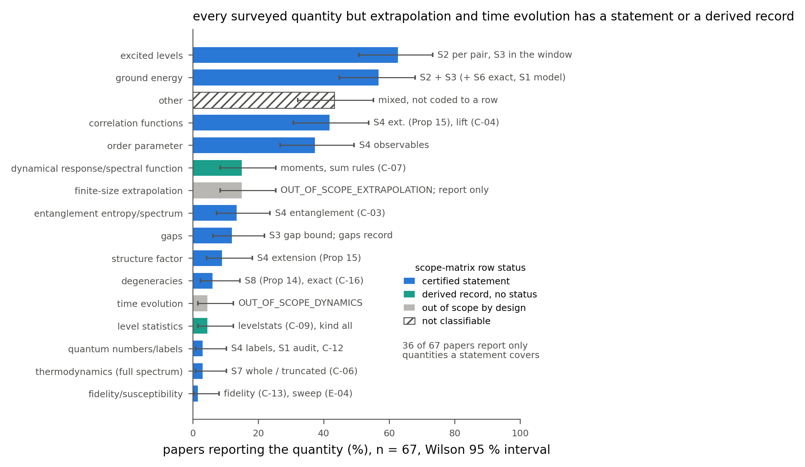

*Figure 1. What ED papers report against what a certificate states. Each bar is the share of the 67 papers of the survey's analysis set that report a quantity, with a Wilson 95 % interval; the colour is the status of the matching row of the scope matrix `code/certify-ed/docs/SCOPE_MATRIX.md` of version 3.2 (blue: a certified statement exists; green: a derived record without a status; grey: out of scope by design; hatched: not classifiable). Of the 16 coded categories, 11 have a certified statement, 2 a derived record, 2 are out of scope by design (finite-size extrapolation and time evolution) and 1 cannot be classified; 36 of the 67 papers report only quantities that a statement covers. Data: `code/certify-ed/experiments/survey/survey_for_scope.json` and `survey_coded.csv`, drawn by `experiments/figures/fig_scope_vs_survey.py`; caption numbers in `code/certify-ed/docs/figures/INDEX.md`. The percentages rest on automatic coding with a hand check below the pre-registered agreement, so they are provisional.*

**What it shows and does not show.** The survey describes arXiv preprints of 2024 to 2026 that name ED in their abstract, not a whole field, and its outcome was fixed in advance not to change which statements the software certifies. It does show that the quantities a certificate addresses are the ones papers report most, and that the use of ED numbers inside proofs, the use that matters most for this project, is rare enough not to appear in a sample of 67. That use had been found by a different route, described below.

## The first version and its referees (December 2025 to July 2026)

The public repository `sarang-kernel/CERTIFY-ED` received its first commit on 18 December 2025. A read-only fetch on 22 October 2026 found 18 commits of version 1, dated 18 December 2025 to 7 May 2026, all by Sarang Vehale; the commits themselves are not in the archive, so only the first and last dates are known (decision D-56). The earliest package in the archive dates from 5 May 2026. A critical mathematical review of that first draft (`earlier_deliverables/certify_ed_verification.md`) found textbook results presented as new theorems, incomplete proofs, figures marked "illustrative" instead of measured, a claim of bitwise reproducibility across platforms, and no code repository. The package was rebuilt the next day and released as version 1.0.0 on 7 May 2026, with a benchmark run behind its numbers (`results/run_20260507_120755`, 53 of 53 tests passed; `uploads/run_20260507_120755_tar.gz`).

Version 1 had 16 lattice-model builders, three LAPACK paths plus ARPACK, certificates sealed with SHA-256 hashes, 13 validators and an error-injection self-test. On Sarang's machine 81 of 81 validator tests passed, with agreement to QuSpin of 1.6e-14 over 320 comparisons and to 50-digit mpmath of 1.6e-15 (`report/03_chronology.md`, `report/10_referees.md`). The preprint arXiv:2605.11787 was posted on 12 May 2026 and submitted to SciPost Physics Codebases, with the use of AI assistance in drafting disclosed at submission.

Two research directions were tried around the same time, each with a pilot whose threshold was fixed before it ran, so that a weak direction would be stopped cheaply. Direction C2 enclosed eigenvalues sector by sector with a Krawczyk method (an interval form of Newton's method). Its pilot of 13 May 2026 on Heisenberg chains of 8 to 12 sites gained a factor of 5.2 to 5.5 in tightness against a pre-registered requirement of 100, and the gain was structural, the ratio of the full dimension to the largest block, with no term that depends on the spectrum; a literature audit also found the construction covered by Miyajima (2014) and by Rump and Lange (2023). Decision D-01 stopped C2. Direction C1, a Chebyshev-preconditioned Krawczyk method for sums of Pauli strings, passed its pilot on two software stacks (maximum difference 7.9e-13) and found a real overflow on the way, a shifted argument that reached 10^34 to 10^71 (`earlier_deliverables/pilot_report.md`; decision D-02); it was later put aside by Sarang's choice so that CERTIFY-ED could be finished first (decision D-03). What survived C2 became symveig 1.0.0, a separate package for enclosing every eigenvalue of a Hermitian matrix, released on 22 May 2026 and described in the preprint arXiv:2606.16217 of 15 June 2026.

The SciPost referees rejected version 1 three times. Report #1 of 18 June 2026 said that residual norms at machine precision already suffice, that groups already test against literature values and independent codes, that the three "independent" LAPACK paths share the same tridiagonal reduction (DSYTRD), and that the construction of the Hamiltonian, the main source of errors, was excluded from the checks. Report #2 of 10 July said that the gap the paper wanted to close was not shown to exist, and that massively parallel and non-LAPACK cases were not covered. Report #4 of 21 July (there was no #3) called the contribution insubstantial, in its view a test suite for linear-algebra libraries and not a scientific advance, and criticised the writing style (`report/10_referees.md`). The project's own audits of the manuscript and the code, made between the reports, confirmed the technical points and found more: a typo of 1.6e-10 for 1.6e-14, a function named `is_certified` that certified nothing, a Jordan-Wigner Kitaev test that always passed, swapped author names in the citation file (`earlier_deliverables/CERTIFY-ED_manuscript_audit.md`, `earlier_deliverables/CERTIFY-ED_code_audit.md`).

The response was not a rebuttal. Decision D-04 recorded that two independent experts had converged on one criticism and that Sarang judged it correct; decision D-05 named the failure as a mismatch between claimed scope and actual coverage, since version 1 claimed to serve ED practice in general and covered small dense LAPACK runs, which no change of framing could repair. On 13 July 2026 the project chose to broaden CERTIFY-ED into a general checking layer for ED results (D-06), to enumerate first, without filtering, everything that checking an ED result can mean (D-07 to D-10, because in version 1 the plan had silently filtered the scope), and adopted the rule D-12 on new mathematics. The scope enumeration of that day lists ten dimensions and about 150 items (`earlier_deliverables/SCOPE_ENUMERATION.md`). After the third report, decision D-16 changed the writing process: Sarang drafts the load-bearing prose of every manuscript, and automated help is limited to auditing, fact-checking, tightening and adversarial reading. No dated change is recorded for August 2026.

## The redesign: statements about a declared model

Work resumed on 25 September 2026 with Sarang's request for a substantially revised manuscript rather than a point-by-point patch (decision D-17). Version 1 was imported as the root commit of a new repository (tag `v1.0.0-baseline`), and a version 2 core was written around one idea taken from the referees: a certificate must establish something about a result for a declared model, not test LAPACK. Decision D-18 fixed five statements, four statuses and a mandatory list of what is not checked; decisions D-19 and D-20 fixed a default accuracy target and the method for completeness. Three more statements followed in October: an exact re-check in integer arithmetic (17 and 18 October), and thermodynamics and degeneracy counts (22 October, in release 3.1.0). The eight statements, as `docs/project/math/certificate_statements.md` describes them, are these.

S1, model fidelity, checks that the producer's matrix is the matrix of the declared model. The software builds the model itself with reference builders that share no code with the producer, compares entry by entry (for a symmetry block, through the isometry onto the block; for a matrix-free producer, by random probes, marked probabilistic), and when they differ it fits the difference by changed couplings, so that a wrong sign is reported as a changed coefficient of one named bond. S1 also produces the model shift, a certified upper bound on the distance in spectral norm between the matrix the bounds are computed for and the exact matrix of the declared model, which comes from the rounding of the matrix construction. Decision D-22 made every later radius refer to the declared model by adding the model shift to it. S2, enclosures, gives each claimed eigenvalue an interval that contains an eigenvalue of the declared model with a distinct index; if the claim states no accuracy target, a radius of at most 1e-8 times max(1, the norm of H) is presumed, so a true but very loose enclosure is FAILED (D-19). S3, completeness, shows that no eigenvalue is missing below the top claimed one and gives a certified lower bound on the next eigenvalue. S4 makes statements about degenerate eigenspaces that do not depend on the basis chosen inside them: the distance of the claimed vectors to the true eigenspace, quantum numbers of a degenerate level, and expectation values written as tr(PO) for the projector P onto the level (an idea adopted from an unsolicited e-mail on its technical merits, decision D-14). S5 records whether independent solvers agree; it is evidence, not a certified statement, and its status is CORROBORATED. S6 repeats S2 and S3 in integer and rational arithmetic, with no assumption about floating point. S7 encloses thermodynamic functions at declared temperatures from a complete enclosure of the whole spectrum. S8 counts exactly how many eigenvalues lie in a bracket around a level.

The statuses are exact in their meaning (`code/certify-ed/docs/what_certified_means.md`). CERTIFIED means that the statement holds for the stored numbers under the assumptions listed with it. FAILED means that what was computed contradicts the statement: the matrix differs from the model, a certified radius exceeds the target, or a count finds an eigenvalue the claim lacks; it is a finding about the claim, not about the software. INCONCLUSIVE means that the statement was attempted and the evidence neither establishes nor contradicts it, for example when a claim of the k lowest eigenvalues cuts through a degenerate level. NOT_CHECKED means that the statement did not run, with a reason code: narrowed by the user, a missing input, a budget or size limit, or mathematics that is not implemented. From version 3.1.0 every certificate also carries a scope block in which every statement appears exactly once, as run, narrowed or out of scope with a reason (decision D-49).

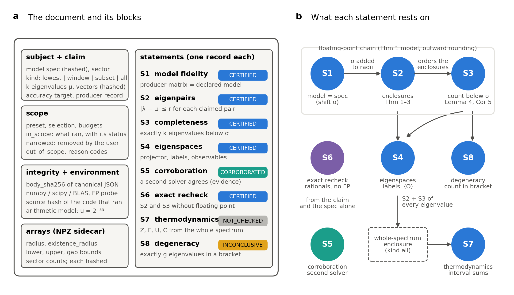

*Figure 2. What a certificate contains. Panel (a) shows the JSON body: the subject and claim (model specification, claim kind, the claimed eigenvalues and the hash of their vectors), one record per statement S1 to S8 with a status, the scope block, the integrity and environment block (body hash, library versions, floating-point probe, source hash) and the array sidecar; the statuses shown are an example, not a record. Panel (b) shows the dependencies: S1 fixes the matrix the enclosures refer to and adds its shift to every radius, S2 encloses each claimed value, S3 counts eigenvalues below a shift and orders the enclosures, S4 and S8 read clusters and brackets off S2 and S3, S6 re-checks S2 and S3 in exact arithmetic, S7 needs a whole-spectrum enclosure, and S5 is corroboration. Concept figure with no data, from `code/certify-ed/docs/figures/fig_certificate_anatomy.png`.*

## The mathematics behind the statements

The project claims no mathematical novelty (decision D-25): the contribution claimed is the scope of the statements, their independence from the producer, and the engineering for physical models. The results used are classical results of numerical linear algebra, adapted to floating-point evaluation and to symmetry sectors; several of the adaptations are nevertheless new in the sense of rule D-12, with proofs that the project wrote itself, and those are the results that wait for Sarang's check. This section explains them in the order in which a certificate uses them; `docs/project/math/theorems.md` states each with its hypotheses, its proof outline, its implementation and its status, and the table at the end of this section repeats the status.

**One eigenpair.** Theorem 1 is the residual bound for a Hermitian matrix A (Parlett 1998, Theorem 4.5.1): for any nonzero vector x and real number mu, some eigenvalue lies within the norm of Ax minus mu x, divided by the norm of x, of mu. Expanding x in an orthonormal eigenbasis proves it in one line. It gives existence only: two copies of the same vector satisfy it with the same eigenvalue, so Theorem 1 alone never shows that two claimed values belong to two different eigenvalues. Theorem 3, the Kato-Temple inequality (Kato 1949, Temple 1928), sharpens an isolated value: with the Rayleigh quotient theta and an interval (alpha, beta) around it that holds exactly one eigenvalue, the eigenvalue lies within the squared residual divided by the distance to the interval ends. Because the residual enters squared, the Kato-Temple half-width follows the actual error, while the Theorem 1 radius is the residual itself. In the 3.2.1 evidence run, for a J1-J2 chain of 12 sites at J2 = 0.2 solved with a loose tolerance of 1e-03, the actual error was 1.41e-08, the Theorem 1 radius 1.33e-04 and the Kato-Temple half-width 2.76e-08 (`code/certify-ed/results/run_full_20261105/E3.log`, collected in `docs/project/math/theorems.md`).

**A degenerate level.** For a cluster of claimed pairs, such as the members of a degenerate level, one needs distinct eigenvalues for distinct claims. Theorem 2 gets them from Kahan's inclusion theorem applied to the polar factor of the claimed vectors: with X the matrix of claimed vectors, eta the orthonormality defect (the norm of X^H X minus I, required below 1) and R the block residual, there are as many distinct eigenvalues as claims within rho = norm(R) + (norm(A) + norm(Lambda)) delta of the claimed values, where delta = 1 minus the square root of 1 minus eta. Theorem 2' gives a second radius eps*, sharper when the claimed vectors are far from orthonormal, and the code uses the smaller of the two. The cluster radius is where the soundness of a whole-spectrum tool is decided: without a certified bound on the orthonormality defect, merged intervals can be said to contain at least one eigenvalue, never a stated number of them.

**Nothing missing.** S3 rests on Sylvester's law of inertia. If A minus sigma I is factored as L D L^T, the number of negative eigenvalues of A minus sigma I equals the number of negative entries of D. A floating-point factorization is exact only for a nearby matrix, so Lemma 4 carries a backward error beta: if the computed factors reproduce A minus sigma I up to a perturbation of norm at most beta, and D has nu negative eigenvalues, then the number of eigenvalues below sigma minus beta is at most nu, and nu is at most the number at or below sigma plus beta. Corollary 5 closes the argument: if k claimed enclosures, pairwise distinct, lie below sigma minus beta and the count gives nu = k, then the enclosures hold exactly the k lowest eigenvalues, in order, and the next eigenvalue is at least sigma minus beta, which is the certified gap. If the count exceeds k, an eigenvalue is missing from the claim and S3 is FAILED. Decision D-20 chose this method, with a sparse SuperLU factorization in symmetric mode, a ladder of probes at 0.9, 0.5, 0.2 and 0.05 of the estimated gap, and the rule that beyond the size limits S3 is NOT_CHECKED, never an uncertified count.

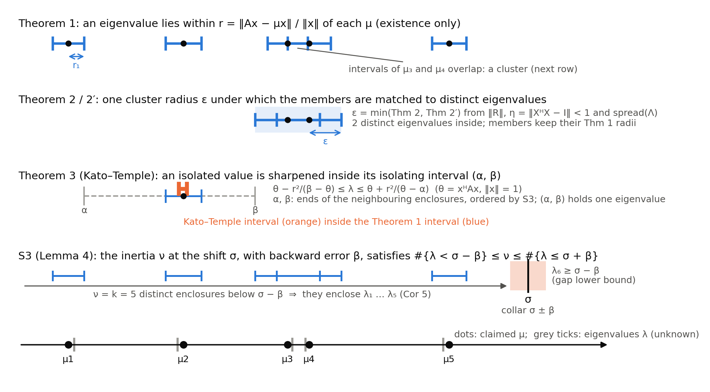

*Figure 3. The enclosure geometry (positions illustrative). Theorem 1 gives each claimed value an interval containing an eigenvalue; overlapping intervals form a cluster, whose members Theorem 2 or 2' matches to distinct eigenvalues under one cluster radius; Theorem 3 sharpens an isolated value inside the interval between its neighbouring enclosures; the inertia count of Lemma 4 at sigma with backward error beta, together with k distinct enclosures below sigma minus beta, gives the certified gap of Corollary 5. Concept figure with no data, from `code/certify-ed/docs/figures/fig_enclosure_geometry.png` (based on sections 2 and 3 of `code/certify-ed/docs/theory.md`).*

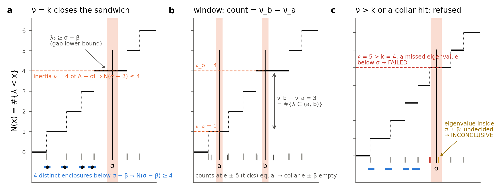

*Figure 4. Completeness by counting (illustrative spectra; N(x) is the number of eigenvalues below x). Panel (a): for a claim of the k lowest eigenvalues, k distinct enclosures below sigma minus beta and an inertia count nu = k close the sandwich. Panel (b): a window claim without eigenvectors, counted at its two edges after further counts show the collars around the edges to be free of eigenvalues. Panel (c): what the count refuses, a count above k (an eigenvalue missing, FAILED) or an eigenvalue inside the collar (undecided, INCONCLUSIVE). Concept figure with no data, from `code/certify-ed/docs/figures/fig_inertia_completeness.png`.*

**Sectors and eigenspaces.** Most ED results are computed sector by sector. Theorem 8 assembles a certified global low-energy spectrum from certified sectors: the sector matrices are checked to be the blocks of the full matrix up to an audited defect, the counts below a common cut add up, and the pooled claimed values are paired with the global eigenvalues. Writing its proof against the code found an ordering hypothesis that the first implementation lacked, and decision D-23 made the assembly require every claimed value to lie below the cut minus the largest backward error of the sectors. Theorem 6 bounds the distance between the claimed vectors of a cluster and the true eigenspace, which gives the basis-independent observables of S4, and Proposition 7 certifies integer quantum numbers of a degenerate level. Proposition 9 states when a list of intervals contains every eigenvalue with certified counts: the block structure checked exactly, cluster counts from Theorem 2, disjoint and outward-rounded intervals, and counts adding up to the dimension.

**Floating point.** Every bound above is evaluated in binary64 arithmetic, so the evaluation itself must not shrink it. The code works in the standard model with unit roundoff u = 2^-53 and Higham's constants gamma_n = n u/(1 minus n u), checks at run time that the machine follows that model, rounds every reported interval end one unit in the last place outward, and accounts for every rounding of the Theorem 1 radius in six steps (`docs/project/math/arithmetic_model.md`). The model assumes that no intermediate quantity underflows; how that hypothesis was handled is part of the story of the known issues INT-01 and INT-05 below.

**The exact layer.** S6 removes the floating-point hypothesis altogether (`docs/project/math/exact_layer.md`). The matrix of a spin model is written with integer entries in a scaled basis (Lemma 10), residuals are computed exactly, and an eigenvalue count at a rational point is made exactly: a floating-point L D L^T factorization only proposes factors, the residual of the factors is computed in integers, and the count is moved by that exact residual (Lemma 11). Symmetry sectors are entered through orbit sums whose symmetry is checked exactly (Lemma 12), and Proposition 13 decides a claim of the k lowest eigenvalues from those counts.

**Thermodynamics, degeneracies and the model shift.** Proposition 14 brackets a degenerate level between two counts and gives its exact multiplicity (S8). Propositions 15 and 16 turn a complete enclosure into intervals for sums such as structure factors and for thermodynamic functions, with exp and ln enclosed in dyadic arithmetic by Lemma 17 (S7). Appendix A bounds the model shift through Weyl's inequality.

| result | used by | status |
|---|---|---|
| Theorem 1, residual bound | S2 | classical (Parlett 1998) |
| floating-point evaluation of Theorem 1 | S2 | derivation document `thm1_fp-accounting.md`, second derivation GAP for complex data (closed in the code by a looser constant); Sarang's check pending |
| Theorem 1 under underflow (INT-05) | S2 | derivation document `int05_underflow.md`, second derivation ERROR (corrected in the code); Sarang's check pending |
| polar-factor lemma and Theorem 2 | S2 | Kahan's theorem is classical; derivation document `thm2_polar-factor.md`, AGREES-WITH-REMARKS; Sarang's check pending |
| Theorem 2' (eps*) | S2 | derivation document `thm2prime_eps-star.md`, AGREES-WITH-REMARKS; Sarang's check pending |
| Theorem 3, Kato-Temple | S2 | classical (Kato 1949, Temple 1928) |
| Lemma 4, inertia with backward error | S3 | classical; the measured sparse backward error of 3.2 in `D-01_sparse-residual.md`, AGREES-WITH-REMARKS; Sarang's check pending |
| Corollary 5, completeness and pairing | S3 | derivation document `cor5_pairing.md`, AGREES; Sarang's check pending |
| Theorem 6 and Proposition 7 | S4 | UNVERIFIED, no derivation document |
| Theorem 8, sector assembly | S2, S3 | derivation document `thm8_rho.md`, AGREES; Sarang's check pending |
| Proposition 9, whole spectrum | S7 | UNVERIFIED, no derivation document |
| Lemma 10, scaled basis | S6 | classical, re-derived |
| Lemmas 11 and 12, Proposition 13 | S6, applications | UNVERIFIED, no derivation document |
| Propositions 14, 15, 16 and Lemma 17 | S8, S4, S7 | derivation documents, AGREES (14, 15, 17) and AGREES-WITH-REMARKS (16); Sarang's check pending |
| Appendix A, model shift | S1 | derivation document `appA_model-shift.md`, AGREES-WITH-REMARKS; Sarang's check pending |

The verdicts are those of the independent second derivations recorded in `code/certify-ed/docs/proofs/VERDICTS.md`, which are automated checks, not human checks; the full table with the case counts of every machine check is at the end of `docs/project/math/theorems.md`. The Lean status of these results is given in the section on the re-verification in Lean.

## Version 2 at work: the first experiments and the first bugs (September and October 2026)

The version 2 core was committed on 28 September 2026 with the experiment driver and E1, and by 4 October it had experiments E0 to E5, each answering a question that a referee or an earlier result had raised (`docs/project/experiments/README.md`). Decision D-24 fixed the evidence policy that every later run follows: every number, table and figure of the paper is generated from experiment records by a number script, which also asserts each qualitative sentence the text makes about the numbers, and all experiments of a cited run come from one commit.

**E0, do the bounds hold?** The first question was whether the floating-point bounds contain the true values, tested against references that share no code with the software. E0 compares the enclosures with eigenvalues computed in ball arithmetic by Arb (6,391 eigenpairs of 273 matrices), the inertia counts with exact counts (2,400 counts on 300 matrices), and the reference builders with QuSpin (280 models, largest difference 3.2e-16). In every evidence run there was no violation (`docs/project/experiments/E0_verifier_validation.md`). The instrument found a bug of the software itself in its first run: of 80 models built under the string direction then used for the Jordan-Wigner transformation, 40 disagreed with QuSpin, exactly the 40 whose strings change the particle number, while all 40 number-conserving models agreed, which is why the deterministic tests had passed. Decision D-21 made the string direction an option, with QuSpin's direction as the default.

**E1, which practice catches which error?** Report #2 had said that the gap between ordinary practice and certification was not demonstrated. E1 plants 13 realistic errors in results for a Heisenberg chain of 12 sites (a coupling sign, the Pauli against the spin convention, the site order, a missing Jordan-Wigner sign at the periodic boundary, a sector result reported as global, Lanczos ghosts, a loose tolerance, swapped eigenvectors, phase errors in sector bases, omitted sector blocks) and applies three practices: the producer's residual check with its own matrix (P1), recomputation with QuSpin from the intended model (P2), and the certificate (P3). A correct result is the positive control, and a correct result that quotes a single-vector observable of a degenerate level is a control of another kind. The outcome is identical in the 3.0.0, 3.1.0 and 3.2.1 runs. P1 flags 2 of the 13 errors, P2 flags 9, and the certificate leaves all 13 uncertified, 12 as FAILED and the Lanczos ghosts as INCONCLUSIVE (duplicated Ritz values approximate a true eigenvalue, and the error is that they are not distinct); for the model errors it also names the term or bond, and for the Pauli convention a global factor of exactly 4.000 (`docs/project/experiments/E1_failure_matrix.md`). P2 misses four errors because they leave the reported eigenvalues equal to those of the intended model. E1 does not measure how often such errors occur in published work.

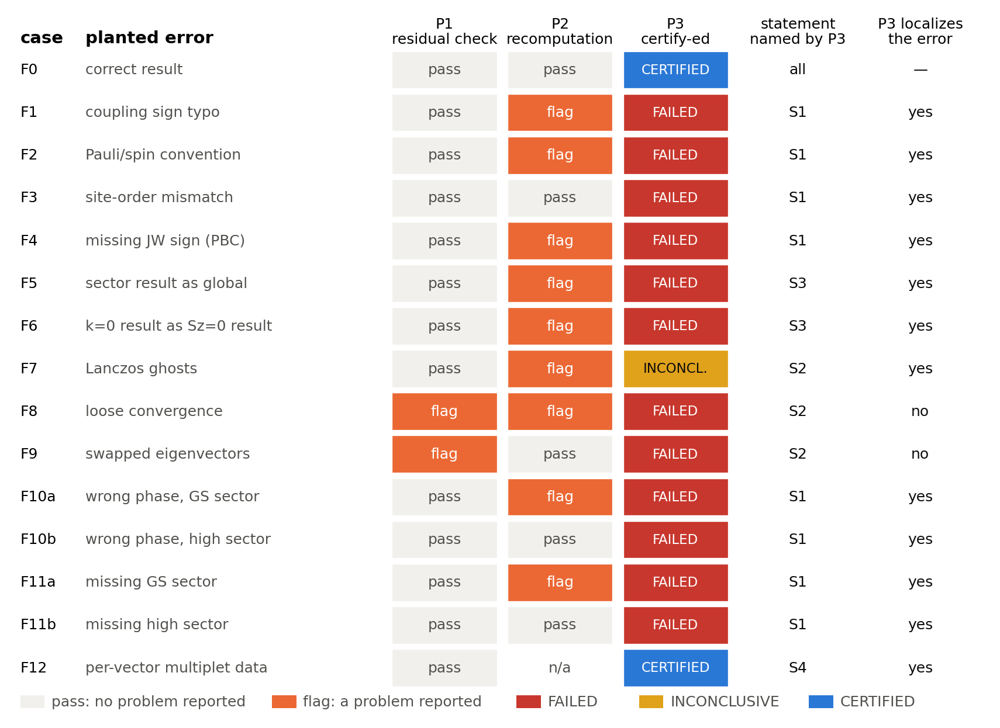

*Figure 5. The failure matrix of experiment E1 in the 3.2.1 evidence run: 15 cases (13 wrong results) on a chain of N = 12 sites with K = 5 claimed pairs, checked by the producer's residual check (P1), recomputation from the intended model (P2) and the certificate (P3). P1 flags 2, P2 flags 9, the certificate leaves 13 uncertified and locates the error in 12 cases. The column "statement named" is derived by the plotting script from the diagnosis text of the record. Data: `code/certify-ed/results/run_full_20261105/e1_failure_matrix_20261105_104157/data.json`, drawn by `experiments/figures/fig_failure_matrix.py`; caption numbers in `code/certify-ed/docs/figures_run_3.2.1/INDEX.md`.*

**E2 to E4, cost, tightness and workflows.** A certificate that costs more than a user will pay is not used, and a statement that silently stops working is worse than one that says where it stops. E2 measures the time and memory of S1 to S3 on Heisenberg blocks up to dimension 112,720 under a memory cap of 4.5 GiB per process, E3 measures how far each bound lies from the true error, and E4 runs four workflows of the kind researchers use (W1 to W4, among them the Haldane triplet of a spin-1 ring and four benchmark ground energies). S3 was feasible up to dimension 12,870 in every run, as decision D-20 had predicted, and beyond it S3 was NOT_CHECKED with the failed allocation as its reason (`docs/project/experiments/E2_cost.md`). The rounding allowance of the floating-point form of Theorem 1 costs a factor of 2.5 to 5.7 against residuals computed in Arb (`docs/project/math/theorems.md`).

**E5, an error nobody planted.** The planted errors of E1 invite the objection that they were chosen to suit the method. While E2 was being measured, ARPACK, asked for the eight lowest states of the 4x4 Heisenberg block of dimension 12,870, sometimes returned three of the four members of a fourfold level at -8.88644241 and then two members of the next level. Each returned pair was accurate; the list was not the eight lowest eigenvalues. Decision D-27 made this an experiment, reported at whatever frequency the seeded runs give, and rejected both re-seeding until the run came out clean and dropping the point. In every evidence run 3 of 12 seeded runs were incomplete. The residual check flagged none of them; comparing two ARPACK runs flagged some incomplete runs but also correct ones, so disagreement did not say which run was wrong; the certificate gave S3 FAILED for all 3 after 4 factorizations and certified the correct runs up to the first gap (`docs/project/experiments/E5_arpack_multiplet.md`). The first E5 run of 4 October had reported the truncated lists as INCONCLUSIVE, because the backward error of the factorization (about 5e-7) exceeded the margin near the level; decision D-28 moved the probe further from the claimed level, and the first run was superseded rather than quoted.

Two more defects of the software were found that week. SciPy seeds ARPACK from operating-system entropy unless a start vector is given, so records were not reproducible; decision D-26 gave every iterative solver call a seeded start vector. And a rerun of E5 interrupted at the end of a working day left a record without rows, which put a stale table into the manuscript; decision D-29 moved such records to a folder that the number scripts never read. The second manuscript, ms_v2, was delivered to Sarang on 11 October 2026 with 37 pages, every number generated from the records, and the proofs marked UNVERIFIED (`manuscript_v2/REVISION_REPORT.md`). The rule that every result must reproduce on a second machine stack was not yet met.

## From a validator to proof lemmas: the applications (15 to 18 October 2026)

On 15 October 2026 Sarang dropped SciPost Physics Codebases as the target ("rejected from there; this is free ends now"), so that no venue would constrain the scope, and asked for a wider survey of the horizon, covering laboratory practice and the caveats the project had missed (decision D-32). The survey of that day, in five strands summarised in 64 unranked directions (`research/Expanding ED verification horizons.md`), changed the direction of the project. It found that inertia counts with guaranteed bounds for sparse matrices are prior art, so neither the device nor its reach belongs to the project; that the symveig preprint overlapped with the work; that nothing checked the floating-point model at run time, nothing checked the project's own code, and nothing made certificates authentic. Above all, it found that published Anderson-type bounds and finite-size gap criteria rest on Lanczos or DMRG numbers with no error control, one of them, by Kránitz and Penc (2026), at dimension 48,620. In such a proof a certified number changes the logical status of a theorem, not only the confidence in a benchmark. Decision D-34 made the certification of such numerical lemmas the main application, with the pyrochlore crown of Kránitz and Penc first, and decision D-36 added the AKLT gap criteria of Pomata and Wei as the second. Decision D-33 recorded that symveig was the authors' own work and that both should go into one paper ("one solid paper > two mediocre papers").

### The pyrochlore crown of Kránitz and Penc

**Why.** Kránitz and Penc (arXiv:2601.07800) bound the ground-state energy of the Heisenberg antiferromagnet on the pyrochlore lattice from below by writing the lattice Hamiltonian as a sum of copies of an 18-site cluster, the crown, with couplings constrained by how the copies embed in the lattice; the energy per site is then at least the lowest eigenvalue of the crown, which the authors computed by the Lanczos method with no error bound. The cluster is large enough that the eigenvalue must come from an iterative solver and small enough for exact arithmetic after symmetry reduction (`docs/project/applications/crown_kranitz_penc.md`).

**Spin 1/2.** For the paper's reduced model, the couplings were made exact rationals that satisfy the embedding constraint exactly, and the Hamiltonian was multiplied by 8 times 10^7 so that every coupling is an integer. Because the crown conserves total spin and the total spin of 18 spins 1/2 is an integer, the lowest eigenvalue lies in the S^z = 0 space of dimension 48,620. Seven symmetry generators of order two, each checked exactly to commute with the integer Hamiltonian, split that space into 128 blocks, the largest of dimension 3890. At a dyadic shift placed a relative 1e-10 below the Lanczos estimate -0.550158297907944, the exact count of the exact layer found no eigenvalue below the shift minus the exact residual term in any block. The result is that the reduced crown has no eigenvalue below -0.5501582988212038, an exact rational rounded down to -0.550158299 for display, 9.1e-10 below the Lanczos value. This certifies the paper's reduced-model value -0.550158(2). It does not certify the paper's headline spin-1/2 value -0.549832(8), which comes from a nine-coupling model in the paper's appendix; an independent review reproduced that value only in floating point, as -0.54983289. The certified bound also rests on Lemmas 11 and 12 and Proposition 13 of the exact layer, which are UNVERIFIED and have no derivation document. Earlier certificates of 17 and 18 October gave -0.550158313 and -0.55015831338, valid but looser, because the shift was placed further from the estimate.

**Spin 1.** For spin 1 the paper prints the couplings and the bound -1.632985 and states that a second-neighbour coupling is neglected. The pair spins of the six outer pairs of the crown are conserved, so the Hamiltonian splits into classes labelled by them. In the class in which all six outer pairs are singlets the crown Hamiltonian is a multiple of the spin-1 Heisenberg ring of 6 sites plus a constant, an identity that is a test of the code and that the review derived independently from the paper's bond table. The lowest eigenvalue of the ring, -8.617423181814216, was certified with an exact radius of 5.092986520018812e-15, and with the printed couplings taken as exact rationals the crown has an eigenvalue at most -1.6380246425131773, below the published -1.632985 by 0.0050396425131771765. The two sectors that the paper names have lowest eigenvalues -1.6329866581559116 and -1.632984890229642 in floating point, which reproduce the published number; the all-singlet class, evidently not included in the published search, is the only class materially below it.

The reading of this result changed once. The first reading of the project, that an unprinted nonzero second-neighbour coupling was the likeliest cause, was wrong, and so was a sentence of the draft note to the authors (version 0.2) saying that the bound could not be reproduced; the independent review of 21 October 2026 found both, and a cutting-plane computation over 34 of the 92 classes showed that no value of that coupling rescues the published number (the best value is at most -1.6342449, a floating-point upper bound). Decision D-51 withdrew version 0.2 of the note. What follows is that the inequality with -1.632985 is not established by the paper's argument at its printed couplings; it may still hold. Decision D-34 requires that the authors hear of it before anything is said publicly, and the corrected note (version 0.3) waits for Sarang's check against the paper.

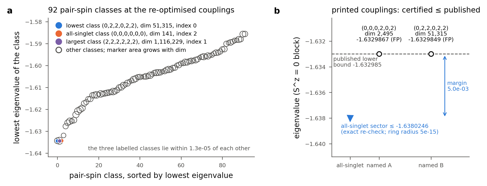

*Figure 6. The spin-1 pyrochlore crown in the E9 record of the 3.2.1 evidence run. Panel (a): the lowest eigenvalue of each of the 92 pair-spin classes of the S^z = 0 block at the record's re-optimised couplings, sorted, with marker area growing with the class dimension; these are floating-point values, and the lowest class, the all-singlet class and the largest class (dimension 1,116,229) lie within 1.3e-05 of each other. Panel (b): at the printed couplings, the certified all-singlet eigenvalue (at most -1.6380246, exact re-check, no floating-point assumption), 5.0e-03 below the published bound -1.632985, and the two sectors the paper names at -1.6329867 and -1.6329849, floating-point values drawn as such. Data: `code/certify-ed/results/run_full_20261105/e9_pyrochlore_20261105_084835/data.json`, drawn by `experiments/figures/fig_crown_sectors.py`; caption numbers in `code/certify-ed/docs/figures_run_3.2.1/INDEX.md`.*

### The AKLT gap criteria of Pomata and Wei

**Why.** Pomata and Wei (Physical Review Letters 124, 177203 (2020); arXiv:1911.01410) prove that AKLT models on several two-dimensional lattices have a spectral gap. For each lattice the gap follows from a criterion of the form eta < 1/z, where eta is the largest cosine of the principal angles between the ground spaces of two overlapping subgraphs, other than the cosines equal to 1. The authors computed eta in floating point and checked it with residuals of about 1e-13, so the expected outcome was a confirmation. What a certificate adds is that the count of ground states and of unit cosines is complete: a residual shows that a computed vector is close to some eigenvector, not that no eigenvector was missed, and a missed cosine just below the threshold would change eta (`docs/project/applications/aklt_pomata_wei.md`).

**What was done.** The valence-bond-solid states of each subgraph are exact integer vectors in a scaled basis. A kernel lemma (classical, after Affleck, Kennedy, Lieb and Tasaki 1988 and Kirillov and Korepin 1989, re-derived in the project) identifies each ground space with the range of these states, and it was confirmed by exact computation for the three smaller subgraph types. The squared cosines are eigenvalues of a pencil built from Gram matrices; the code never inverts a matrix, and counts the pencil eigenvalues above a rational threshold through the inertia of a bordered integer matrix (the bordered-pencil lemma, through Haynsworth's inertia additivity; decision D-38). Floating-point factorizations only propose factors, their residual is computed exactly, and the threshold is set just above the floating-point value of eta squared. As a negative control, on the decorated honeycomb lattice at a threshold below eta squared the same code finds 218 positive pivots against 216 unit cosines and reports "not certified".

**What it found.** Every criterion holds with a certified margin. The certified upper bounds on eta are 0.1110430221 for the star lattice (published 0.1110430220), 0.1589663312 and 0.1061446859 for the two values of the square-octagon lattice, 0.1997384508 for the cross lattice, 0.1530329086 for the decorated honeycomb and 0.2203543194 for the decorated square (published 0.2203543174); they exceed the published values by 2.3e-11 to 1.9e-9. The largest criterion value is 0.88142, for the decorated square, which needed a symmetry group of order 4 to reduce its largest bordered block from 8842 to 4034. The honeycomb lattice was not attempted: its space has dimension 2^26, and its gap bound uses three further eigenvalue constants that would each need a certificate. The bounds rest on the bordered-pencil lemma, which is UNVERIFIED and has no derivation document; an automated review tested it on 3000 random instances with 0 violations, which is not the human check that D-12 requires.

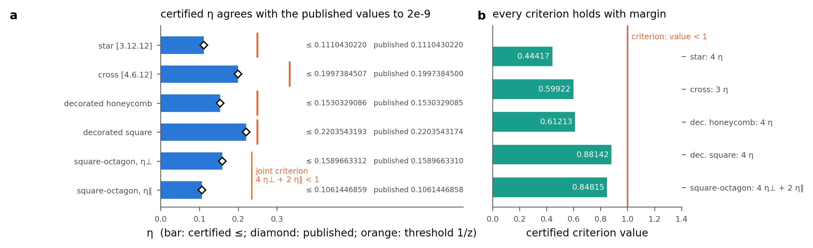

*Figure 7. The AKLT lattices of Pomata and Wei in the E10 record of the 3.2.1 evidence run. Panel (a): the certified upper bound on eta for each lattice (bar) against the published value (diamond), with the threshold 1/z in orange; the largest difference is 1.9e-09, so bars and diamonds coincide at this scale and the values are printed. Panel (b): the certified criterion values, all below 1 (star 0.44417, cross 0.59922, decorated honeycomb 0.61213, decorated square 0.88142, square-octagon 0.84815, rounded to nearest). The largest symmetry-adapted block has dimension 4,034 (decorated square, 2368 s). Data: `code/certify-ed/results/run_full_20261105/e10_aklt_20261105_071106/data.json`, drawn by `experiments/figures/fig_aklt_eta.py`; caption numbers in `code/certify-ed/docs/figures_run_3.2.1/INDEX.md`.*

### Exact benchmarks and symveig

The same exact path certified four benchmark ground energies with no floating-point assumption (experiment E7, decision D-41): the Heisenberg and J1-J2 chains of 20 sites in the momentum-zero block of dimension 9252, and the Heisenberg and J1-J2 squares of 4x4 sites in the S^z = 0 block of dimension 12,870, with exact radii from 1.099862660492978e-14 to 3.719300427741141e-14. For the J1-J2 chain at the Majumdar-Ghosh point, where the ground energy is known to be -7.5, the stored value -7.499999999999966 with its exact radius 3.392663354321801e-14 contains it (`docs/project/applications/exact_benchmarks_e7.md`). The J2 = 0.5 square, whose S3 had been NOT_CHECKED in workflow W4, was certified this way.

symveig entered the project from the other side. When Sarang provided its source on 18 October 2026, an audit found that its central claim, that each merged interval contains exactly as many eigenvalues as its stated multiplicity, was not proved and was false for eigenpairs supplied by a user: for the diagonal matrix diag(0, 1) with two copies of the first unit vector, symveig returned one interval of multiplicity 2 around 0, and the eigenvalue 1 lay outside every interval. Its sector path never checked that the matrix conserves the quantity that defines the sectors: on a Heisenberg chain of 6 sites with a small staggered transverse field, 58 of the 64 eigenvalues lay outside every interval labelled `verified`. Both counterexamples are now tests. Decision D-42 merged the capability into CERTIFY-ED as `certify_ed.spectrum`, with counts certified by the cluster theorem, an exact check of the sector structure and outward rounding; experiment E8 compares the two on symveig's 17 benchmark configurations. Both tools' intervals contained the reference eigenvalues in every row; at dimension 4096 the median half-widths of CERTIFY-ED were 17 to 29 times smaller than symveig's in the 3.2.1 run (`docs/project/applications/symveig_e8.md`). Decision D-53 chose a corrected replacement of the public symveig preprint, with an erratum, and a deprecation notice on its code; a withdrawal was judged to overstate the errors, because the residual intervals themselves are valid. On 6 November 2026 that replacement was still among Sarang's open items.

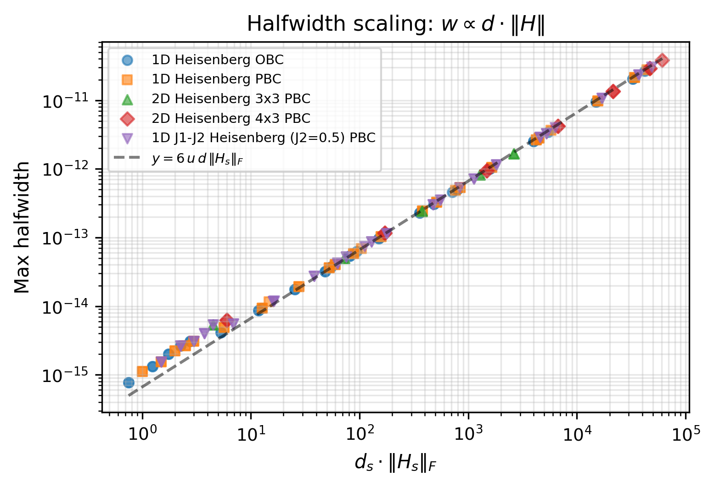

*Figure 8. A figure from symveig's own package: the half-widths of symveig's intervals follow the line 6 u d times the Frobenius norm of the block, the dimension-dependent form of its rounding bound that the audit identified as the source of the reported gain of its sector path. Copied unchanged from `symveig/code/symveig-1.0.0/results/figures/fig_width_vs_dim_norm.png`; the comparison with CERTIFY-ED's tighter bound is the table of experiment E8 in `docs/project/applications/symveig_e8.md`.*

### Mutation analysis

Decision D-35 of 17 October 2026 added experiment E6, mutation analysis, to the evidence. A passing test suite says only that the tests found nothing; a mutant changes one operator or constant in the verification core, and a mutant that no test detects points either to a gap in the tests or to a change with no observable effect. The rule was that a score is reported only with a classification of the survivors. The first run killed 66 of 160 mutants; after inspection, 12 real test gaps (13 mutants) were closed by new tests and the rest received a verdict (decision D-39).

## One codebase and one run per version: certify-ed 3.0.0 (18 to 21 October 2026)

On the evening of 18 October 2026 Sarang asked for "a single homologated script and codebase". Version 1 and symveig 1.0.0 moved to a legacy folder, the version 2 core, the exact layer, the whole-spectrum enclosure and both applications became one package, certify-ed 3.0.0, and one command, `certify-ed reproduce` (also `python run.py`), runs the tests, the experiments E0 to E10 and the number scripts (decision D-43). Decision D-44 added the rule that defines an evidence run. Every step records a computational source fingerprint, `source_hash`, a hash of exactly the code that can change a result (documentation, figure scripts and other post-processing are excluded), and a cited version needs one full run at a single source, with no edits in flight. The first full run, started that evening, was cut off after E8, and its number step failed two checks spuriously (it compared whole commits instead of the source hash, and runs instead of blocks); it was kept as a record. The run `run_full_final` of 18 to 19 October completed every step with 74 of 74 statement checks.

On 21 October two soundness gaps were found by writing the appendix proofs of the manuscript against the code (decision D-46), the route that had already found the ordering hypothesis of D-23. While writing the paragraph on arithmetic it became clear that rounding to nearest could place a reported interval end half a unit in the last place inside the exact interval; every endpoint and shift margin is now rounded one unit outward. While writing the proof of Proposition 13 it turned out that the exact "k lowest" re-check took a group of overlapping intervals with two or more claimed values to hold that many eigenvalues whenever one count above it agreed, so that two copies of the first excited vector, claimed as the two lowest, were certified with the ground state missing; multiplets are now bracketed by counts on both sides, and the duplicated-vector case is a test. Neither gap had been found by mutation analysis, which cannot resolve rounding at the level of half a unit in the last place, or by the tests, which do not use inputs that nobody thought of (`docs/project/failures/README.md`). The full run was restarted twice so that every record came from the fixed source; the records of the two aborted attempts were discarded and are not archived. The run `run_full_20261021` on Linux finished on 21 October with every step ok and 90 of 90 statement checks; E6 killed 30 of 64 mutants. It became the second stack for the next version.

## The review of 21 October 2026 and release 3.1.0

**Why a review.** By the afternoon of 21 October 2026 the project had a manuscript scaffold (ms_v3, in which the structure, claims, evidence pointers, generated tables and appendix mathematics were done and the load-bearing prose was left to Sarang, decision D-45), a consolidated report of 62 pages and a first project archive. A checker that has only been checked by its authors invites the question of what they missed. That evening the three deliverables were submitted to an independent review produced automatically in five parallel tracks: the mathematics, an audit of the code, the applications recomputed with independent code, a replication on a second machine stack, and a check of the report and the manuscript against the records. It is not a human check (`review/REVIEW_CERTIFY-ED_2026-10-21.md`).

**What held.** The review recorded 179 findings: 6 critical, 23 major, 80 minor and 70 informational. All 1,572 SHA-256 sums of the archive matched, the source hash `7fb63586baf7ea6f` and the 90 statement checks regenerated, every certified statement of E7, E9, E10, E8 and parts (a) to (c) of E3 reproduced on a second stack, none of the 15 numbered mathematical results was found false, and all 36 DOIs and 4 arXiv identifiers of the bibliography matched.

**What had to change.** Three input paths gave a false CERTIFIED. A claimed vector equal to zero got an exact radius of 0 and certified a wrong eigenvalue (finding IMP-18), and non-finite claimed eigenvalues or vectors passed through (IMP-21 and IMP-22). One path gave a false FAILED: a correct claim with valid but non-orthogonal eigenvectors of a degenerate level got a radius of 4.9 against a target of 4.5e-8 (IMP-13), which led to the radius eps* of Theorem 2' and to the use of the smaller of the two cluster radii. The reading of the spin-1 crown had to change, as described above, and the spin-1/2 wording had to name the reduced-model value instead of the headline. Decision D-52 restated Theorem 2 as Kahan's inclusion theorem applied to the polar factor of the claimed vectors. The review also found that the private e-mail address of the author was recorded in the history of the code repository, in three nested repository tarballs of the archive and on one page of the report. Decision D-48 rewrote the history before the next run: author and committer of every commit became Sarang Vehale with the paper address, and a table (`code/certify-ed/HASH_MAP.csv`) maps each of the 52 earlier commit ids to its new id with an unchanged tree. The fixes were committed between 22:58 and 23:48 IST that night, and the 14 attack cases of the review became a test file, of which 7 had failed on the reviewed code (`review/RESULT_code_fixes.md`).

The same evening decision D-49 widened the scope on the model of tools that accept every input format by default: the software accepts everything a laboratory's ED run produces, the user narrows with presets, selections and budgets, and every certificate declares what was in scope, what was narrowed and what is out of scope, with a reason. The universal importer, the presets, the scope block and the statements S7 and S8 (whose mathematics was marked UNVERIFIED under D-12) entered version 3.1.0 on 22 October, together with the practice survey described at the beginning of this account.

**Attempt 1 of the 3.1.0 run.** Decision D-54 had made the Windows workstation the primary machine (Sarang: "don't keep anything waiting for the ryzen machine as this will be my new primary machine"), with a Python environment that pins the library versions of the Linux run. The first attempt of the 3.1.0 evidence run, from commit `ada1362` on 22 October 2026 between 10:28 and 13:56 IST, therefore exercised the code on Windows for the first time, and it failed on four portability defects that the Linux runs had never reached: the matrix-free importer did not accept the (n, 1) columns that SciPy 1.17 passes to a producer's function (1 test failed, 536 passed), E4 imported the POSIX-only module `resource`, E2 used a POSIX-only process option, and E6 gave the mutants a copy of the repository without `pyproject.toml` and the folder `experiments/`, which six tests read, so that its unmutated baseline would have failed on any platform. No certified statement was involved. The steps that ran are valid records of that commit, but an evidence run must come from one commit (D-44), so the attempt was kept with a note (`code/certify-ed/results/run_full_20261022_attempt1/ATTEMPT_NOTE.md`), the defects were fixed with a portable memory cap (an address-space limit on Linux, a job object on Windows), and the tag `v3.1.0` was placed on the fixed commit `e860a83` before it was published.

**The 3.1.0 evidence run.** The run `run_full_20261022`, from 16:58 to 23:17 IST on 22 October 2026, completed every step at the single source `acbef11af991c860`: 541 tests passed and 1 was skipped, E0 to E10 were ok, and the two number scripts passed 45 of 45 and 61 of 61 checks. Against the Linux 3.0.0 run, the comparison of 3,885 record leaves found no MISMATCH; the certified bounds of E9 and E10 agree exactly (-0.5501582988212038 and -1.6380246425131773), and the exact radii of E7 differ only at the level of 1e-14. One status differs between the stacks, and the reason is the instrument: the completeness of the J2 = 0.5 square in W4 is CERTIFIED on Windows (gap at least 0.2870) and NOT_CHECKED on Linux, because a Windows job object counts committed memory where the Linux limit counts address space, so the factorization fits under one cap of 5 GiB and not under the other (`docs/project/experiments/03_comparisons.md`). E6 killed 38 of 64 mutants; 15 survivors await Sarang's verdicts. This run is the evidence the manuscript cites (`code/certify-ed/RESULT_evidence_run_3.1.0.md`).

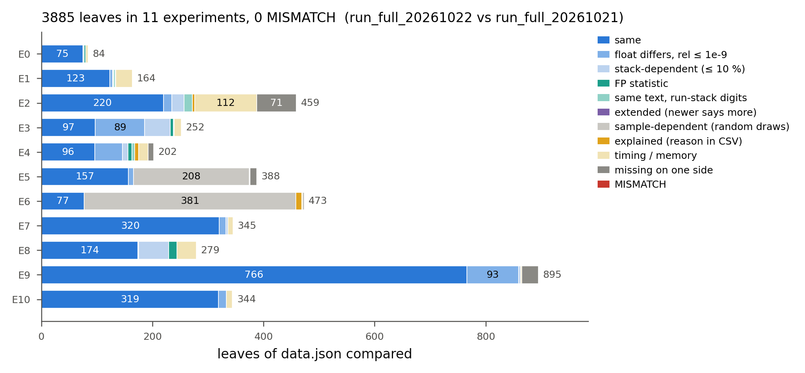

*Figure 9. The two-stack comparison for 3.1.0: the 3,885 leaves of the eleven experiments' records of `run_full_20261022` (Windows, 3.1.0) against `run_full_20261021` (Linux, 3.0.0), each in one class of `experiments/compare_runs.py`: 2,424 identical, 288 differing by a relative 1e-09 or less, 143 stack-dependent bounds within 10 %, 589 random draws compared through invariants (E5 samples, E6 mutants), 237 timings, 125 present on one side only, and others; MISMATCH 0. Data: `code/certify-ed/results/run_full_20261022/compare_vs_run_full_20261021.csv`, drawn by `experiments/figures/fig_two_stack.py`; caption numbers in `code/certify-ed/docs/figures/INDEX.md`.*

**Known issues.** Filling the manuscript's evidence pointers after the run found four places where the text and the code of 3.1.0 disagree (`review/INTEGRATION_FINDINGS_2026-10-22.md`). INT-01: the hypothesis that no operand or radius underflows (all above 2^-900) is assumed, not enforced. INT-02: no validator rejects a certificate whose scope block omits a statement. INT-03: exported radii add the model shift in round-to-nearest instead of upward. INT-04: Appendix A's accounting of the Theorem 1 radius does not describe the code, whose bound is sound. INT-02 and INT-03 were fixed on a branch `fix/3.1.1` that was never released on its own and was merged into the 3.2 work on 28 October. Decision D-57 kept the run as it stands and recorded the four as known issues of 3.1.0, because none changes a statement or a status. The rewritten history was prepared for the public repository as an extension of its public history, not a rewrite of it, but it was not pushed, because no credential with write access existed (decision D-56).

## The 3.2 expansion (23 October to 4 November 2026)

**A scored roadmap.** On 23 October 2026 Sarang asked for the framework to be expanded with a scored list of at least 50 improvements. The roadmap that answered has 78 items in eight themes, each scored for adoption (0 to 5) and rigor of the result (0 to 5) with an effort class, 20 of them flagged as new mathematics under D-12, grouped in five waves worth 470 points (`project_docs/roadmap/ROADMAP_expansion.md`). Sarang approved Waves 0 and 1, and decision D-58 adopted the roadmap, with the condition that all of it run on a separate branch, `dev/3.2`, kept apart from the cited 3.1.0 until a 3.2 version had its own full run.

**Waves 0 and 1.** The two waves (28 and 29 October) were engineering: a one-call interface and a one-sentence summary of a certificate, explanatory diagnostics, a cost model, a JSON schema for certificates with a conformance check, readers for the output of HPhi, DiagHam, SPINPACK and ALPS, a QuSpin wrapper, gap records and certified level crossings, a whole-spectrum path, an offline viewer, and a planted-error corpus. The known issue INT-01 was enforced conservatively: any nonzero magnitude below 2^-900 in the inputs or the reported radii now makes S2 and the statements that depend on it INCONCLUSIVE with the reason code `UNDERFLOW_RISK`. Implementing it found a new issue, INT-05: routine LAPACK eigenvectors can have entries of order 1e-265, the intermediate residual vectors then have entries of order 1e-278, below the threshold, so the hypothesis is violated inside the computation for ordinary inputs. An early version that scanned those intermediate vectors flagged an ordinary test case and was withdrawn; INT-05 was later closed by underflow terms added to the radius. The integration of the seven tracks on 29 October passed 953 tests with 2 skipped; 30 roadmap items were done and 3 partial, and the item of publishing to GitHub (G-01) was blocked for lack of a credential (`code/certify-ed/RESULT_integration_3.2.md`).

**The planted-error corpus.** E1 had tested 13 errors on one chain. The corpus extends the idea to 60 cases on three model families: 53 planted errors in 14 classes and 7 correct controls, each with a written expectation of which statements must not be certified. Its first run detected 49 and missed 4 of the 53: the four cases of an unnormalised cluster member were silent because their expectation listed only S4 while the note of the same case named S2 as well. The expectation was revised to S2 and S4, as the note had stated, and the same run then scored 53 of 53 with 0 false alarms; both reports are committed, and nothing in the certifier was changed to reach the score (`code/certify-ed/corpus/README.md`). A corpus written by the authors of the tool tests the tool against the errors its authors imagined, which is why E5 and the independent review keep their place in the evidence.

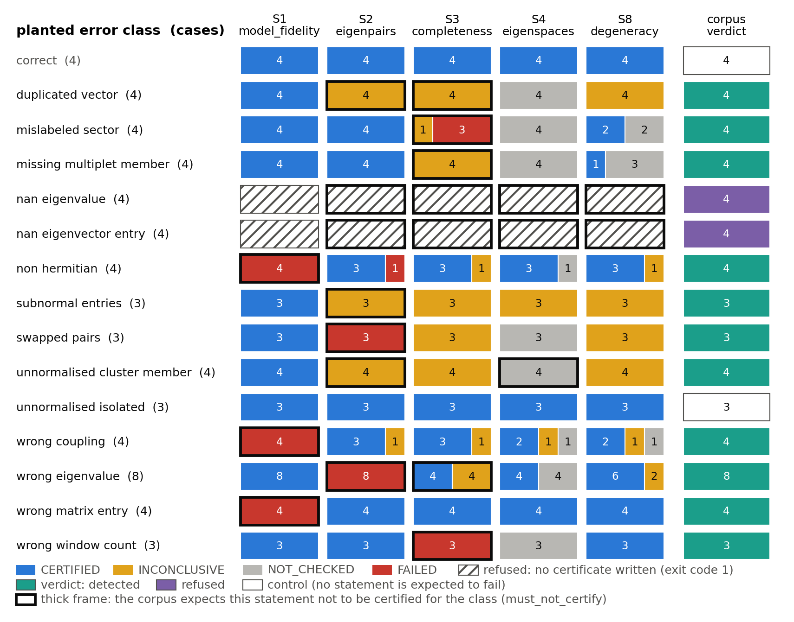

*Figure 10. certify-ed on the planted-error corpus (run of 29 October 2026 on `dev/3.2`): 53 planted cases in 14 error classes and 7 controls. Each cell counts, for the cases of one class, the status of one statement; a hatched cell is a refused input (no certificate written); a thick frame marks the statements the corpus expects not to be certified for that class. Verdicts: 53 detected (8 of them by refusal), 0 missed, 0 unsound, 0 silent, 0 false alarms, 7 of 7 controls clean. Data: `code/certify-ed/corpus/results/certify-ed/report.json`, drawn by `experiments/figures/fig_corpus_detection.py`; caption numbers in `code/certify-ed/docs/figures/INDEX.md`.*

**Clearing the backlog of new mathematics.** By the end of October many results that certificates relied on were marked UNVERIFIED and waited for Sarang's re-derivation. Decision D-59 (Sarang's request of 30 October, recorded on 3 November) set a procedure for each of them: a derivation document with six fixed sections; a verification script in exact rational or high-precision arithmetic, run on random and adversarial cases with negative controls; and an independent re-derivation, a second derivation written from the statement and the code mapping alone without reading the first, with a verdict recorded in `code/certify-ed/docs/proofs/VERDICTS.md`. A bound may become tighter only with a proof document, while a looser correction may be made at once with a negative-control test. Every result keeps the line "Sarang's check (D-12): pending".

Twenty-two documents were written in two phases, and every executed verification run reported 0 violations. The independent re-derivations then gave 6 AGREES, 9 AGREES-WITH-REMARKS, 5 GAP and 2 ERROR (`docs/project/math/derivation_documents.md`). The two errors were real. In the underflow model of INT-05 one theorem was false when the squared norm of a huge claimed vector overflows, which gave a radius of two units of the smallest subnormal number; the code now returns a lower norm bound of 0 in that case, which is looser. In the certified parameter intervals of roadmap item E-04 the crossing criterion had been applied across the jump of the enclosure tubes at interior grid points; the code now adds the affinity defects at those points, which is looser, and the adversarial script of the second derivation found 60 violating cases before the fix and 0 after it. The five gaps are missing steps in proofs whose statements hold or whose bounds are unaffected, among them a rounding constant for complex data in the Theorem 1 accounting, closed in the code by the looser constant gamma_{w+3}. This is the plainest lesson of the expansion: a derivation that its own verification script had passed still contained two errors and five gaps, which the second, independent derivation found. It is also why the status line of these documents names both checks and why neither replaces the check D-12 requires.

**A second program: the C verifier.** A certificate is produced by the same code whose correctness it is meant to support, so a defect in that code, or a certificate altered after it was written, would not be caught by running the same code again. Roadmap item B-01 is a second program, `verifier/src/cev.c`, of about 1 500 lines of C with no code shared with the Python package: its own JSON parser and canonical serialiser, its own SHA-256, its own reader for the stored arrays, and every bound evaluated in directed rounding, with the processor's rounding mode set upward for upper ends and downward for lower ends. It re-checks the hash chain, the internal consistency of the record, the cluster arithmetic of Theorems 2 and 2', the residuals and radii from the stored operator and vectors, and the logic of the S2 and S3 statuses. It does not address S1, which would need a second model builder, does not re-derive S4 to S8, and handles complex operators only through the hash checks. On the corpus and the conformance fixtures (63 bundles, 8 refused by certify-ed, 55 certificates) it passed 55 of 55, reproduced 18 of 18 FAILED statuses, and caught 80 of 80 forged certificates, 20 each of four kinds designed so that exactly one group of checks can catch each (`docs/project/applications/c_verifier.md`). It was written in C because a Rust toolchain installed for the purpose had no linker on the development machine; it is built with the MinGW gcc 14.2 that ships with GNU Octave 10.3.

**Scale.** E2 had shown that S3 stops at dimension 12,870 under a 4.5 GiB cap and that S1 and S2 need the stored matrix. The scale track of 3 November addressed both. Roadmap item D-01 replaced the a-priori backward-error bound of the sparse factorization by an a-posteriori residual of the stored factors, with a memory gate; the reach script handled dimension 12870 in 95 s, and the memory gate refused dimension 48620 at 8 GiB. Roadmap item D-02 computes S2 radii for claims whose matrix is never stored, from the model specification, with records from 2^16 to 2^24 (dimension 2^24 in 1896 s and 3.2 GB) (`code/certify-ed/RESULT_scale.md`).

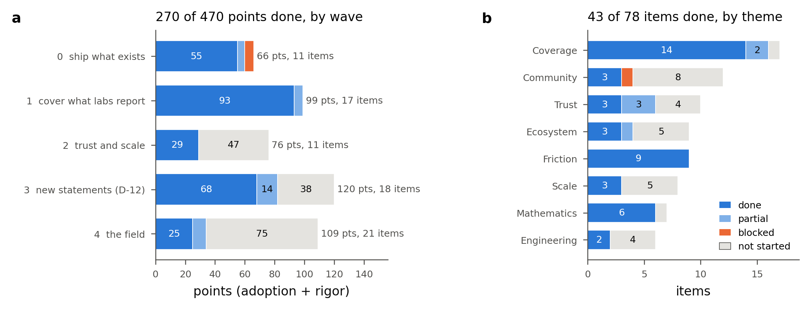

*Figure 11. The 78 roadmap items by wave (panel a, in points, adoption plus rigor) and by theme (panel b, item counts), with their status on 3 November 2026: 43 done, 6 partial, 1 blocked (G-01, publishing to GitHub), 28 not started; 270 of 470 points done. Waves 2 and 3 are untouched. Data: `code/certify-ed/experiments/figures/data/ROADMAP_expansion_items_2026-11-03.csv`, drawn by `experiments/figures/fig_roadmap_progress.py`; caption numbers in `code/certify-ed/docs/figures/INDEX.md`.*

## The 3.2 evidence runs: a crash, a fix and two time-outs (4 to 6 November 2026)

**Why a new run.** Decision D-60 of 3 November 2026 tagged certify-ed 3.2.0 from `dev/3.2` and gave it its own full evidence run, because under D-44 a version can be cited only with a full run at one source, and only such a run, compared with the 3.1.0 run, could show whether the 3.2 work had changed any statement of 3.1.0. The release suite passed 1168 tests with 8 skipped; a release sample of 16 mutants killed 10, and the two reachable survivors were turned into tests before the tag (`v3.2.0` = `55d9f61`, 4 November 2026, 08:40 IST).

**The 3.2.0 run and the E4 crash.** The run `run_full_20261104` took 22 h, from 08:42 on 4 November to 06:49 on 5 November, and every step was ok except E4. Its fourth workflow case, the J1-J2 square of 4x4 sites at J2 = 0.5 (dimension 12870), ended the experiment process with return code 3221225477, a Windows access violation, under the experiment's 5 GiB cap. Because E4 failed, the number script produced no numbers. A native crash is not an outcome the certifier is designed to produce: a factorization that does not fit in memory must give NOT_CHECKED, never a dead process (D-20). The crash was therefore diagnosed rather than rerun, in a separate clone so that the run's source would not change. The new a-posteriori residual of roadmap item D-01 formed its row blocks on eight threads, and under a cap on committed memory an allocation failure inside SciPy's sparse matrix product in a worker thread ends the whole process instead of raising `MemoryError` in the calling thread, so the certifier's handling of memory failures never runs. The control experiments were the two remaining combinations: with one thread the case certifies S3 under the same cap (gap at least 0.287), and without the cap both one and eight threads certify. The E2 record of the same run shows a probable second trace: the certifier child for the same matrix ended with an empty error text, though that it was the same crash is an inference, not a recorded fact (`docs/project/experiments/02_evidence_runs.md`).

**The fix.** Version 3.2.1 (tag `v3.2.1` = `f3c478b`, 4 November 2026, 18:23 IST) computes the residual on one thread unless an environment variable asks for more, with a test that the bound does not depend on the thread count. It differs from 3.2.0 only in this default. Decision D-61 kept the 3.2.0 run as a record and rejected citing it with E4 patched in from a later run, because one commit and one run is the rule.

**The 3.2.1 run.** The run `run_full_20261105` took 15 h 55 min, from 06:51 to 22:46 IST on 5 November 2026, from a clean tree at the source `cb73dec3e4433a3b` at every step. 1172 tests passed and 8 were skipped; E0 to E10 were ok; all four W4 benchmarks of E4 certified S3 under the cap, including the case that had crashed (gap at least 0.2870); E6 killed 36 of 64 mutants with no timeouts. The number scripts at first failed one E2 check, which treated a certifier run without S3 as a crash. Two E2 points had reached the experiment's 900 s limit for the certifier on the now single-threaded residual, the chain of 18 sites (dimension 48620) and the J2 = 0.5 square (dimension 12870), and their records hold the certificates without S3, with S1 and S2 certified. In 3.1.0 both points had S3 NOT_CHECKED under the 4.5 GiB memory cap, so no S3 statement was lost there. A non-computational change to the number script (commit `44d318c`) counted such a run as a certificate, the source hash stayed unchanged, and the numbers were regenerated from the same records: 44 of 44 and 61 of 61 checks. The price of the measured residual shows in E2: the S3 step at dimension 12870 took 250 to 800 s instead of 60 to 180 s in 3.1.0. Decision D-61 rejected raising the 900 s limit, because that would change the settings of E2 and with them the comparison with 3.1.0 (`code/certify-ed/RESULT_evidence_run_3.2.1.md`).

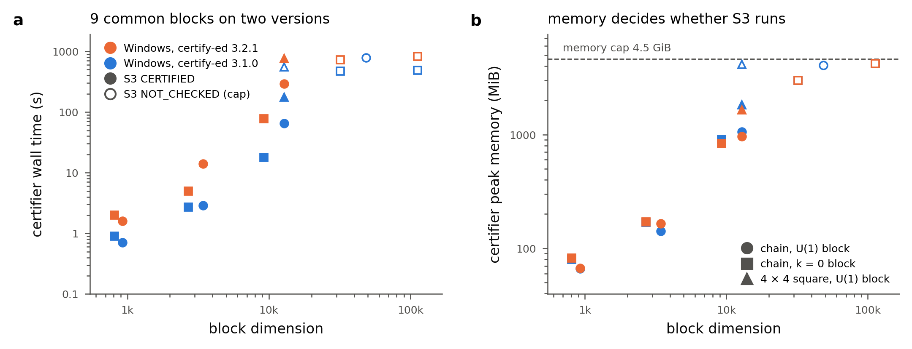

*Figure 12. Cost and reach of S1 to S3 (experiment E2) for the 3.2.1 run and the 3.1.0 run on the same workstation: certifier wall time (a) and peak memory (b) against block dimension. Filled markers have S3 CERTIFIED, open markers S3 NOT_CHECKED because the factorization did not fit under the 4.5 GiB cap. Plotted are 9 blocks of 3.2.1 (S3 certified for 7 up to dimension 12,870, not checked for 2; the 2 further rows that reached the 900 s limit record no time or memory and are not drawn) and 11 blocks of 3.1.0 (S3 certified for 7, not checked for 4); the largest block has dimension 112,720. Longest certifier run 831 s (3.2.1) and 793 s (3.1.0); peak memory 4210 MiB and 4213 MiB. Data: `code/certify-ed/results/run_full_20261105/e2_cost_20261105_142518/data.json` and `code/certify-ed/results/run_full_20261022/e2_cost_20261022_200335/data.json`, drawn by `experiments/figures/fig_cost_memory.py`; caption numbers in `code/certify-ed/docs/figures_run_3.2.1/INDEX.md`.*

**What changed between the versions.** The comparison of the 3.2.1 run with the 3.2.0 run found 3472 identical leaves, no float difference and no MISMATCH, which shows that the thread count changes no bound. The comparison with the cited 3.1.0 run, on the same machine and library versions, decides whether the 3.2 work changed a statement of 3.1.0. Of 3896 leaves, 10 are MISMATCH, and each is a documented change (`docs/project/experiments/03_comparisons.md`). Seven are the sparse fill of E2, which 3.2 counts as one factor of the symmetric factorization, 2 nnz(L) minus n, instead of nnz(L) plus nnz(U). Two are certified lower bounds on the next eigenvalue in E3 that became tighter by 1.271e-09 and 1.029e-09 relative, because the measured backward error of roadmap item D-01 is smaller than the a-priori bound of 3.1; they stand or fall with Sarang's check of `code/certify-ed/docs/proofs/D-01_sparse-residual.md`, and if that check finds a gap they revert and a 3.2.2 needs its own run. One is the number of files the mutation driver copies, 215 at `v3.1.0` and 915 at `v3.2.1`, because the repository grew. The certified application results did not move: E9 has 893 of its 895 leaves identical and E10 333 of its 344, the rest being timings. Writing the documentation of this repository found one limit of the comparison tool itself: its tolerance for stack-dependent bounds is divided by max(1, the absolute value), so a bound below 1 is compared with an absolute tolerance of 0.10, and two radii of 4.905e-10 and 3.0335e-10 count as the same class although they differ in the first digit. What the tool compares strictly is the status that a bound supports.

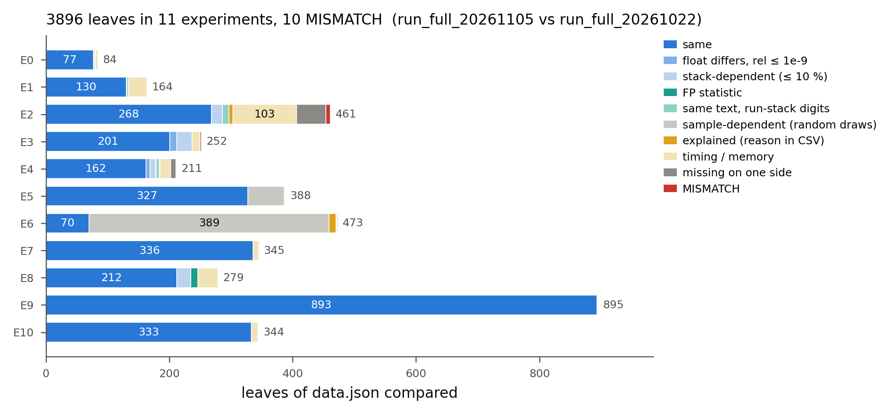

*Figure 13. The comparison of the 3.2.1 evidence run with the cited 3.1.0 run on the same stack: 3,896 leaves of the eleven experiments' records, each in one class: 3,009 identical, 19 differing by a relative 1e-09 or less, 77 stack-dependent bounds within 10 %, 448 random draws compared through invariants, 226 timings, 57 present on one side only, and others; MISMATCH 10, each a documented change of 3.2. Data: `code/certify-ed/results/run_full_20261105/compare_vs_run_full_20261022.csv`, drawn by `experiments/figures/fig_two_stack.py`; caption numbers in `code/certify-ed/docs/figures_run_3.2.1/INDEX.md`.*

**Mutation analysis of 3.2.1.** The 64 mutants of the 3.2.1 sample are the same as those of 3.2.0, with the same outcomes mutant by mutant: 36 killed and 28 survived. A rule-based classification puts 18 of the survivors in the class that needs inspection by a person (`docs/project/experiments/E6_mutation.md`). A worksheet prepared for that inspection, whose readings are suggestions and not verdicts, names seven soundness-relevant test gaps, places where a mutant changes a bound or a count that no test pins, such as the real embedding factor of a complex sector block and the amplitude vector of the fermion lowering operator (`code/certify-ed/E6_inspection_worksheet_3.2.0.md`). None of them changes a statement of an evidence run, because the records were produced by the unmutated code; the tests that pin those formulas, and the verdicts, belong to a version 3.2.2. The scores of different versions are not comparable as measures of progress, because each describes a different test suite against different code (2834 mutation sites in 3.0.0, 3051 in 3.1.0, 3639 in 3.2).

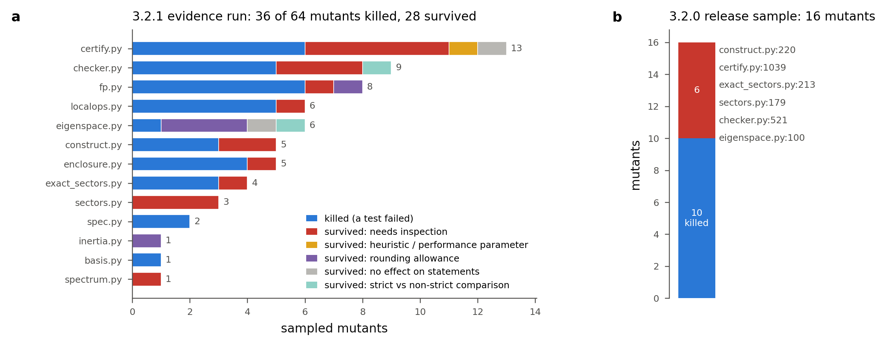

*Figure 14. Mutation testing. Panel (a): the E6 record of the 3.2.1 evidence run, 64 sampled mutants over 13 modules, 36 killed and 28 survived (no timeouts; score 0.562; baseline suite 1715 s), with the survivors by class: 18 need inspection, 1 heuristic or performance parameter, 5 rounding allowances in a worst-case bound, 2 with no effect on statements, 2 strict against non-strict comparisons. Panel (b): the 16-mutant release sample of 3.2.0 on the branch `dev/3.2`, 10 killed. The two samples come from different code and sizes, and the figure does not compare their scores. Data: `code/certify-ed/results/run_full_20261105/e6_mutation_20261105_154612/data.json` and `classification.json`, and `code/certify-ed/RESULT_integration_3.2.md`, drawn by `experiments/figures/fig_mutation.py`; caption numbers in `code/certify-ed/docs/figures_run_3.2.1/INDEX.md`.*

**Where the archive stands.** Decision D-61 of 6 November 2026 named the 3.2.1 run the 3.2 evidence run and left the choice of the cited version to Sarang. The manuscript scaffold ms_v4 (version 0.2) now generates its macros from the 3.2.1 run, with the 3.1.0 macros kept beside them, so that the cited run is switched by swapping two directories; no PDF of it was built, because no TeX engine was available on the machine that assembled it. Project archive v5 of 6 November 2026 holds one clone of the code repository with every branch and tag, the runs, the 22 derivation documents with their checks and verdicts, the C verifier, the report sources and the decision log, with checksums for every file (`README_ARCHIVE.md`). That is where the dated record of the project ends.

## The re-verification in Lean (after the archive)

**Status of this section.** This section is written from the verification report `docs/lean/VERIFICATION_REPORT.md` and the four part documents `docs/lean/CORE.md`, `docs/lean/ENCLOSURE.md`, `docs/lean/COUNTING.md` and `docs/lean/APPS.md`, with their result files in `lean/results/`. The report lists every statement with its Lean level and what is not formalized; this section tells what was done and why.

**Why Lean.** After archive v5 the mathematics behind a certificate had been machine-checked on random and adversarial cases and derived a second time automatically, and the arithmetic of the certificates had been re-checked by a second program in C. Neither is a proof. A theorem in Lean, accepted by the Lean kernel, is a formal proof of the statement as it is written in Lean, checked by a small program whose trust does not depend on the people who wrote the proof. The re-verification uses Lean 4.35.0, alone for the core library and with the mathematics library Mathlib (release `v4.35.0`) for the linear algebra, and grades every result on a fixed scale (`README.md` of this repository): level K for a kernel-checked theorem with no `sorry` and no `native_decide`, whose axioms are printed; K2 when the independent kernel nanoda also accepts it; K+ when Lean's own checker `leanchecker` replays the compiled module and accepts it again; N when a compiled Lean program recomputed a number from the raw data and agrees with the record; P for a number that only a Python run record contains; H for a check by a named person. Whether a level K proof meets rule D-12 is Sarang's decision; until he takes it, the derivation documents keep the status "Sarang's check pending".

**A third checker of the certificates (level N).** `cecheck` is a compiled Lean program without Mathlib that re-checks certify-ed certificates from their raw stored numbers in exact rational arithmetic. It decodes every stored binary64 number into an exact dyadic rational, recomputes every SHA-256 hash with its own implementation over its own canonical serialization of the certificate, recomputes every residual exactly, checks every recorded radius against Theorems 1, 2 and 2' with rational upper bounds of the square roots, and counts eigenvalues exactly by fraction-free elimination with Sylvester's law. To make exact counts affordable it splits each matrix into connected components and into the character blocks of the spin-flip and reflection symmetries it detects exactly; one count that took 247 s densely took 2.9 s after the reductions. The instrument was checked against the SHA-256 test vectors, by reproducing every certificate file byte for byte from its parsed form, by agreeing with Python's decimal conversion on 3015 test values, and by recomputing the 70 eigenvalue counts that certify-ed recorded, which all agree.

It was run on the same validation set as the C verifier: the 55 certificates of the corpus and conformance fixtures, produced again from the archived code, and the 80 forgeries made by the validation script itself. `cecheck` passed all 55 certificates, reproduced all 18 FAILED statuses (15 of them refuted outright by exact counts, which show that no eigenvalue lies within the target of the claimed value or that eigenvalues are missing, so the claim is false and not only uncertified), rejected all 80 forgeries, and gave the same answer as the C verifier in 135 of 135 rows of the agreement table (55 certificates and 80 forgeries: pass or fail, and whether each FAILED status is reproduced; in the 15 rows where `cecheck` goes further and refutes the claim, the C verifier reproduces the FAILED status); certify-ed's own integrity check, which compares hashes, rejects the 40 hash forgeries and none of the 40 resealed ones (`lean/results/core/summary.json`). One result goes beyond agreement. Four certificates whose stored vectors have entries below 2^-900 carry S2 INCONCLUSIVE under the conservative rule for INT-01, and the exact recomputation shows that every radius and every distinctness claim of their S2 holds exactly, because exact arithmetic needs no hypothesis about underflow. The checks cover S2, S3, S8 and the Kato-Temple records; S1 (rebuilding the declared model), S4 to S7, complex operators and sector certificates are not checked by `cecheck`.

**Kernel theorems about the arithmetic (level K).** The core library also holds 76 theorems over the rational numbers of core Lean, about the finite arithmetic behind the bounds: the constants gamma_n with u = 2^-53, the guard inequalities of the floating-point accounting of Theorem 1, the facts about the subnormal grid used for INT-05, the series remainders of Lemma 17, a lemma of the parameter intervals of roadmap item E-04, and the counting lemmas of Corollary 5, of the exact degeneracy bracket and of sector pooling. Every one depends at most on the three standard axioms `propext`, `Classical.choice` and `Quot.sound`. Three second checks followed (`lean/results/core/second_kernel.json`). The kernel replay program `leanchecker` accepted all 21 modules again (exit code 0 after 473 s), which guards against a compiled file that differs from what the kernel accepted, though not against an error of the kernel itself. `nanoda`, an implementation of Lean's type theory written in Rust and independent of the Lean kernel, checked each of the 76 theorems from scratch with only the three standard axioms allowed and accepted all 76, so they are at level K2. The reimplementation `lean4lean` in the toolchain is a nightly build that cannot read the compiled files of this toolchain (its control on the toolchain's own module fails the same way), so it checked nothing. The formalization found three things that the derivation documents had not stated precisely, none of which affects a stored certificate (`docs/lean/CORE.md`, section 8). One guard inequality of the Theorem 1 accounting, derived under the closing condition (w + 2) u at most 1/3, holds for every w + 2 up to 3002399751580329 and fails at the single larger value 3002399751580330 that the condition still admits; it would need a matrix row with 3002399751580328 nonzero entries. The constant 9/8 of a logarithm remainder in the 3.1 code was too small for the stated argument range, as the derivation of Lemma 17 had remarked, but no enclosure computed by the 3.1 code was wrong, because the remainder the code adds is always at least one grid unit while the true tail is at most 0.00118 grid units; the constant fails in the proof, not in the computed enclosures. And the binding norm guard has a margin of only 0.75u at the end of its stated range n = 2^26 and fails from n = 84886744 on. Finally, the S2 and S3 checks of the three smallest conformance certificates (dimension 64) were evaluated by the kernel itself, and the same evaluation rejects a radius forgery (`docs/lean/CORE.md`).

**The enclosure theorems on Mathlib.** The Mathlib part formalizes the statements that S2 rests on, including the floating-point arithmetic. A floating-point model was written in Lean that states only the standard properties of rounding (each operation returns the exact result times 1 + delta with |delta| at most u, sums may be taken in any order, and the underflow model of INT-05 adds an absolute term), and Higham's Lemmas 3.1 and 3.3 and the error bounds of dot products and matrix-vector products were proved in it. With this model Theorem 1 is formalized not only in exact arithmetic but also for the radius as the code computes it, for real and complex data, and for real data under the underflow model (Theorem U5). Of 22 statements, 18 are complete and 4 partial, in 355 theorems that depend only on the three standard axioms; nanoda accepted all 63 main theorems, so every statement is at level K2 (`lean/results/mathlib_enclosure.json`). Complete are Theorem 1 in its single, multi-pair and model-shift forms, the floating-point model, Theorem 1 in floating point for real and complex data and under INT-05, Kato-Temple, Gershgorin's theorem in the form the code uses, Weyl's inequality, Lemmas A1 to A5 of Appendix A, the polar-factor lemma, Kahan's inclusion theorem, and Theorems 2 and 2'. For Kahan's theorem the Lean proof uses an explicit matching on the real line instead of Hall's marriage theorem, which gives an order-preserving pairing, a stronger conclusion than the document states. Partial are E-05 (the variational certificates, without the computed bound of its Lemma 3 and the MPS contraction of its Lemma 4), D-02 (the matrix-free bound, for real data in the standard model with two of its lemmas as hypotheses), E-03 (the generalized eigenproblem, without the Bunch-Kaufman propositions) and Lemma 17 (the dyadic exp and ln, with the bit-length decomposition and two facts about binary64 conversion as hypotheses) (`docs/lean/ENCLOSURE.md`).

**The counting theorems on Mathlib.** The counting part covers 27 statements: 18 complete, 7 partial and 2 not formalized, in 291 theorems that depend only on the three standard axioms; nanoda accepted all 71 main theorems, so the 25 formalized statements are at level K2 (`lean/results/mathlib_counting.json`). Mathlib had no min-max theorem for matrices and no statement that the number of negative squares does not depend on the diagonalization, so the library proves the subspace form of the eigenvalue count once and derives the rest from it. Complete are Sylvester's law of inertia, the min-max counts, Weyl's inequality in counting and sorted form, the norm lemmas, Lemma 4 with the backward error (in the strict form that the manuscript states), the count of a 2x2 pivot block, Corollary 5 with the sorted pairing, the spectrum of a block-diagonal matrix, Theorem 8 (joined with the polar-factor lemma of the enclosure part), Theorem 6, Lemmas 1 to 3 and Proposition 1 of E-07, C-13, Proposition 14 and Proposition 15 (with its floating-point corollary in the model of the enclosure part). Partial are D-01 (its floating-point parts are complete for real data, and parts (a) and (b) for complex data), C-12, Proposition 16 (up to the dyadic arithmetic of Lemma 17), C-06, C-04 and C-07 (their exact parts) and E-04. Not formalized are Lemma 5 of E-07, a rounding lemma, and the exact degeneracy bracket C-16, for which Mathlib has no Sturm theorem. Mathlib also has no trace norm, so the proofs of C-04, C-07, C-13 and of the trace bound of Theorem 6 use a rank bound in its place, with the documents' constants (`docs/lean/COUNTING.md`).

**The application numbers (level N, with Mathlib lemmas at level K2).** A second compiled program, `ceapps`, rebuilds the models of E7, E9 and E10 from their specifications in exact integer arithmetic, compares them with the Python builder entry by entry (all equal, including the two 20-site chains of E7 with 2066052 and 4048556 entries), and recomputes each certified application number from the recorded vectors and shifts with exact rational arithmetic and exact LDL inertia counts. All 14 targets agree with the records of the 3.2.1 run, whose values for these targets are the same as in the 3.1.0 run: the four E7 benchmark ground energies, the two crown bounds, the eta bounds of the six AKLT lattices, the square-octagon criterion, and the exact check that the ground space of each of the 12 AKLT subgraphs is the span of its valence-bond states (the largest has 16777216 states). For the spin-1/2 crown the Lean bound is -0.55015829796302939, slightly above the recorded -0.5501582988212038, because its residual bound is computed exactly instead of with floating-point allowances; for the spin-1 crown at the printed couplings the Lean value is -1.6380246425131775 against the recorded -1.6380246425131773. A final re-run of all 14 targets with one binary built from the final sources reproduced every result exactly (`lean/results/apps/final_rerun.json`); the decorated square lattice took the longest, about 2300 s with 0.8 GiB. On the Mathlib side, the bordered-pencil lemma behind the AKLT eta bound, the eta bound as `eta.py` computes it and the finite-size criterion are formalized in 37 theorems, and nanoda accepted the 15 main ones. The AKLT kernel lemma is formalized as a certificate over the rationals for the six lattices, not in its general form, and the gap theorem of Pomata and Wei is cited, not formalized (`docs/lean/APPS.md`).

**The audit of the whole.** After the last change the three libraries and both programs were built once more together (2883 jobs, no error), and a short Lean program, `lean/Audit/AxiomAudit.lean`, asked Lean for the axioms of every theorem of the three libraries: the 164, 805 and 87 named theorems of CertifyCore, CertifyMathlib and CertifyApps, and the auxiliary theorems that Lean generates, depend on nothing beyond `propext`, `Classical.choice` and `Quot.sound`, so no `sorry` and no `native_decide` is hidden in any of them. nanoda accepted every main theorem of the four parts (76, 63, 71 and 15 of them), each checked together with every declaration it depends on, Lean core and Mathlib included; the 14 main theorems whose modules the final build recompiled were checked again and accepted, and one theorem whose export needed more than the 4 GiB first allowed was checked with 6 GiB. The final replay by `leanchecker` and the commands to repeat every step are in the report (`lean/results/integration.json`).

**What formalizing found.** Eleven places were found where a document and its Lean statement differ (`docs/project/failures/07_found_while_formalizing.md`). Three are the ones of the core part above. Proposition 14 in `theory.md` lacks the hypothesis that the inner interval is not empty; a 1x1 counterexample shows that it is needed, and the code uses the inequality only where it holds. Part (b) of D-02 holds by a second-order inequality with a margin of about W u^2, not by the slack of one index that its document names. One inequality in the proof of Theorem U5 is false although the conclusion holds, `from_float` of Lemma 17 is exact only on the grid, and the factor of Lemma A1 for complex amplitudes needs one more index, which the code's width covers. The code does not check that the row width and the dimension stay below 2^26, the range in which the floating-point guards hold; no stored operator comes near, and the check is a candidate for 3.2.2. None of the eleven changes a stored certificate, and the code repository received two documentation commits for them, `40d59f4` and `fa86456`, which change no computational file.

**What remains unformalized, and why.** Four gaps remain (`docs/lean/VERIFICATION_REPORT.md`). The Lean model of floating point is connected to the machine only by hypotheses: that binary64 arithmetic, NumPy and SciPy round as the model assumes and that the code's sums have the summation trees the theorems assume; certify-ed tests the first at run time with its floating-point probe. The two programs are at level N: no theorem says that `cecheck` or `ceapps` computes what the Mathlib theorems assume. Some statements need mathematics that Mathlib v4.35.0 lacks (Sturm's theorem for C-16, the trace norm for C-04 and C-07, which the proofs replace by a rank bound). And some parts were not reached: complex data under INT-05 and in part (c) of D-01, the floating-point lemmas of E-07, C-04 and C-07, Propositions 1 to 3 of E-03, the computed bound of E-05, the exact-layer Lemmas 11 and 12 and Proposition 13, Propositions 7 and 9, and the gap theorem of Pomata and Wei. That a Lean statement says what its document says was judged by reading, and the correspondence notes say where the two differ; those notes have not been checked by a person. Under rule D-12 no Lean level counts as Sarang's check. A proposal for how a review of the Lean statements could take its place for the statements at level K2 is in `docs/project/decisions/05_proposed_d62_lean.md`; it is not adopted.

| part | document and results | result |
|---|---|---|
| core checker `cecheck` and kernel theorems | `docs/lean/CORE.md`, `lean/results/core/` | 55 of 55 certificates, 18 of 18 FAILED statuses, 80 of 80 forgeries, 135 of 135 rows agree with the C verifier (level N); 76 kernel theorems (level K2) |
| enclosure theorems on Mathlib | `docs/lean/ENCLOSURE.md`, `lean/results/mathlib_enclosure.json` | 22 statements: 18 complete, 4 partial; 355 theorems; level K2 |
| counting theorems on Mathlib | `docs/lean/COUNTING.md`, `lean/results/mathlib_counting.json` | 27 statements: 18 complete, 7 partial, 2 not formalized; 291 theorems; level K2 |
| application numbers and AKLT lemmas | `docs/lean/APPS.md`, `lean/results/apps/` | 14 of 14 targets agree (level N); 37 theorems, 15 main theorems at level K2 |
| the whole | `docs/lean/VERIFICATION_REPORT.md`, `lean/results/integration.json` | final build, axiom audit of every theorem, final replay, nanoda rechecks |

## What is open

The record of 6 November 2026 ends with a list of what remains, in order (`project_docs/SESSION_HANDOVER_2026-11-06.md`; `docs/project/failures/05_open_items.md`). First, Sarang's check of the 22 derivation documents under D-12, beginning with those that changed bounds and then the ERROR and GAP rows, together with the results that are still UNVERIFIED and have no derivation document: Theorem 6, Proposition 7, Proposition 9, Lemmas 11 and 12 and Proposition 13 of the exact layer, and the bordered-pencil lemma of the AKLT application. Two consequences hang on this check: if the check of the sparse residual finds a gap, two tighter E3 bounds of 3.2 revert and a 3.2.2 needs its own run, and the five GAP rows need proof text that only Sarang writes. Second, the cited version: whether 3.2.1 replaces 3.1.0 is his decision after reading `code/certify-ed/RESULT_evidence_run_3.2.1.md`, and the manuscript macros of both runs are ready. Third, the verdicts of a person on the mutation survivors that need inspection, 15 of the 3.1.0 run and 18 of the 3.2.1 run, and the tests for the seven soundness-relevant gaps the worksheet names, which belong to a 3.2.2 together with a memory gate that uses the process's memory cap when no budget is given.

Several open items are acts of the authors rather than code. The note to Kránitz and Penc (version 0.3) waits for Sarang's check of three statements against the paper, and nothing about the spin-1 discrepancy is said publicly before their reply. The corrected replacement of the symveig preprint and the deprecation of its public code (D-53) have not been carried out. The push of the rewritten history to the public repository waits for a credential with write access and for Sarang's word (D-56, D-60), and the Zenodo version follows it; whether the Zenodo record 20066565 or 20066566 is the concept record of version 1 is an open question from the audit of version 1. The known issue INT-01 is enforced conservatively in 3.2, but the choice among rejecting, rescaling and stating the hypothesis as the user's is Sarang's, and INT-04 needs Appendix A of the manuscript rewritten, which is prose under D-16. The PDFs of manuscript v4 and of report v1.2 have not been built from the archive sources, and the load-bearing prose of the manuscript is still to be written by Sarang. On the research side, two certifications have not been attempted: the honeycomb lattice of Pomata and Wei, the natural next target on a larger machine, and the nine-coupling headline value of the spin-1/2 crown, the same S^z = 0 problem without the pair-swap symmetry. In the Lean re-verification, the statements listed as partial or not formalized in `docs/lean/VERIFICATION_REPORT.md` remain open, and the check of the size range that the formalization found missing belongs to 3.2.2.

## Glossary

| term | meaning in this account |
|---|---|
| exact diagonalization (ED) | computing eigenvalues and eigenvectors of a Hamiltonian written as a matrix, dense or by an iterative solver |
| producer | the program that computed an ED result; CERTIFY-ED never runs its code |
| declared model | the model as a list of operator strings and couplings, written by the user independently of the producer |
| claim | the producer's eigenvalues, usually with eigenvectors and the matrix, of kind lowest, window, all or subset |
| certificate | a machine-readable record of statements S1 to S8 about one claim, each with a status, evidence and assumptions |
| CERTIFIED, FAILED, INCONCLUSIVE, NOT_CHECKED | the statement holds for the stored numbers; the computation contradicts it; neither; it did not run, with a reason code |
| enclosure, radius | an interval around a claimed eigenvalue that contains an eigenvalue of the declared model; its half-width |
| cluster | claimed pairs whose single-pair enclosures overlap, such as the members of a degenerate level |
| model shift | a certified bound on the distance between the matrix the bounds refer to and the exact matrix of the declared model, added to every radius |
| inertia count | the number of negative eigenvalues of A minus sigma I, read off an L D L^T factorization by Sylvester's law |
| backward error | the size of the perturbation for which a computed factorization is exact |
| exact layer (S6) | the re-check of S2 and S3 in integer and rational arithmetic, with no floating-point assumption |
| unit roundoff u | 2^-53 in binary64 arithmetic; gamma_n is n u divided by 1 minus n u |
| source hash | `source_hash`, a fingerprint of exactly the code that can change a result |
| evidence run | one full run of tests, experiments and mutation analysis from one tagged commit at one source hash (D-44) |
| MISMATCH leaf | a field of two run records that differs outside every named class of expected differences |
| mutation analysis, mutant, killed | deliberate small changes of the code; a mutant is killed when a test fails |
| planted-error corpus | 60 producer bundles, 53 with one known error and 7 correct controls |
| derivation document | one of 22 documents that derive a result, with a verification script and an independent re-derivation |
| independent re-derivation | a second derivation written from the statement alone, produced automatically; not a human check |
| D-12 | the project rule that new mathematics counts as established only after Sarang Vehale re-derives it |
| UNVERIFIED | the mark of a result that has neither a derivation document nor Sarang's check |
| kernel-checked in Lean | a Lean theorem accepted by the Lean kernel with no `sorry` and no `native_decide` (level K) |
| level K2, N | a level K theorem also accepted by a second checker; a number recomputed by a compiled Lean program |
| crown | the 18-site cluster of the pyrochlore bound of Kránitz and Penc |
| eta | in the AKLT criteria, the largest cosine of the principal angles between two ground spaces other than 1 |

## Sources

Paths beginning with `docs/project/`, `docs/blog/`, `docs/lean/` or `lean/` are files of this repository; all other paths are relative to `archive_v5/`, and the code paths are those of its clone `code/certify-ed/`. The file `docs/blog/make_bundle.py` collects the text files named in this table and in the body into the bundle against which the numbers of this account are checked (see the end of this section).

| document | used for |
|---|---|
| `docs/project/CHANGELOG_PROJECT.md` | every dated change, with its source |
| `docs/project/00_overview.md`, `docs/project/decisions/README.md`, `docs/project/decisions/01_before_v2.md` | versions, decisions D-01 to D-61 |
| `docs/project/math/README.md`, `docs/project/math/certificate_statements.md`, `docs/project/math/theorems.md`, `docs/project/math/arithmetic_model.md`, `docs/project/math/exact_layer.md`, `docs/project/math/derivation_documents.md` | the statements, the theorems, their status |
| `docs/project/applications/README.md`, `docs/project/applications/crown_kranitz_penc.md`, `docs/project/applications/aklt_pomata_wei.md`, `docs/project/applications/exact_benchmarks_e7.md`, `docs/project/applications/symveig_e8.md`, `docs/project/applications/c_verifier.md` | the applications, symveig, the C verifier |
| `docs/project/experiments/README.md`, `docs/project/experiments/02_evidence_runs.md`, `docs/project/experiments/03_comparisons.md` | the experiments, the evidence runs, the comparisons |
| `docs/project/experiments/E0_verifier_validation.md`, `docs/project/experiments/E1_failure_matrix.md`, `docs/project/experiments/E2_cost.md`, `docs/project/experiments/E5_arpack_multiplet.md`, `docs/project/experiments/E6_mutation.md` | the single experiments |
| `docs/project/failures/README.md`, `docs/project/failures/05_open_items.md` | how defects were found; what is open |
| `docs/lean/README.md`, `docs/lean/CORE.md`, `docs/lean/ENCLOSURE.md`, `docs/lean/COUNTING.md` | the Lean re-verification |
| `lean/results/core/summary.json`, `lean/results/mathlib_enclosure.json`, `lean/results/mathlib_counting.json` | counts of the Lean re-verification |
| `project_docs/DECISIONS_LOG.md` | the decision log, version 1.19 |
| `project_docs/SESSION_HANDOVER_2026-11-06.md` | the state and the open items on 6 November 2026 |
| `report/03_chronology.md`, `report/10_referees.md` | version 1 and the referee reports |
| `earlier_deliverables/certify_ed_verification.md`, `earlier_deliverables/CERTIFY-ED_manuscript_audit.md`, `earlier_deliverables/CERTIFY-ED_code_audit.md` | the review and audits of version 1 |
| `earlier_deliverables/pilot_report.md`, `earlier_deliverables/SCOPE_ENUMERATION.md` | the C1 pilot, the scope enumeration |
| `manuscript_v2/REVISION_REPORT.md` | the manuscript of 11 October 2026 |
| `research/Expanding ED verification horizons.md` | the survey of horizons of 15 October 2026 |
| `survey/PREREG_practice_survey.md`, `survey/RESULT_practice_survey.md` | the practice survey |
| `review/REVIEW_CERTIFY-ED_2026-10-21.md`, `review/RESULT_code_fixes.md`, `review/INTEGRATION_FINDINGS_2026-10-22.md` | the independent review, its fixes, the known issues |
| `code/certify-ed/RESULT_evidence_run_3.1.0.md`, `code/certify-ed/RESULT_evidence_run_3.2.1.md` | the two evidence runs |
| `code/certify-ed/results/run_full_20261022_attempt1/ATTEMPT_NOTE.md` | attempt 1 of the 3.1.0 run |
| `code/certify-ed/RESULT_integration_3.2.md`, `code/certify-ed/RESULT_scale.md`, `code/certify-ed/corpus/README.md` | the 3.2 integration, the scale track, the corpus |
| `code/certify-ed/E6_inspection_worksheet_3.2.0.md` | suggested readings of the 3.2 mutation survivors |
| `code/certify-ed/docs/what_certified_means.md`, `code/certify-ed/docs/SCOPE_MATRIX.md`, `code/certify-ed/docs/proofs/VERDICTS.md` | the meaning of the statuses, the scope matrix, the verdicts |
| `code/certify-ed/docs/figures/INDEX.md`, `code/certify-ed/docs/figures_run_3.2.1/INDEX.md` | the figures and the numbers of their captions |
| `code/certify-ed/results/run_full_20261105/E3.log` | the sizes of the bounds in the 3.2.1 run |
| `project_docs/roadmap/ROADMAP_expansion.md` | the expansion roadmap |
| `README_ARCHIVE.md` | the contents of archive v5 |

The figures were copied unchanged into `docs/blog/figures/` from `code/certify-ed/docs/figures/` (Figures 1 to 4, 9 to 11), from `code/certify-ed/docs/figures_run_3.2.1/` (Figures 5 to 7 and 12 to 14) and from `docs/project/applications/figures/` of this repository (Figure 8, itself a copy of the symveig figure named in its caption); where two source figures share a name, the copy carries the run in its file name.

To check this account: `python docs/blog/make_bundle.py` writes `docs/blog/blog_sources_bundle.txt` from the cited files, then `python tools/lint_docs.py docs/blog/BLOG.md` checks the style rules and `python tools/lint_docs.py --bundle docs/blog/blog_sources_bundle.txt docs/blog/BLOG.md` also checks that every number of three or more digits occurs in a cited file.
