# Figure index

Figures for the manuscript, the consolidated report and this documentation site. Each figure is one script in
`experiments/figures/` (listed in `provenance.NON_COMPUTATIONAL`: the scripts read records and documents and draw;
none computes a bound) and is written as PDF and PNG into this directory together with `<name>.numbers.json`,
the numbers the caption prints. This file is rendered by `experiments/figures/make_index.py` from those files; every
number below was read from the data source named in the entry. Concept figures carry no data. The evidence run is
`run_full_20261022` (Windows, certify-ed 3.1.0), compared with `run_full_20261021` (Linux, certify-ed 3.0.0); the
record directories are those of the project archive (`code/certify-ed-3.1/results/`). To regenerate:
`CERTIFY_RESULTS=<run dir> CERTIFY_RESULTS_B=<second run dir> python experiments/figures/<script>.py`, then
`python experiments/figures/make_index.py`. The smoke test is `tests/test_figures.py`.

Placement in the manuscript and the report: `MANUSCRIPT_PLACEMENT.md`.

## C1  `fig_certificate_anatomy.pdf` / `fig_certificate_anatomy.png`

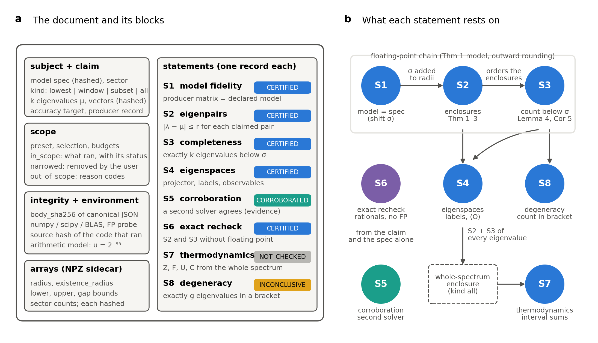

What a certificate contains and how its statements depend on each other. (a) The JSON body: the subject and claim (model specification, claim kind, the k claimed eigenvalues and the hash of their vectors), one record per statement S1–S8 with a status (CERTIFIED, INCONCLUSIVE, NOT_CHECKED, FAILED; CORROBORATED for S5 only), the scope block (what ran, what the user narrowed, what is out of scope and why), integrity and environment (body hash, library versions, floating-point probe, source hash), and the arrays sidecar. The statuses shown are an example, not a record. (b) The floating-point chain: S1 fixes the matrix the enclosures refer to (its shift σ is added to every radius), S2 encloses each claimed value, S3 counts eigenvalues below a shift and orders the enclosures, S4 and S8 read clusters and brackets off S2 and S3; S6 re-checks S2 and S3 in exact arithmetic from the claim and the specification alone; S7 needs the whole-spectrum enclosure of a kind `all` claim; S5 is corroboration by a second solver, evidence rather than a certified statement.

- data source: concept figure, no data
- script: `experiments/figures/fig_certificate_anatomy.py`

## C2  `fig_enclosure_geometry.pdf` / `fig_enclosure_geometry.png`

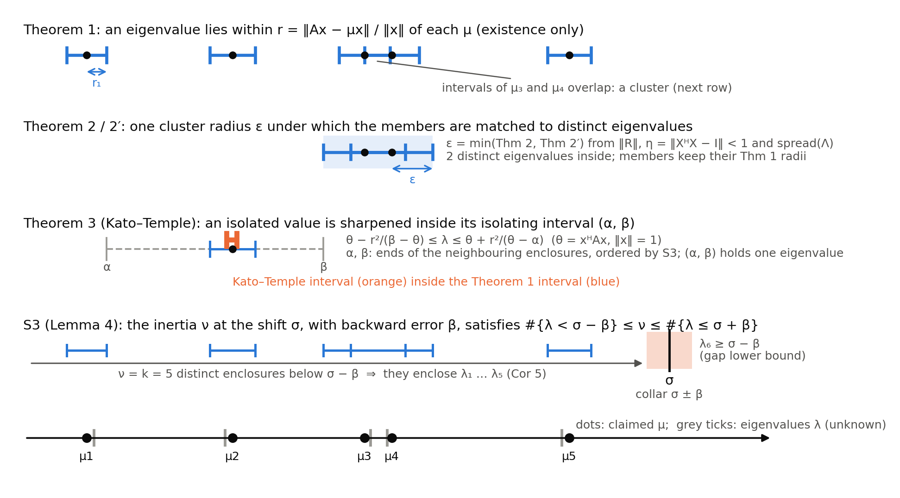

The enclosures on the real line (positions illustrative). Theorem 1 gives each claimed value μ an interval of radius r = ‖Ax − μx‖/‖x‖ containing an eigenvalue, existence only; when two intervals overlap the pair is a cluster and Theorem 2/2′ gives one cluster radius ε under which the members are matched to distinct eigenvalues, each member keeping its Theorem 1 existence radius. Theorem 3 (Kato–Temple) sharpens an isolated value inside its isolating interval (α, β), whose ends are the neighbouring enclosures ordered by S3. S3 (Lemma 4) counts the inertia ν of A − σI with backward error β: #{λ < σ − β} ≤ ν ≤ #{λ ≤ σ + β}; with ν = k and k distinct enclosures below σ − β the enclosures hold λ₁ … λ_k and λ_{k+1} ≥ σ − β (Corollary 5), the certified gap lower bound.

- data source: concept figure, no data (docs/theory.md sections 2–3)
- script: `experiments/figures/fig_enclosure_geometry.py`

## C3  `fig_inertia_completeness.pdf` / `fig_inertia_completeness.png`

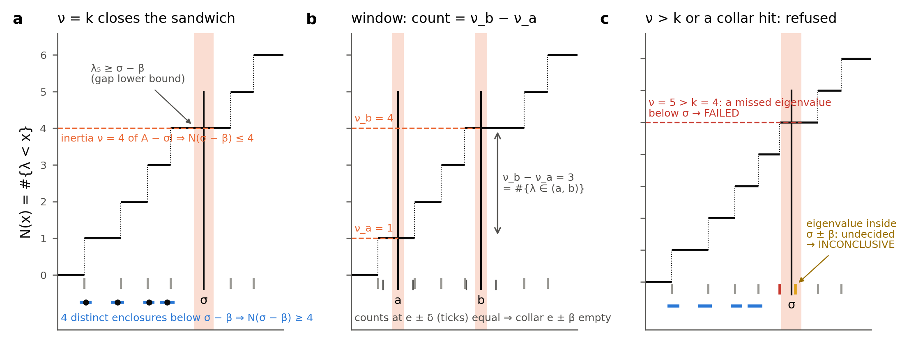

How inertia counts certify "exactly k eigenvalues below σ" (illustrative spectra; N(x) = #{λ < x} is the counting function). (a) A `lowest` claim: k distinct enclosures below σ − β give N(σ − β) ≥ k; the inertia ν = k of the LDLᴴ factorization of A − σI gives N(σ − β) ≤ ν; the sandwich closes, the enclosures hold λ₁ … λ_k and λ_{k+1} ≥ σ − β. (b) A window claim without eigenvectors: two counts at the edges give ν_b − ν_a = #{λ ∈ (a, b)} once two further counts at e ± δ per edge show the collar e ± β to be eigenvalue-free. (c) What the count refuses: ν > k means an eigenvalue below σ is missing from the claim (FAILED); an eigenvalue inside the collar leaves the count undecided (INCONCLUSIVE).

- data source: concept figure, no data (docs/theory.md section 3)
- script: `experiments/figures/fig_inertia_completeness.py`

## C4  `fig_rounding_accounting.pdf` / `fig_rounding_accounting.png`

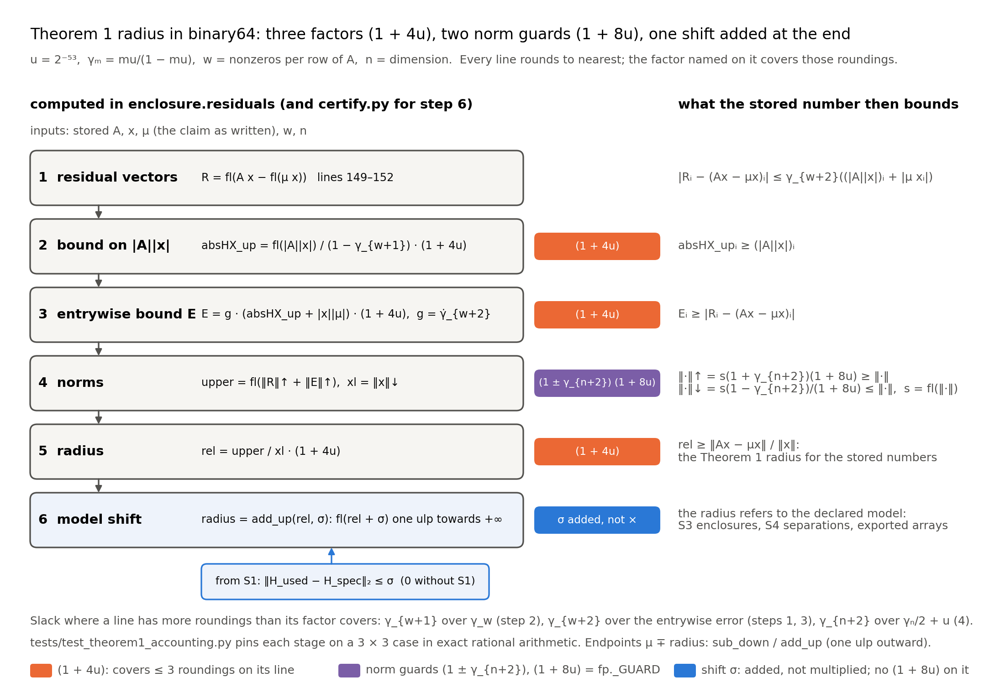

The floating-point accounting of the Theorem 1 radius, as implemented (docs/theory.md section 2, `enclosure.residuals`): the residual vectors, the bound on |A||x| and the entrywise rounding bound E, each with one factor (1 + 4u) covering the roundings of its line; the norms with the guards (1 ± γ_{n+2}) and (1 + 8u); the radius with a third (1 + 4u); and the model shift σ from S1, added with `add_up` (one ulp towards +∞) where the radius enters S3, S4 and the exported arrays — added, never multiplied. Where a line has more roundings than its factor covers, the slack of γ_{w+1} over γ_w, of γ_{w+2} over the entrywise error and of γ_{n+2} over γₙ/2 + u absorbs the rest; tests/test_theorem1_accounting.py pins each stage in exact rational arithmetic.

- data source: concept figure, no data (docs/theory.md section 2)
- script: `experiments/figures/fig_rounding_accounting.py`

## E1  `fig_failure_matrix.pdf` / `fig_failure_matrix.png`

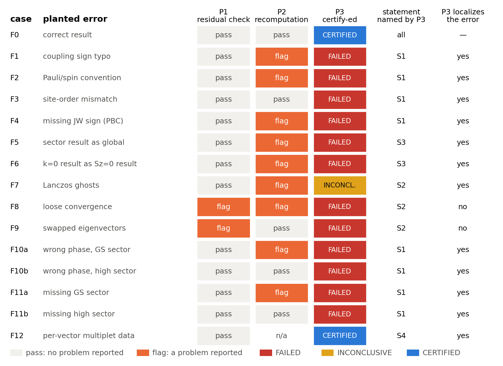

Fifteen results checked by three practices (E1 record, run_full_20261022 (Windows, certify-ed 3.1.0 evidence run)): 15 cases of which 13 are wrong results, N = 12 sites, K = 5 claimed pairs, residual and agreement tolerances 1e-08. P1 (residual check with the producer's own matrix) flags 2 of them, P2 (recomputation from the intended model) flags 9, certify-ed (P3) leaves 13 not certified (FAILED or INCONCLUSIVE) and localizes the error in 12 cases. The "statement named" column is derived from the diagnosis text of the record (`P3_detail`) by keyword rules, because the record stores per-statement statuses for the correct result only; F12 is a correct result whose single-vector observable is basis dependent and is certified at the multiplet level (S4).

- data source: e1_failure_matrix_20261022_195847/data.json; run run_full_20261022 (Windows, certify-ed 3.1.0 evidence run)
- script: `experiments/figures/fig_failure_matrix.py`

## E2  `fig_cost_memory.pdf` / `fig_cost_memory.png`

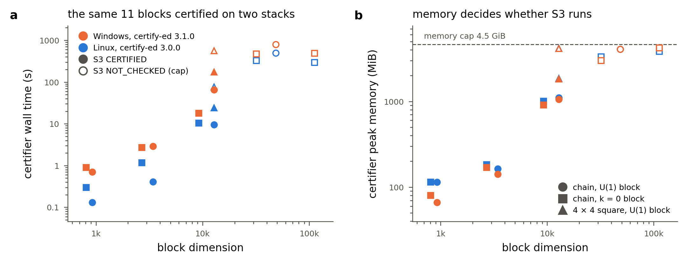

Certifier wall time (a) and peak memory (b) against block dimension for the 11 E2 blocks on two stacks: run_full_20261022 (Windows, certify-ed 3.1.0 evidence run) and run_full_20261021 (Linux, certify-ed 3.0.0 run). Filled markers: S3 (completeness) CERTIFIED; open markers: S3 NOT_CHECKED because the factorization did not fit under the 4.5 GiB cap. On both runs S3 is certified for 7 blocks up to dimension 12,870 and not checked for 4; the largest block has dimension 112,720. Longest certifier run: 793 s (Windows, certify-ed 3.1.0), 495 s (Linux, certify-ed 3.0.0); peak memory 4213 MiB and 4163 MiB. Time is `certifier.total`, memory `certifier.maxrss_mb`, both read from the records.

- data source: e2_cost_20261022_200335/data.json of run_full_20261022 (Windows, certify-ed 3.1.0 evidence run); e2_cost_20261021_070755/data.json of run_full_20261021 (Linux, certify-ed 3.0.0 run)
- script: `experiments/figures/fig_cost_memory.py`

## E3  `fig_two_stack.pdf` / `fig_two_stack.png`

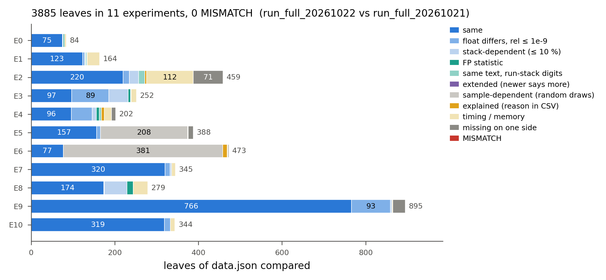

Record-by-record comparison of the two runs (run_full_20261022 against run_full_20261021, `compare_vs_run_full_20261021.csv`): 3,885 leaves of the eleven experiments' data.json files, each in one class. 2,424 are identical, 288 differ by a relative 1e-09 or less, 143 are stack-dependent statistics within 10 %, 32 are floating-point statistics, 24 are the same sentence with run-stack digits, 1 is an extension of the newer version, 589 are random draws (E5 samples, E6 mutants), 22 are differences explained once by path pattern, 237 are timings or memory, 125 are present on one side only; MISMATCH: 0.

- data source: compare_vs_run_full_20261021.csv at the root of run_full_20261022 (Windows, certify-ed 3.1.0 evidence run)
- script: `experiments/figures/fig_two_stack.py`

## E4  `fig_mutation.pdf` / `fig_mutation.png`

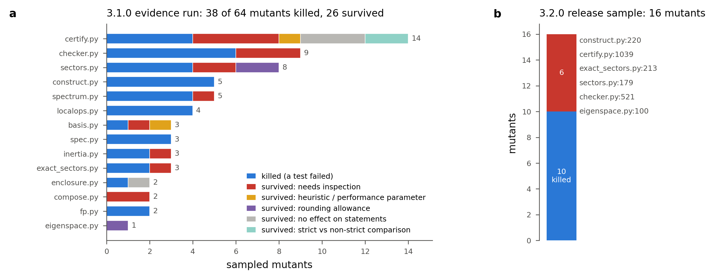

Mutation testing. (a) E6 record of run_full_20261022 (Windows, certify-ed 3.1.0 evidence run): 64 sampled mutants over 14 modules, 38 killed and 26 survived (0 timeouts; score 0.594); the baseline suite took 511 s. Survivors by category of classification.json: 15 need inspection, 2 are heuristic or performance parameters, 3 are rounding allowances in a worst-case bound, 4 have no effect on statements, 2 are strict-versus-non-strict comparisons. (b) The 16-mutant sample on the merged dev/3.2 branch (RESULT_integration_3.2.md): 10 killed; survivors `construct.py:220`, `certify.py:1039`, `exact_sectors.py:213`, `sectors.py:179`, `checker.py:521`, `eigenspace.py:100`. The two samples come from different code and sample sizes; the figure does not compare their scores.

- data source: e6_mutation_20261022_205005/data.json and e6_mutation_20261022_205005/classification.json of run_full_20261022 (Windows, certify-ed 3.1.0 evidence run); RESULT_integration_3.2.md (dev/3.2)
- script: `experiments/figures/fig_mutation.py`

## E5  `fig_corpus_detection.pdf` / `fig_corpus_detection.png`

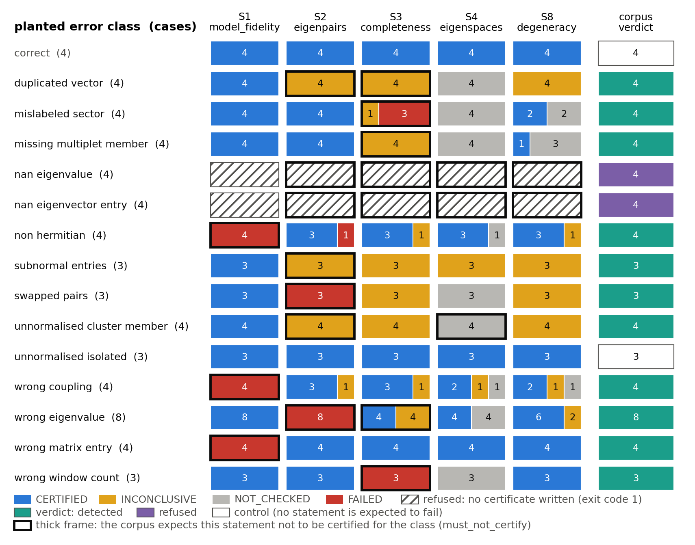

certify-ed on the planted-error corpus (corpus/results/certify-ed/report.json, run started 2026-10-29T04:36:23+00:00): 53 planted cases in 14 error classes and 7 controls. Each cell counts, for the cases of a class, the status of one statement; a hatched cell is a refused input (no certificate written); a thick frame marks the statements the corpus expects not to be certified for that class. Verdicts: 53 detected (of which 8 by refusal), 0 missed, 0 unsound, 0 silent, 0 errors, 0 false alarms (0 weak), 7 of 7 controls clean.

- data source: corpus/results/certify-ed/report.json (repository, corpus run on dev/3.2)
- script: `experiments/figures/fig_corpus_detection.py`

## E6  `fig_scope_vs_survey.pdf` / `fig_scope_vs_survey.png`

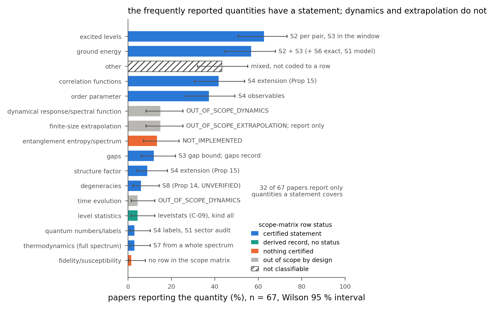

What ED papers report against what a certificate states. Bars: the share of the n = 67 papers of the practice survey's analysis set reporting each quantity (model-coded; Wilson 95 % intervals), from experiments/survey/survey_for_scope.json; colours: the status of the matching row of docs/SCOPE_MATRIX.md. The two most reported quantities, excited levels (62.7 %, 50.7–73.3 %) and ground energy (56.7 %), are certified statements; of the 16 coded categories 11 are certified statements, 2 a derived record without status, 0 have nothing certified (entanglement entropy: NOT_IMPLEMENTED; fidelity: no row), 2 are out of scope by design (dynamics, time evolution, extrapolation) and 1 ("other") is not classifiable. 36 of the 67 papers report only quantities a statement covers ("other" excluded).

- data source: experiments/survey/survey_for_scope.json, experiments/survey/survey_coded.csv, docs/SCOPE_MATRIX.md
- script: `experiments/figures/fig_scope_vs_survey.py`

## E7  `fig_roadmap_progress.pdf` / `fig_roadmap_progress.png`

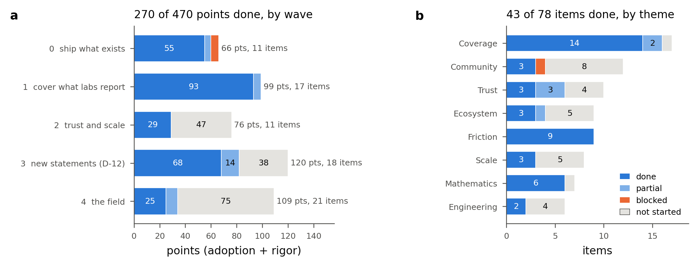

The 78 roadmap items (ROADMAP_expansion_items.csv, status column `status_2026-11-03`) by wave (a, points = adoption + rigor) and theme (b, item counts): 43 done, 6 partial (B-03, B-08, B-09, C-07, C-13, F-02), 1 blocked (G-01), 28 not started; 270 of 470 points done. Wave 0 (66 points) has 55 done, Wave 1 (99) has 93, Wave 4 (109) has 25; Waves 2 and 3 (76 and 120 points) are untouched. The wave of each item is read from the wave lists of ROADMAP_expansion.md (experiments/figures/data/README.md).

- data source: experiments/figures/data/ROADMAP_expansion_items_2026-11-03.csv
- script: `experiments/figures/fig_roadmap_progress.py`

## A1  `fig_crown_sectors.pdf` / `fig_crown_sectors.png`

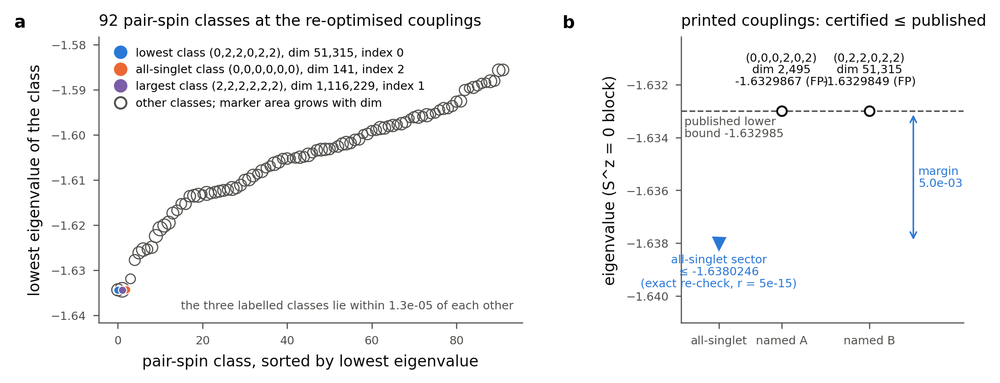

The pyrochlore-crown S = 1 model (E9 record, run_full_20261022 (Windows, certify-ed 3.1.0 evidence run)). (a) The lowest eigenvalue of each of the 92 pair-spin classes of the S^z = 0 block at the record's re-optimised couplings (c1 = 0.053975, c3 = 0.082883), sorted; marker area grows with the class dimension. The lowest class (0, 2, 2, 0, 2, 2) (dimension 51,315), the all-singlet class (dimension 141) and the largest class (dimension 1,116,229) lie within 1.3e-05 of each other. The record holds the landscape at these couplings only, not at the printed ones. (b) At the printed couplings (c1 = 26733/500000, c3 = 41363/500000, c17 = 11563/100000): the all-singlet-sector eigenvalue is certified ≤ -1.6380246 by the exact re-check (CERTIFIED; radius of the spin-1 ring eigenvalue it rests on 5.1e-15; no floating-point assumption), 5.0e-03 below the published lower bound -1.632985; the two named sectors (0, 0, 0, 2, 0, 2) (dimension 2,495) and (0, 2, 2, 0, 2, 2) (dimension 51,315) have lowest eigenvalues -1.6329867 and -1.6329849, floating-point values without a certified interval in the record, drawn as such.

- data source: e9_pyrochlore_20261022_185936/data.json of run_full_20261022 (Windows, certify-ed 3.1.0 evidence run)
- script: `experiments/figures/fig_crown_sectors.py`

## A2  `fig_aklt_eta.pdf` / `fig_aklt_eta.png`

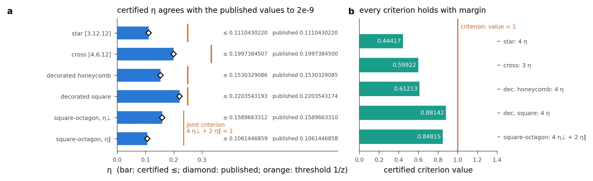

The Pomata–Wei AKLT lattices (E10 record, run_full_20261022 (Windows, certify-ed 3.1.0 evidence run)). (a) The certified upper bound on η for each lattice (bar) against the published value (diamond); the largest difference is 1.9e-09, so bar end and diamond coincide at this scale and the values are printed. Orange ticks: the gap-criterion threshold 1/z for the lattices whose criterion is η < 1/z (z = 4 for the star, decorated honeycomb and decorated square, z = 3 for the cross); the two square-octagon rows share the joint criterion 4η⊥ + 2η∥ < 1. (b) The certified criterion values: star 0.44417, cross 0.59922, decorated honeycomb 0.61213, decorated square 0.88142, square-octagon 0.84815; every one is below 1. The largest symmetry-adapted block is 4,034 (decorated square, 2683 s).

- data source: e10_aklt_20261022_170609/data.json of run_full_20261022 (Windows, certify-ed 3.1.0 evidence run)
- script: `experiments/figures/fig_aklt_eta.py`
