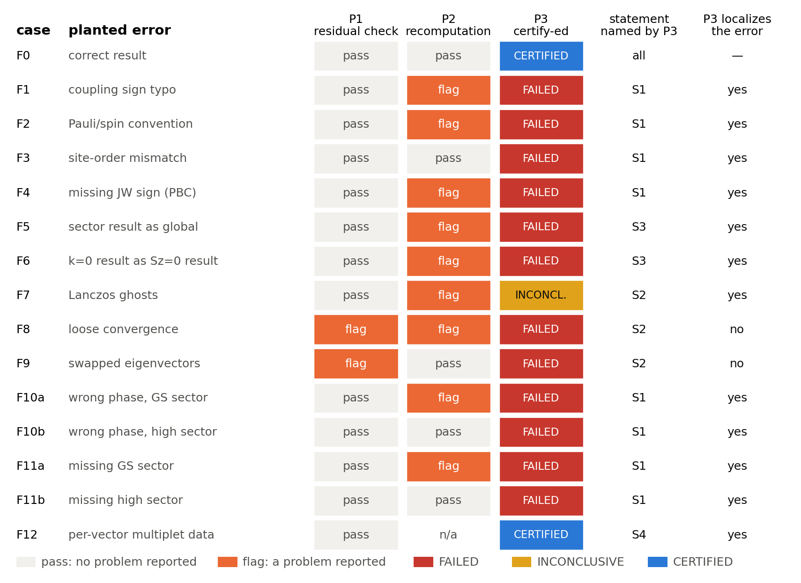
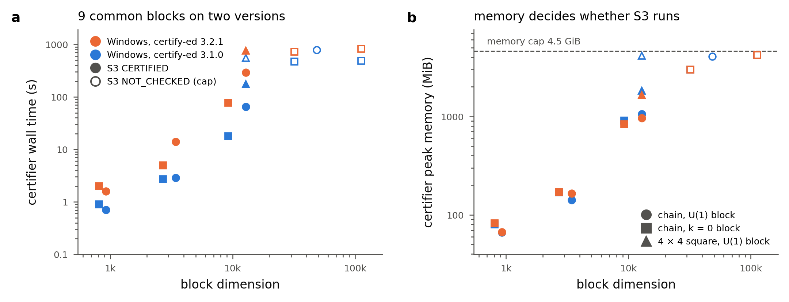
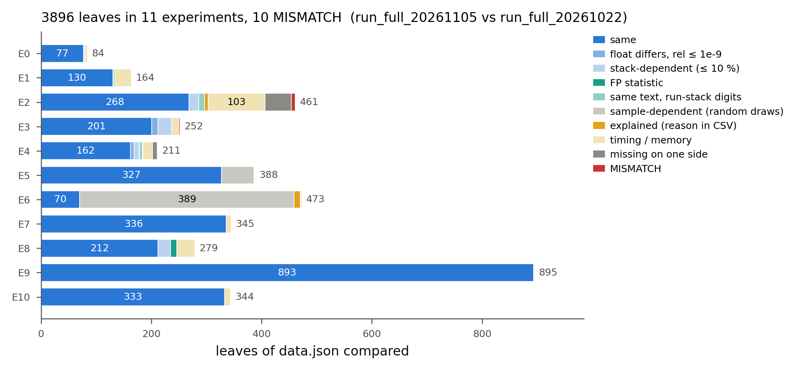
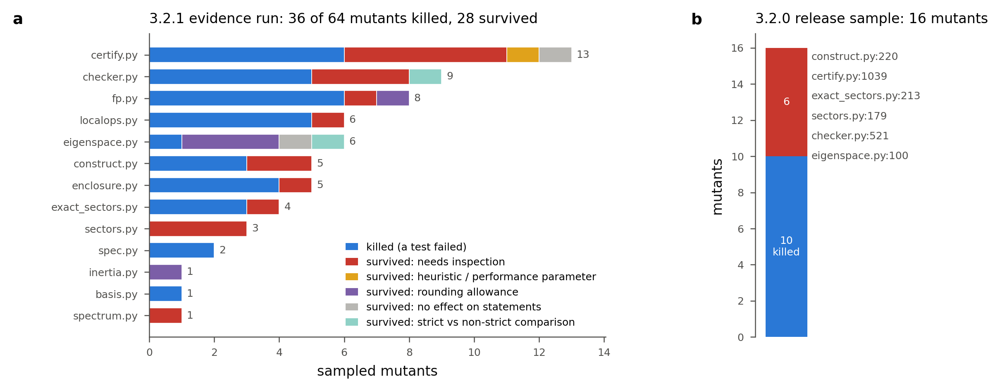
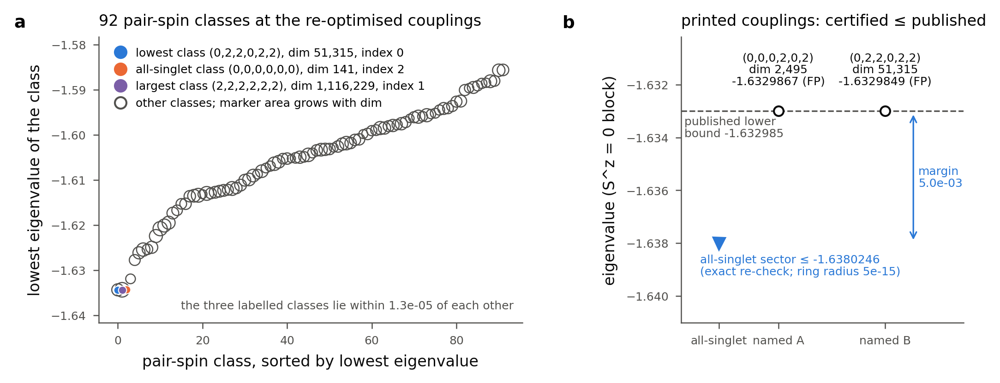
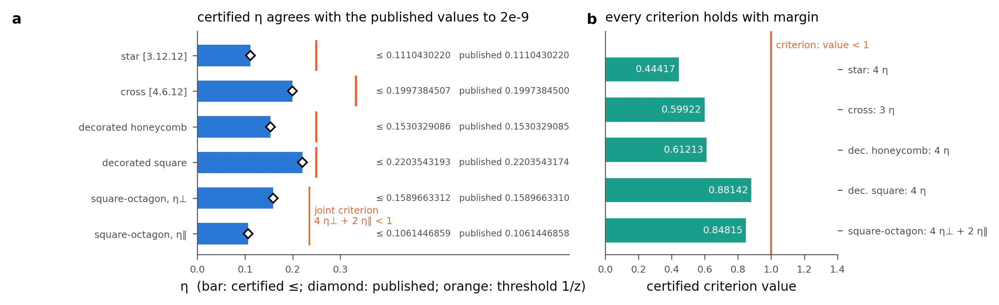

# Figure index

Figures for the manuscript, the consolidated report and this documentation site. Each figure is one script in
`experiments/figures/` (listed in `provenance.NON_COMPUTATIONAL`: the scripts read records and documents and draw;
none computes a bound) and is written as PDF and PNG into this directory together with `<name>.numbers.json`,
the numbers the caption prints. This file is rendered by `experiments/figures/make_index.py` from those files; every
number below was read from the data source named in the entry. Concept figures carry no data. The evidence run is
`run_full_20261105` (Windows, certify-ed 3.2.1), compared with `run_full_20261022` (Windows, certify-ed 3.1.0); the
record directories are those of the project archive (`code/certify-ed-3.1/results/`). To regenerate:
`CERTIFY_RESULTS=<run dir> CERTIFY_RESULTS_B=<second run dir> python experiments/figures/<script>.py`, then
`python experiments/figures/make_index.py`. The smoke test is `tests/test_figures.py`.

Placement in the manuscript and the report: `MANUSCRIPT_PLACEMENT.md`.

This directory holds the record-driven figures regenerated from `run_full_20261105` (Windows, certify-ed 3.2.1); concept figures and document-driven figures are in `docs/figures/` and are not repeated here.

## E1  `fig_failure_matrix.pdf` / `fig_failure_matrix.png`

Fifteen results checked by three practices (E1 record, run_full_20261105 (Windows, certify-ed 3.2.1 evidence run)): 15 cases of which 13 are wrong results, N = 12 sites, K = 5 claimed pairs, residual and agreement tolerances 1e-08. P1 (residual check with the producer's own matrix) flags 2 of them, P2 (recomputation from the intended model) flags 9, certify-ed (P3) leaves 13 not certified (FAILED or INCONCLUSIVE) and localizes the error in 12 cases. The "statement named" column is derived from the diagnosis text of the record (`P3_detail`) by keyword rules, because the record stores per-statement statuses for the correct result only; F12 is a correct result whose single-vector observable is basis dependent and is certified at the multiplet level (S4).

- data source: e1_failure_matrix_20261105_104157/data.json; run run_full_20261022 (Windows, certify-ed 3.1.0 evidence run)
- script: `experiments/figures/fig_failure_matrix.py`

## E2  `fig_cost_memory.pdf` / `fig_cost_memory.png`

Certifier wall time (a) and peak memory (b) against block dimension for the E2 blocks on two versions on one stack: run_full_20261105 (Windows, certify-ed 3.2.1 evidence run) and run_full_20261022 (Windows, certify-ed 3.1.0 run). Filled markers: S3 (completeness) CERTIFIED; open markers: S3 NOT_CHECKED because the factorization did not fit under the 4.5 GiB cap. Plotted: 9 blocks of Windows, certify-ed 3.2.1 (S3 certified for 7 up to dimension 12,870, not checked for 2; 2 further rows hit the experiment's certifier limit and record no time or memory) and 11 blocks of Windows, certify-ed 3.1.0 (S3 certified for 7 up to dimension 12,870, not checked for 4); the largest block has dimension 112,720. Longest certifier run: 831 s (Windows, certify-ed 3.2.1), 793 s (Windows, certify-ed 3.1.0); peak memory 4210 MiB and 4213 MiB. Time is `certifier.total`, memory `certifier.maxrss_mb`, both read from the records.

- data source: e2_cost_20261105_142518/data.json of run_full_20261022 (Windows, certify-ed 3.1.0 evidence run); e2_cost_20261022_200335/data.json of run_full_20261021 (Linux, certify-ed 3.0.0 run)
- script: `experiments/figures/fig_cost_memory.py`

## E3  `fig_two_stack.pdf` / `fig_two_stack.png`

Record-by-record comparison of the two runs (run_full_20261105 against run_full_20261022, `compare_vs_run_full_20261022.csv`): 3,896 leaves of the eleven experiments' data.json files, each in one class. 3,009 are identical, 19 differ by a relative 1e-09 or less, 77 are stack-dependent statistics within 10 %, 13 are floating-point statistics, 19 are the same sentence with run-stack digits, 0 is an extension of the newer version, 448 are random draws (E5 samples, E6 mutants), 18 are differences explained once by path pattern, 226 are timings or memory, 57 are present on one side only; MISMATCH: 10.

- data source: compare_vs_run_full_20261022.csv at the root of run_full_20261022 (Windows, certify-ed 3.1.0 evidence run)
- script: `experiments/figures/fig_two_stack.py`

## E4  `fig_mutation.pdf` / `fig_mutation.png`

Mutation testing. (a) E6 record of run_full_20261105 (Windows, certify-ed 3.2.1 evidence run): 64 sampled mutants over 13 modules, 36 killed and 28 survived (0 timeouts; score 0.562); the baseline suite took 1715 s. Survivors by category of classification.json: 18 need inspection, 1 are heuristic or performance parameters, 5 are rounding allowances in a worst-case bound, 2 have no effect on statements, 2 are strict-versus-non-strict comparisons. (b) The 16-mutant sample on the merged dev/3.2 branch (RESULT_integration_3.2.md): 10 killed; survivors `construct.py:220`, `certify.py:1039`, `exact_sectors.py:213`, `sectors.py:179`, `checker.py:521`, `eigenspace.py:100`. The two samples come from different code and sample sizes; the figure does not compare their scores.

- data source: e6_mutation_20261105_154612/data.json and e6_mutation_20261105_154612/classification.json of run_full_20261022 (Windows, certify-ed 3.1.0 evidence run); RESULT_integration_3.2.md (dev/3.2)
- script: `experiments/figures/fig_mutation.py`

## A1  `fig_crown_sectors.pdf` / `fig_crown_sectors.png`

The pyrochlore-crown S = 1 model (E9 record, run_full_20261105 (Windows, certify-ed 3.2.1 evidence run)). (a) The lowest eigenvalue of each of the 92 pair-spin classes of the S^z = 0 block at the record's re-optimised couplings (c1 = 0.053975, c3 = 0.082883), sorted; marker area grows with the class dimension. The lowest class (0, 2, 2, 0, 2, 2) (dimension 51,315), the all-singlet class (dimension 141) and the largest class (dimension 1,116,229) lie within 1.3e-05 of each other. The record holds the landscape at these couplings only, not at the printed ones. (b) At the printed couplings (c1 = 26733/500000, c3 = 41363/500000, c17 = 11563/100000): the all-singlet-sector eigenvalue is certified ≤ -1.6380246 by the exact re-check (CERTIFIED; radius of the spin-1 ring eigenvalue it rests on 5.1e-15; no floating-point assumption), 5.0e-03 below the published lower bound -1.632985; the two named sectors (0, 0, 0, 2, 0, 2) (dimension 2,495) and (0, 2, 2, 0, 2, 2) (dimension 51,315) have lowest eigenvalues -1.6329867 and -1.6329849, floating-point values without a certified interval in the record, drawn as such.

- data source: e9_pyrochlore_20261105_084835/data.json of run_full_20261022 (Windows, certify-ed 3.1.0 evidence run)
- script: `experiments/figures/fig_crown_sectors.py`

## A2  `fig_aklt_eta.pdf` / `fig_aklt_eta.png`

The Pomata–Wei AKLT lattices (E10 record, run_full_20261105 (Windows, certify-ed 3.2.1 evidence run)). (a) The certified upper bound on η for each lattice (bar) against the published value (diamond); the largest difference is 1.9e-09, so bar end and diamond coincide at this scale and the values are printed. Orange ticks: the gap-criterion threshold 1/z for the lattices whose criterion is η < 1/z (z = 4 for the star, decorated honeycomb and decorated square, z = 3 for the cross); the two square-octagon rows share the joint criterion 4η⊥ + 2η∥ < 1. (b) The certified criterion values: star 0.44417, cross 0.59922, decorated honeycomb 0.61213, decorated square 0.88142, square-octagon 0.84815; every one is below 1. The largest symmetry-adapted block is 4,034 (decorated square, 2368 s).

- data source: e10_aklt_20261105_071106/data.json of run_full_20261022 (Windows, certify-ed 3.1.0 evidence run)
- script: `experiments/figures/fig_aklt_eta.py`
