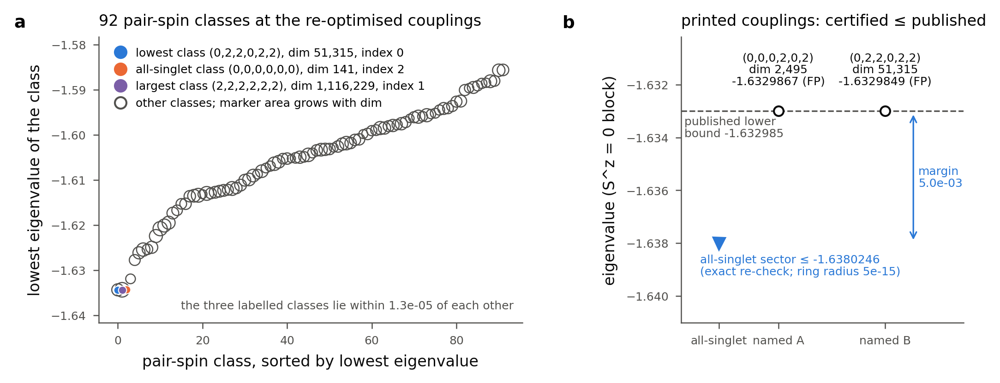

# The pyrochlore crown of Kránitz and Penc

Kránitz and Penc (arXiv:2601.07800) bound the ground-state energy of the Heisenberg antiferromagnet on the pyrochlore
lattice from below by an Anderson-type argument: the lattice Hamiltonian is written as a sum of copies of an 18-site
cluster, the "crown", with cluster couplings constrained by how the copies embed in the lattice, and then
$e_{\rm GS} \ge \lambda_{\min}(H_{\rm crown})$. The authors optimise the couplings and compute $\lambda_{\min}$ with the
Lanczos method, in floating point and with no error bound. The inequality of the paper is only as true as that number.
This document describes what CERTIFY-ED computed for the spin-1/2 and spin-1 crowns, what is certified, what is a
floating-point estimate, and what is taken from the paper. The code is `certify_ed/apps/pyrochlore/` (`model.py`,
`spin_half.py`, `spin_one.py`); the run records are experiment E9 of the 3.1.0 evidence run,
`code/certify-ed/results/run_full_20261022/e9_pyrochlore_20261022_185936/data.json`, and of the 3.2.1 evidence run,
`code/certify-ed/results/run_full_20261105/e9_pyrochlore_20261105_084835/data.json`. The two records agree in all 893
compared leaves except timings (`code/certify-ed/RESULT_evidence_run_3.2.1.md`); every number below is from the 3.2.1
record unless another file is named.

## Why this application

The survey of the literature made on 15 October 2026 found that published proofs (Anderson-type lower bounds on energies
and finite-size criteria for spectral gaps) rest on floating-point eigenvalues with no error control. In such a proof a
certified number changes the logical status of the theorem, not only the confidence in it. Decision D-34 made this kind
of application the main demonstration of the project (`report/07_applications.md`). The crown is a good test because the
cluster is large enough that the eigenvalue must come from an iterative solver (the $S^z = 0$ space has dimension 48 620)
and small enough for exact arithmetic after symmetry reduction.

## What is taken from the paper and what is computed

Taken from the paper: the Anderson decomposition $e_{\rm GS} \ge \lambda_{\min}(H_{\rm crown})$; the embedding
constraint $2c_1 + 4c_3 + 4c_{12} + 2c_{17} = 1$ on the couplings; the reduced model in which $c_3 = c_{12}$ and
$c_5 = 0$ (the paper's "Crown*") with its optimal coupling ratio; and the printed couplings of the spin-1 case
(`manuscript_v4/sections/appC_applications.tex`). The argument of the paper itself is not re-derived. The geometry and
the assignment of couplings in `apps/pyrochlore/model.py` were compared by the independent review of 21 October 2026
with the paper's LaTeX source and with an independently written Hamiltonian, and they match the reduced model (findings
B2-1 and B2-3 of `review/REVIEW_B_applications.md`).

## Spin 1/2: a certified lower bound for the reduced model

**What was done.** The couplings are $c_1 = n_1/10^7$ and $c_3 = n_3/10^7$ with $n_1/n_3$ = 381414/817957, so that $c_1$ =
190707/5000000, $c_3$ = 817957/10000000, and the constraint gives $c_{17}$ = 673379/5000000. The Hamiltonian is
multiplied by $K = 8 \cdot 10^7$, which makes every coupling an integer and satisfies the embedding constraint exactly.
The crown Hamiltonian commutes with total spin; with 18 spins 1/2 the total spin is an integer, so every multiplet has a
member with $S^z = 0$ and $\lambda_{\min}$ is attained in the $S^z = 0$ space of dimension 48 620. Seven $\mathbb{Z}_2$
generators were checked exactly to be symmetries, which splits that space into 128 character blocks, the largest of
dimension 3890. A Lanczos estimate gives $\lambda_{\min} \approx$ -0.550158297907944. At a dyadic shift g just below it,
$g$ = -9230124599117/16777216000000, placed at a relative margin of 1e-10 below the estimate, the exact count of Lemma
11 (with Lemma 12 for the blocks; [theorems.md](../math/theorems.md)) finds 0 eigenvalues below $g - \delta$ in every
block, with $\delta$ = 8.582401785032515e-10. Hence $\lambda_{\min} \ge g - \delta$.

**How the instrument was checked.** The count uses integer arithmetic only: floating-point $LDL^T$ factorizations
propose factors, and the residual of the factors is computed exactly. The symmetry generators are checked to commute
with the integer Hamiltonian exactly. The bound is compared with the floating-point estimate, which it must lie below,
and the review rebuilt the Hamiltonian independently and found $\lambda_{\min} \approx$ -0.5501582979 on the full 48
620-dimensional space and in the sectors (B2-2).

**Result.** $\lambda_{\min}(H_{\rm crown}) \ge$ -0.5501582988212038, an exact rational number (`lower_bound_exact` in
the record) rounded down to -0.550158299 for display, 9.1e-10 below the Lanczos value (`report/07_applications.md`). The
step took 1656 s in the 3.2.1 run and 1959 s in the 3.1.0 run. Earlier certificates, all valid, gave -0.550158313 (17
October 2026, floating-point model), -0.5501583125 (17 October, first exact re-check), -0.55015831338 (18 October, the
generic exact path) and the present value from 21 October onward; they differ only in where the shift was placed and in
$\delta$.

**What it shows and does not show.** The result certifies the paper's reduced-model value -0.550158(2) of its Table I:
the reduced-model crown has no eigenvalue below -0.550158299. It does not certify the paper's headline spin-1/2 bound
-0.549832(8) (abstract and Table I), which comes from the nine-coupling model of the paper's Appendix D; the review
reproduced that value in floating point (-0.54983289) with its own Hamiltonian, and nobody has certified it (finding
B2-4). Certifying it is the same $S^z = 0$ problem without the pair-swap symmetry. The certified bound also rests on
Lemmas 11 and 12 and Proposition 13 of the exact layer, which are marked UNVERIFIED and have no derivation document, so
it is "certified by the implementation, subject to them" (finding RA-20). The embedding constraints on the real
pyrochlore lattice were not checked by the review (B2-5).

## Spin 1: an eigenvalue below the published bound at the printed couplings

**Why.** For spin 1 the paper prints the couplings $c_1$ = 0.053466 and $c_3 = c_{12}$ = 0.082726, states that the
second-neighbour coupling $c_5$ is neglected, and reports the bound -1.632985. A certified upper bound on
$\lambda_{\min}$ at those couplings below -1.632985 would show that the published number is not $\lambda_{\min}$ of the
crown it describes.

**What was done.** The outer-pair spins $\tilde S$ of the crown are conserved, so the Hamiltonian splits into classes
labelled by the six pair spins. In the class in which all six outer pairs are singlets, the Hamiltonian equals
$-12c_1 + c_{17} H_{\rm ring}$, with $H_{\rm ring}$ the spin-1 Heisenberg ring of 6 sites; this identity is a test
(`tests/test_apps.py::test_pyrochlore_spin1_all_singlet_block_is_the_ring`) and was derived independently from the
paper's bond table by the review (B3-1). With the printed values as exact rationals, $c_1$ = 26733/500000, $c_3$ =
41363/500000 and $c_{17}$ = 11563/100000. The lowest eigenvalue of the ring, -8.617423181814216, is enclosed by S2 and
S3 and re-checked by S6 (status CERTIFIED), with exact radius 5.092986520018812e-15 and floating-point radius
1.3545154070606862e-13. The eigenvalue bound $-12c_1 + c_{17}(E_0 + r)$ is evaluated in rationals.

**Result.** The crown at the printed couplings has an eigenvalue at most -1.6380246425131773, below the published
-1.632985 by a margin of 0.0050396425131771765 (the record's `contradiction` is true). The value is bit-identical on the
second machine stack used by the review (finding SS-05 in `report/07_applications.md`).

**The two sectors the paper names (floating point).** The paper names the outer-spin configurations [0,0,0,2,0,2] and
[0,2,2,0,2,2]. In the record these classes (`pair_spins2` = [0,0,0,4,0,4] and [0,4,4,0,4,4], twice the pair spin) have
lowest eigenvalues -1.6329866581559116 (dimension 2495) and -1.632984890229642 (dimension 51 315). These are
floating-point values from a sparse eigensolver, with no interval; they reproduce the published -1.632985 and its level
crossing.

**Interpretation.** At the couplings the paper prints, the published value is reproduced in the two sectors the paper
names, and the only class that lies materially below it is the all-singlet class, which evidently was not included in
the published search (findings B3-2 and B3-3). Including $c_5$ does not rescue the number: the paper says that $c_5$ is
neglected, and a cutting-plane linear program over 34 of the 92 classes bounds the best value over $(c_1, c_3, c_5)$
from above by -1.6342449 (floating point, a valid upper bound because it uses a subset of the classes; finding B3-5).
The earlier reading of the project, that an unprinted coupling $c_5 \ne 0$ was the likeliest cause, was wrong (finding
B3-3), and so was the sentence "we could not reproduce the bound" in the draft note v0.2 to the authors, which was
withdrawn. What follows is that the inequality $e_{\rm GS} \ge$ -1.632985 is not established by the paper's argument at
its printed couplings; it may still hold. Decision D-34 requires that the authors be contacted before anything is said
publicly, and the corrected note v0.3 (`review/note_kranitz_penc_v0.3_proposed.md`) is waiting for Sarang Vehale's check
against the paper (`project_docs/SESSION_HANDOVER_2026-11-06.md` lists it among his open items). Every public document
describes the result as pending the authors' reply.

**Re-optimised couplings (floating point).** With $c_5 = 0$ the code also evaluates all 92 pair-spin classes at
re-optimised couplings $c_1$ = 0.053975140682882464, $c_3$ = 0.08288267138128608 (`apps.pyrochlore.spin_one.landscape`).
The lowest class is [0,4,4,0,4,4] (dimension 51 315) at -1.6343595995104314, followed by the class with all pair spins 2
(dimension 1 116 229) at -1.6343529000425256 and the all-singlet class (dimension 141) at -1.634346435612205. These are
floating-point estimates. A certified max-min over the couplings would need an exact inertia count in the 1 116
229-dimensional class, which lies only about 7e-6 above the minimum (`manuscript_v4/generated_3.1.0/numbers_apps.tex`),
and that is beyond the present code.

**A minor discrepancy in the paper.** The paper prints 1 116 220 for its largest block; the computed dimension is 1 116
229, and the sum over all 729 configurations, 44 152 809, equals the paper's full $S^z = 0$ dimension (finding B1-4).

The figure (`code/certify-ed/docs/figures/fig_crown_sectors.png`, drawn from the 3.1.0 record, whose values are those
quoted above) shows in panel (a) the lowest eigenvalue of each of the 92 pair-spin classes at the re-optimised
couplings, sorted, with the marker area growing with the class dimension; these are floating-point values. Panel (b)
shows, at the printed couplings, the certified all-singlet eigenvalue bound against the published value and the two
named sectors.

## Reproducing

From the root of the code clone (see `docs/math/README.md`): `python run.py --only E9` runs the experiment, and
`certify_ed.apps.pyrochlore.spin_half.certify_crown`, `certify_ed.apps.pyrochlore.spin_one.printed_coupling_check` and
`certify_ed.apps.pyrochlore.spin_one.landscape` are the three entry points (`code/certify-ed/docs/applications.md`). The
full evidence run is `certify-ed reproduce --full --with-mutation --jobs 2 --out results/run_full_<date>`; E9 took 2101
s in the 3.2.1 run.
