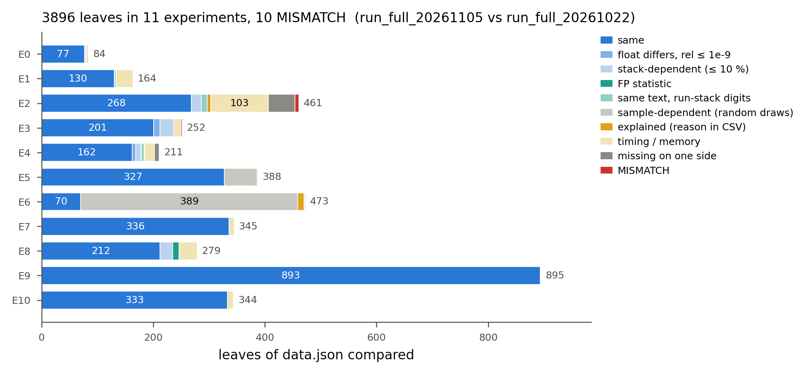

# Record-by-record comparisons between runs

The project's rule for reproduction is that two runs of the same experiments must certify the same statements, while
digits that depend on the floating-point stack may differ (decision D-54; finding SS-19 of the review). The instrument
that applies the rule is `experiments/compare_runs.py`. This document describes how it classifies differences, what
its classes can and cannot detect, and the three comparisons the archive holds: the two-stack comparison of the Linux
3.0.0 run with the Windows 3.1.0 run, the comparison of the 3.2.1 run with the 3.1.0 run, and the comparison of the
3.2.1 run with the 3.2.0 run. Every count below is computed from the CSV files named in each section, which the script
wrote; where a result file states the same count, it agrees.

## How the comparison works

`python experiments/compare_runs.py RUN_A RUN_B OUT.csv` flattens the two `data.json` files of every experiment
present in both runs into leaves (a path and a value) and classifies each leaf. In the CSV files of the archive,
`value_A` is the older run named in the file name and `value_B` is the run in whose directory the file lies. The
classes are checked in this order. A leaf is `same` when the two values are equal. It is `sample-dependent` when its
path lies in a record that depends on a random sample (the seeded ARPACK runs of E5 and the mutant sample of E6),
whose rows are compared through invariants instead (for example "no incorrect result certified"). It is `explained`
when its path matches a rule of the table `EXPLAINED`, which carries a sentence of explanation. It is `timing` when
its name says it is a time. It is `fp-statistic` for descriptive floating-point statistics such as residual ratios and
the slopes and slowdowns of E8, which never decide the result. It is `stack-dependent` when it is a bound derived from
floating-point quantities (β, δ, radii, exact rationals of bounds) and the two values differ by at most `STACK_RTOL` =
0.10, measured as the absolute difference divided by max(1, the absolute value of A). Strings that are equal once
their numbers are masked are `text-numbers`; a string that extends the other is `extended`; a field present in one
record only is `missing`. Other numbers are `float-differs` when their difference divided by max(1, |A|) is at most
1e-9. Everything else is a `MISMATCH`: every status, count, boolean, pivot sign and statement string must agree
exactly.

Two properties of the instrument limit what a comparison shows. First, because the tolerance of `stack-dependent` is
divided by max(1, |A|), a bound smaller than 1 is in effect compared with an absolute tolerance of 0.10: the W4 radii
of E4, 4.905e-10 in the 3.1.0 run and 3.0335e-10 in the 3.2.1 run for the Heisenberg chain, are classed as
stack-dependent although they differ in the first digit. The class therefore confirms that a small bound stays small,
not that it is reproduced to some relative accuracy; what is compared strictly is the status the bound supports.
Second, an `EXPLAINED` rule matches by path, not by the reason in its sentence. The E2 rule matches every S3 summary
string and explains it by the wording of a NOT_CHECKED reason on different platforms; in the comparison of 3.2.1 with
3.1.0 it also matched six CERTIFIED summaries that differ in another way. Those six leaves were read one by one for
this document. In each the certified count is equal, and so is the printed gap in five of them (for example "exactly 5
eigenvalues below -5.336405258; certified gap to the next >= 2.222e-01" against the same sentence with the shift
-5.336405253); the gap of the 4x4 point (row 9) moves from 8.285e-02 to 8.286e-02. The printed shift differs from the
seventh to the tenth significant digit in four rows and from the sixth in two (row 2: -6.321133961 against
-6.321129354; row 9: -8.803591848 against -8.803586128). The statuses of those points are separate leaves and are
compared strictly.

## Two stacks: the 3.0.0 run on Linux against the 3.1.0 run on Windows

The standing rule asks that the statements of every experiment reproduce on a second stack. For 3.1.0 the rule was met
by the Linux 3.0.0 run `run_full_20261021` against the Windows 3.1.0 run `run_full_20261022`, with the same library
versions (decision D-54). The comparison is
`code/certify-ed/results/run_full_20261022/compare_vs_run_full_20261021.csv`.

| Experiment | leaves | same | float-differs | stack-dependent | fp-statistic | text-numbers | extended | sample-dependent | explained | timing | missing | MISMATCH |
|---|---|---|---|---|---|---|---|---|---|---|---|---|
| E0 | 84 | 75 | 0 | 2 | 3 | 0 | 0 | 0 | 0 | 4 | 0 | 0 |
| E1 | 164 | 123 | 5 | 1 | 1 | 3 | 1 | 0 | 0 | 30 | 0 | 0 |
| E2 | 459 | 220 | 15 | 22 | 0 | 15 | 0 | 0 | 4 | 112 | 71 | 0 |
| E3 | 252 | 97 | 89 | 46 | 6 | 1 | 0 | 0 | 0 | 13 | 0 | 0 |
| E4 | 202 | 96 | 50 | 10 | 7 | 5 | 0 | 0 | 7 | 17 | 10 | 0 |
| E5 | 388 | 157 | 9 | 0 | 0 | 0 | 0 | 208 | 0 | 2 | 12 | 0 |
| E6 | 473 | 77 | 0 | 0 | 0 | 0 | 0 | 381 | 11 | 2 | 2 | 0 |
| E7 | 345 | 320 | 12 | 4 | 0 | 0 | 0 | 0 | 0 | 9 | 0 | 0 |
| E8 | 279 | 174 | 1 | 54 | 15 | 0 | 0 | 0 | 0 | 35 | 0 | 0 |
| E9 | 895 | 766 | 93 | 4 | 0 | 0 | 0 | 0 | 0 | 2 | 30 | 0 |
| E10 | 344 | 319 | 14 | 0 | 0 | 0 | 0 | 0 | 0 | 11 | 0 | 0 |
| all | 3885 | 2424 | 288 | 143 | 32 | 24 | 1 | 589 | 22 | 237 | 125 | 0 |

There is no MISMATCH leaf. The 22 explained leaves fall into four groups, as
`code/certify-ed/RESULT_evidence_run_3.1.0.md` lists them. In E2, four S3 summary strings differ: two NOT_CHECKED
reason texts name the allocation failure as each platform reports it (`MemoryError` against SuperLU's error code), and
two CERTIFIED summaries differ in the printed shift. In E4, four leaves are the quantum numbers of a degenerate level
at the cut of W1, where which member of the multiplet is listed is a tie. In E4, three leaves concern the W4 case
"J1-J2 square 4x4, J2 = 0.5": its S3 is NOT_CHECKED on Linux and CERTIFIED (gap at least 0.2870406984424196) on
Windows, because the factorization fits under a cap on committed memory (a Windows job object) and not under a cap on
address space (Linux `RLIMIT_AS`) of the same size. This is a status that differs between the stacks, and the
explanation is a property of the memory caps of the experiment, not of the certifier; the result file's sentence that
every status agrees has to be read with that exception. In E6, eleven leaves are the mutation sites and the scores,
which belong to two different versions of the code (30 of 64 killed on 3.0.0, 38 of 64 on 3.1.0) and are a version
difference, not a reproduction failure. The 125 missing leaves are fields added in 3.1.0 (E2 71, E4 10, E5 12, E6 2,
E9 30). The 288 float-differs leaves agree to 1e-9.

## 3.2.1 against 3.1.0 on the same stack

The comparison of the 3.2.1 evidence run with the cited 3.1.0 run, on the same machine and library versions, is
`code/certify-ed/results/run_full_20261105/compare_vs_run_full_20261022.csv`. It decides whether the 3.2 work changed
any statement of 3.1.0 (the revisit clause of decision D-60).

| Experiment | leaves | same | float-differs | stack-dependent | fp-statistic | text-numbers | extended | sample-dependent | explained | timing | missing | MISMATCH |
|---|---|---|---|---|---|---|---|---|---|---|---|---|
| E0 | 84 | 77 | 0 | 2 | 1 | 0 | 0 | 0 | 0 | 4 | 0 | 0 |
| E1 | 164 | 130 | 1 | 0 | 0 | 3 | 0 | 0 | 0 | 30 | 0 | 0 |
| E2 | 461 | 268 | 0 | 18 | 0 | 11 | 0 | 0 | 6 | 103 | 48 | 7 |
| E3 | 252 | 201 | 11 | 25 | 0 | 0 | 0 | 0 | 0 | 13 | 0 | 2 |
| E4 | 211 | 162 | 7 | 9 | 1 | 5 | 0 | 0 | 1 | 17 | 9 | 0 |
| E5 | 388 | 327 | 0 | 0 | 0 | 0 | 0 | 59 | 0 | 2 | 0 | 0 |
| E6 | 473 | 70 | 0 | 0 | 0 | 0 | 0 | 389 | 11 | 2 | 0 | 1 |
| E7 | 345 | 336 | 0 | 0 | 0 | 0 | 0 | 0 | 0 | 9 | 0 | 0 |
| E8 | 279 | 212 | 0 | 23 | 11 | 0 | 0 | 0 | 0 | 33 | 0 | 0 |
| E9 | 895 | 893 | 0 | 0 | 0 | 0 | 0 | 0 | 0 | 2 | 0 | 0 |
| E10 | 344 | 333 | 0 | 0 | 0 | 0 | 0 | 0 | 0 | 11 | 0 | 0 |
| all | 3896 | 3009 | 19 | 77 | 13 | 19 | 0 | 448 | 18 | 226 | 57 | 10 |

There are 10 MISMATCH leaves. Each is a documented change of 3.2, as `code/certify-ed/RESULT_evidence_run_3.2.1.md`
states, and each was checked against the CSV for this document.

| Leaves | 3.1.0 value | 3.2.1 value | Cause |
|---|---|---|---|
| E2 `rows[0,1,2,4,5,6,9].certifier.fill_nnz` (7 leaves) | for example 97156 | for example 96232 | the sparse inertia record counts the fill as 2 nnz(L) minus n, one factor of the symmetric factorization, instead of nnz(L) plus nnz(U) (scale track, roadmap item D-01; `inertia.py`) |
| E3 `c_gap[2].certified_lb` | -4.0575197784639645 | -4.057519773307361 | the certified lower bound on the next eigenvalue rises by 1.271e-09 relative, because the measured backward error β of the sparse factorization is smaller than the a-priori bound of 3.1 (`docs/proofs/D-01_sparse-residual.md`) |
| E3 `c_gap[7].certified_lb` | -13.199333093449987 | -13.199333079863882 | the same, 1.029e-09 relative |
| E6 `copy.files` | 215 | 915 | the number of files that git tracks in the repository: 215 at `v3.1.0` and 915 at `v3.2.1` (counted with `git ls-tree` for this document); both records give `copy.source` as `git ls-files`, so the mutants received every tracked file in both runs |

`code/certify-ed/RESULT_evidence_run_3.2.1.md` explains the E6 leaf differently, as the mutation driver copying every
tracked file instead of five folders; that change was made for 3.1.0 after its first attempt
(`docs/project/failures/04_failed_runs_and_attempts.md`), so both compared runs already copied every tracked file, and the
count differs because the repository grew. The two E3 bounds are tighter, and a tighter bound is admitted only on the
strength of a proof document (decision D-59). The document `docs/proofs/D-01_sparse-residual.md` has an independent
verdict of AGREES-WITH-REMARKS and Sarang's check is pending; decision D-61 records that if his check finds a gap,
these two bounds revert to the a-priori bound and a 3.2.2 needs its own run.

The other classes are explained as follows. The 19 float-differs leaves (E1 1, E3 11, E4 7) are radii or bounds that
changed by less than 1e-9 relative; they moved with the Theorem 2 constant ρ (cluster radii can only shrink,
`docs/proofs/thm2_polar-factor.md`) and with the INT-05 additive terms (radii can only grow, by multiples of 2^-1074).
The 18 explained leaves are the six E2 summaries described above, the W4 gap of the J2 = 0.5 square in E4, and the
eleven E6 mutation sites and scores of two versions (38 of 64 killed on 3.1.0, 36 of 64 on 3.2.1). The 57 missing
leaves are 48 in E2, for the two points (rows 3 and 10) whose 3.2.1 certifier hit the experiment's 900 s limit and
recorded only an error and the certificate without S3, and 9 in E4, the Davis-Kahan fields of W2 added in 3.2. None
changes a status. The certified application results are unchanged: E9 has 893 of its 895 leaves identical and E10 333
of its 344, the remaining leaves being timings, so the exact lower bound -0.5501582988212038 for the S = 1/2 reduced
crown, the upper bound -1.6380246425131773 for S = 1 at the printed couplings, and every certified η are the same. E7
has 336 identical leaves and 9 timings.

Figure: the classes of the 3896 leaves of the comparison of the 3.2.1 run with the 3.1.0 run, per experiment, drawn by
`experiments/figures/fig_two_stack.py` from `compare_vs_run_full_20261022.csv` (copied from
`code/certify-ed/docs/figures_run_3.2.1/`, where `INDEX.md` gives the numbers of its caption with their data sources).

## 3.2.1 against 3.2.0

The comparison of the two 3.2 runs is `code/certify-ed/results/run_full_20261105/compare_vs_run_full_20261104.csv`.
Its purpose is to show that the only change of 3.2.1, the default thread count of the residual, does not change any
bound.

| Experiment | leaves | same | float-differs | stack-dependent | fp-statistic | text-numbers | extended | sample-dependent | explained | timing | missing | MISMATCH |
|---|---|---|---|---|---|---|---|---|---|---|---|---|
| E0 | 84 | 80 | 0 | 0 | 0 | 0 | 0 | 0 | 0 | 4 | 0 | 0 |
| E1 | 164 | 133 | 0 | 0 | 0 | 1 | 0 | 0 | 0 | 30 | 0 | 0 |
| E2 | 417 | 274 | 0 | 0 | 0 | 0 | 1 | 0 | 0 | 94 | 48 | 0 |
| E3 | 252 | 239 | 0 | 0 | 0 | 0 | 0 | 0 | 0 | 13 | 0 | 0 |
| E4 | 211 | 181 | 0 | 0 | 0 | 0 | 0 | 0 | 0 | 14 | 16 | 0 |
| E5 | 388 | 350 | 0 | 0 | 0 | 0 | 0 | 36 | 0 | 2 | 0 | 0 |
| E6 | 473 | 407 | 0 | 0 | 0 | 0 | 0 | 64 | 0 | 2 | 0 | 0 |
| E7 | 345 | 336 | 0 | 0 | 0 | 0 | 0 | 0 | 0 | 9 | 0 | 0 |
| E8 | 279 | 246 | 0 | 0 | 0 | 0 | 0 | 0 | 0 | 33 | 0 | 0 |
| E9 | 895 | 893 | 0 | 0 | 0 | 0 | 0 | 0 | 0 | 2 | 0 | 0 |
| E10 | 344 | 333 | 0 | 0 | 0 | 0 | 0 | 0 | 0 | 11 | 0 | 0 |
| all | 3852 | 3472 | 0 | 0 | 0 | 1 | 1 | 100 | 0 | 214 | 64 | 0 |

There is no MISMATCH, no float difference and no stack-dependent leaf: 3472 leaves are identical. The 64 missing
leaves are 48 in E2 and 16 in E4. In E2 they belong to the chain blocks N = 22 and N = 24 at k = 0 (rows 7 and 8),
where the 3.2.0 certifier hit the 900 s limit and the 3.2.1 certifier finished with S3 NOT_CHECKED under the memory
cap. In E4 they are the fourth W4 case and the elapsed-time field, which the crashed 3.2.0 record lacks.
`code/certify-ed/RESULT_evidence_run_3.2.1.md` attributes all 64 missing leaves to E4; the CSV shows the split given
here.
