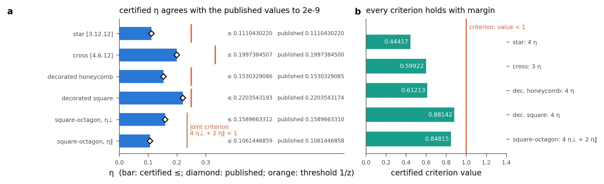

# E10: the AKLT gap criteria of Pomata and Wei in exact arithmetic

## Why this experiment

Pomata and Wei (arXiv:1911.01410) prove that two-dimensional AKLT models on several lattices have a spectral gap,
using a criterion that a quantity η, computed from a finite subgraph, stays below a threshold such as 1/4. The proof
is valid only if the computed η really is below the threshold, and the paper computes η in floating point. Decision
D-36 made the criteria the second application of certification to the numerical lemmas of a published proof: bound η
from above in exact arithmetic, so that the criterion holds with no floating-point assumption. The proof also needs a
kernel lemma (the ground space of the subgraph is spanned by the valence-bond-solid states), which decision D-37
treats as a standard lemma, re-derived and listed for Sarang's check, and confirms by exact computation where the size
allows.

## Design

The script is `experiments/e10_aklt.py`, using `certify_ed.apps.aklt`. For each lattice the union of two overlapping
subgraphs is built from the paper's text (`apps/aklt/lattices.py`); because the geometry had to be inferred, each was
first confirmed by reproducing the paper's η to 7 to 10 digits (decision D-36). η is bounded through a matrix pencil
whose inertia decides whether η² is below a trial value. For the decorated lattices the pencil was first certified
through a bordered matrix whose inertia is additive (Haynsworth), in fully reduced boundary coordinates and split into
exact blocks by the lattice mirror and the spin flip, because the adjugate scaling used before for the star,
square-octagon and cross lattices produced determinants of hundreds of digits (decision D-38); this cut the largest
exactly checked block of the decorated square from 8842 to 4034. Since 3.0.0 one such pipeline serves every lattice
(decision D-43). Every inertia count is exact: floating point proposes the factorization and integer arithmetic checks
it, and a perturbation argument with certified constants transfers the bound. The threshold is placed at η_float²(1 +
1e-9), so the certified η exceeds the floating-point value by a few parts in 10^9 (decision D-45). The kernel lemma is
checked exactly for the subgraphs small enough: the nullity over the rationals is at most the nullity modulo the prime
2147483647 in every S^z block, and the VBS ranks are computed exactly (decision D-37).

## How the instrument is checked

The reproduction of the published η before certification is the check that the geometry is the paper's. A negative
control places the threshold below η², and it is correctly not certified (decision D-36). The kernel check compares
two exact quantities computed by different methods, the modular nullity and the VBS rank. All arithmetic of the
certificate is exact, so a second stack must reproduce the same numbers bit for bit, which the two-stack comparison
checks (`03_comparisons.md`).

## Results

The values are from the E10 record of the 3.2.1 run, `lattices` of
`code/certify-ed/results/run_full_20261105/e10_aklt_20261105_071106/data.json`; the 3.0.0 and 3.1.0 runs give the same
η upper bounds to the digits printed in `code/certify-ed/RESULT_evidence_run_3.1.0.md`, and the comparison of 3.2.1
with 3.1.0 finds 333 of the 344 leaves of E10 identical and the other 11 timings.

| Lattice | Pencil size | Largest exact block | η upper bound (certified) | η published | Criterion | Holds |
|---|---|---|---|---|---|---|
| `star` | 128 | 70 | 0.11104302202338649 | 0.111043022 | η < 1/4 | True |
| `square_octagon_par` | 1024 | 420 | 0.10614468587603454 | 0.1061446858 | enters 4η⊥ + 2η∥ < 1 | see the combined criterion |
| `square_octagon_perp` | 1024 | 420 | 0.15896633115208958 | 0.158966331 | enters 4η⊥ + 2η∥ < 1 | see the combined criterion |
| `cross` | 4096 | 1584 | 0.19973845072185567 | 0.19973845 | η < 1/3 | True |
| `decorated_honeycomb` | 2592 | 673 | 0.15303290857599913 | 0.1530329085 | η < 1/4 | True |
| `decorated_square` | 27648 | 4034 | 0.22035431930729685 | 0.2203543174 | η < 1/4 | True |

For the square-octagon lattice the criterion combines the two overlaps: 4η⊥ + 2η∥ is at most 0.8481546963604274, below
1, so the criterion holds (`square_octagon` of the record; the macro `SOsum` prints 0.84816). Every criterion holds.
The certified upper bounds lie above the published values by at most 2.0e-9 (macro `AKLTMaxExcessObserved`), the
margin left by the threshold placement, and the criterion values (η against its threshold) range from 0.44 to 0.89 of
the threshold (macros `AKLTCritMinDown` and `AKLTCritMax`; the 3.0.0 macro printed the smallest as 0.45 against a
table value of 0.44418, finding IMP-28 of `review/REVIEW_impl.md`, and 3.1.0 added the rounded-down macro). The
decorated square, the largest case, used a largest exact block of 4034 (unreduced 8842) and took 39 min in 3.2.1.

The kernel checks of the record:

| Subgraph | Sites | Dimension | VBS rank | Nullity mod p (upper bound) | Kernel equals VBS range |
|---|---|---|---|---|---|
| star | 6 | 4096 | 16 | 16 | True |
| square_octagon | 8 | 65536 | 64 | 64 | True |
| decorated_honeycomb | 9 | 62208 | 36 | 36 | True |
| decorated_honeycomb | 9 | 62208 | 36 | 36 | True |

The kernel equals the VBS range in every subgraph checked. The cross (16.7 million states) and the decorated square
(4.1 million) are beyond the exact kernel check and rely on the lemma alone (decision D-37).

Figure: certified upper bounds on η against the published values and the thresholds (a), and the criterion value of
each lattice against 1 (b), drawn by `experiments/figures/fig_aklt_eta.py` from the E10 record (copied from
`code/certify-ed/docs/figures_run_3.2.1/`, where `INDEX.md` gives the numbers of its caption with their data sources).

## What the result shows and does not show

E10 shows that the η criteria of Pomata and Wei hold for the star, square-octagon, cross, decorated-honeycomb and
decorated-square lattices with certified upper bounds on η in exact arithmetic, and that the kernel lemma holds by
exact computation for the star, square-octagon and decorated-honeycomb subgraphs. It does not certify the honeycomb
lattice, whose space has dimension 2^26 and whose final bound needs three further numerical constants, each its own
eigenvalue lemma (decision D-36). The kernel lemma itself is a re-derived standard result awaiting Sarang's check
(D-12), and the gap theorem that turns the criterion into a gap is the paper's and is not re-derived here.
