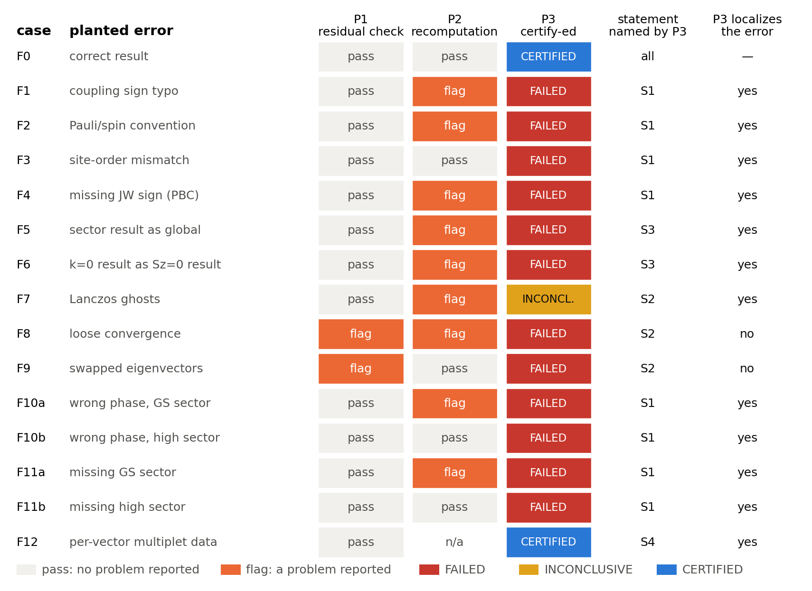

# E1: planted errors and what each practice catches

## Why this experiment

The second SciPost report on v1 said that the gap between what practitioners already do and what certification adds
was not demonstrated (the referee history recorded under decision D-49). E1 answers that objection directly: it
applies three practices to the same set of erroneous results and records which practice detects which error. If
ordinary practice had caught every error, the certificate would have added nothing, and the paper's case would have
had to rest on other grounds.

## Design

The script is `experiments/e1_failure_matrix.py`. The model is the Heisenberg chain of 12 sites and its symmetry
sectors. There are 15 results: F0 is correct, F12 is correct but quotes a single-vector observable of a degenerate
level, and 13 are wrong through ordinary mechanisms. F1 to F4 are input and convention errors (a coupling sign, the
Pauli against the spin convention, reversed site order, a missing Jordan-Wigner sign at the periodic boundary); F5 and
F6 are scope errors (a sector result reported as global); F7 is Lanczos ghosts from 400 steps without
reorthogonalisation; F8 and F9 are accuracy errors (a loose tolerance, swapped eigenvectors); F10a and F10b are phase
errors in sector bases; F11a and F11b omit a sector block. Three practices are applied. P1 is the producer's own
residual check with the producer's matrix (largest relative residual at most 1e-8). P2 is recomputation with QuSpin
from the intended model. P3 is the certificate, with a specification written independently of the producer.

## How the instrument is checked

F0 is the positive control: every practice must accept it, and P3 must certify every statement. F12 is a control of a
different kind: the result is correct, and the experiment checks that the certificate reports the basis-independent
quantity tr(PO) for the degenerate level while the single-vector values spread. The planted errors are realistic
mechanisms rather than random perturbations, so that a practice is credited only for errors that occur in practice;
the objection that they were chosen to suit the method is answered separately by E5, an error nobody planted (decision
D-27).

## Results

The outcome per case is identical in the 3.0.0, 3.1.0 and 3.2.1 runs (the `P1_residual_only`, `P2_recomputation`,
`P3_certify_ed` and `P3_localizes` fields of the three E1 records agree for every case). The table is from the E1
record of the 3.2.1 run, `code/certify-ed/results/run_full_20261105/e1_failure_matrix_20261105_104157/data.json`;
"passes" means the practice accepts the result, "flags" that it rejects it.

| Case | Mechanism | P1 residual check | P2 recomputation | P3 certify-ed | error located in a term, bond or factor |
|---|---|---|---|---|---|
| F0 correct result | reference run, no error | passes | passes | all CERTIFIED | not applicable |
| F1 coupling sign typo | static list: J -> -J on one zz bond | passes | flags | FAILED | yes |
| F2 Pauli/spin convention | couplings for S=sigma/2 used with Pauli basis | passes | flags | FAILED | yes |
| F3 site-order mismatch | producer numbers sites right-to-left; field on site 0 | passes | passes | FAILED | yes |
| F4 missing JW sign (PBC) | wrap-around hopping built without the fermionic string | passes | flags | FAILED | yes |
| F5 sector result as global | Sz=0 block's lowest states reported as the model's lowest states | passes | flags | FAILED | yes |
| F6 k=0 result as Sz=0 result | lowest k=0 states reported as the lowest states of the Sz=0 block | passes | flags | FAILED | yes |
| F7 Lanczos ghosts | 400 Lanczos steps without reorthogonalisation | passes | flags | S2=INCONCLUSIVE, S3=INCONCLUSIVE | yes |
| F8 loose convergence | eigsh tol=1e-4 reported with 10 digits (target 1e-10) | flags | flags | FAILED | no |
| F9 swapped eigenvectors | vectors of levels 0 and 1 interchanged (post-processing) | flags | passes | FAILED | no |
| F10a wrong phase, GS sector | sign error in one momentum-basis vector of the ground-state sector | passes | flags | FAILED | yes |
| F10b wrong phase, high sector | same bug in the (Nup=2, k=0) block (no states below the cut) | passes | passes | FAILED | yes |
| F11a missing GS sector | ground-state (Nup,k) block omitted from the pooled list | passes | flags | FAILED | yes |
| F11b missing high sector | fully polarised block omitted (no states below the cut) | passes | passes | FAILED | yes |
| F12 per-vector multiplet data | <psi|Sz0 Sz1|psi> quoted for one vector of a degenerate level | passes | not applied | CERTIFIED | yes |

| Quantity | 3.0.0 `run_full_20261021` | 3.1.0 `run_full_20261022` | 3.2.1 `run_full_20261105` |
|---|---|---|---|
| erroneous results | 13 | 13 | 13 |
| flagged by P1 | 2 | 2 | 2 |
| missed by P1 | 11 | 11 | 11 |
| flagged by P2 | 9 | 9 | 9 |
| missed by P2 | 4 | 4 | 4 |
| FAILED under P3 (all 13 detected) | 12 | 12 | 12 |
| F2: global factor found by the fit | 4.000 | 4.000 | 4.000 |
| F12: bound on the certified tr(PO) | 2.1e-12 | 2.1e-12 | 9.1e-13 |
| F12: spread of the single-vector values | 0.059 | 0.059 | 0.059 |

The values are the macros of `code/certify-ed/results/<run>/paper/numbers.tex` of each run. P1 flags only the two
accuracy errors F8 and F9, because a residual check with the producer's own matrix cannot see a wrong matrix, a wrong
sector or a missing block. P2 flags 9 of 13 and misses F3, F9, F10b and F11b. P2 compares eigenvalues, and in these
four cases the reported eigenvalues are those of the intended model: reversing the site order maps the chain with a
field on site 0 to a unitarily equivalent chain with the same spectrum (F3), swapped eigenvectors leave the
eigenvalues unchanged (F9), and the wrong phase and the omitted block lie in sectors with no state below the cut
(F10b, F11b). This reading of the four mechanisms is ours; the record stores only the outcomes. P3 detects all 13: 12
as FAILED and F7 (Lanczos ghosts) as INCONCLUSIVE in S2 and S3, because duplicated Ritz values are true approximations
of an eigenvalue and the error is that they are not distinct. For every model error P3 also names where it lies: a
term, a bond, or, for F2, a global factor of exactly 4.000. The bound on F12's certified tr(PO) shrank from 2.1e-12 to
9.1e-13 in 3.2.1, a radius that moved with the Theorem 2 constant ρ; the case's statuses are unchanged.

Figure: the outcome of each practice on each case of E1 in the 3.2.1 run, drawn by
`experiments/figures/fig_failure_matrix.py` from the E1 record (copied from `code/certify-ed/docs/figures_run_3.2.1/`,
where `INDEX.md` gives the numbers of its caption with their data sources). The column "statement named" is derived by
the script from the diagnosis text of the record, because the record stores per-statement statuses only for the
correct result.

## What the result shows and does not show

E1 shows that, on these 13 mechanisms, the certificate detects errors that the two common practices miss, and that it
says where a model error lies. It does not measure how often such errors occur in published work; that would need the
practice survey (decision D-50), which counts what papers report, not what errors they contain. The cases are on one
small chain; the planted-error corpus (`docs/project/software/08_tests_and_mutation.md`) extends the same idea to 60 cases on
three model families.
