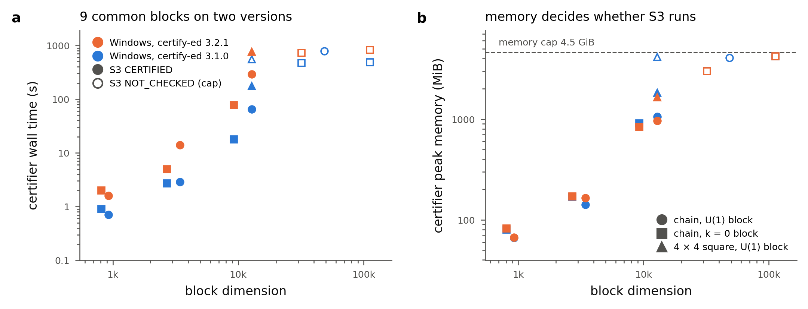

# E2: cost and reach of S1 to S3

## Why this experiment

A certificate that costs much more than the computation it certifies will not be used, and a statement that silently
stops working beyond some size is worse than one that says where it stops. Decision D-20 chose Sylvester inertia with
a sparse factorization for S3 and stated the expected limit, a dimension of about 1e4 under 4.5 GiB of memory, which
had to be measured rather than asserted. E2 measures the cost of S1, S2 and S3 up to the point of failure and records
the failure points, so that the paper can state the reach of each statement and a user can predict the cost of a run
(the cost model of `certify_ed/cost.py` is fitted to the E2 records of the 3.1.0 run).

## Design

The script is `experiments/e2_cost.py`. Each data point runs two fresh processes: a producer, in which QuSpin builds
the basis and the Hamiltonian and computes the lowest eigenpairs with `eigsh` and writes them to a file, and a
certifier, which loads the result and runs `certify()` with S1 to S4 and reports the time of each statement and the
peak resident memory. The points are Heisenberg chains in S^z = 0 blocks (N = 12 to 18) and in (S^z = 0, k = 0) blocks
(N = 16 to 24), and the 4x4 square at J2 = 0 and 0.5. Every child runs with one BLAS thread and a memory cap of 4.5
GiB, an address-space limit on Linux and a job object on Windows (`experiments/portable.py`), and the certifier has a
limit of 900 s per point; the settings are stored in the record (`settings`: `threads` 1, `memory_cap_GiB` 4.5,
`producer_timeout_s` 1800, `certifier_timeout_s` 900). When S3 cannot run, the certifier is also run without S3, so
that S1 and S2 are measured alone.

## How the instrument is checked

The cost is measured against a reference that a reader can interpret: the producer's own solve, run in the same way. A
factorization that does not fit must be detected when its allocation fails and reported as NOT_CHECKED, never as an
uncertified count (decision D-20), so the experiment also checks that the failure mode is the designed one. The memory
cap makes the failure point a property of the cap rather than of the machine's free memory, and the cap mechanism is
recorded per point because the two mechanisms behave differently (`03_comparisons.md`).

## Results

| Quantity | 3.0.0 `run_full_20261021` | 3.1.0 `run_full_20261022` | 3.2.1 `run_full_20261105` |
|---|---|---|---|
| largest S2 time (s) | 0.05 | 0.13 | 0.14 |
| largest S1 time for S^z blocks (s) | 0.58 | 1.55 | 3.36 |
| dimension of that block | 48,620 | 48,620 | 48,620 |
| S1 of the N = 22 momentum block, audited in its parent block (s) | 19 | 36 | 59 |
| largest dimension with S3 feasible | 12,870 | 12,870 | 12,870 |
| one factorization, chain N = 16 (s) | 9 | 13 | 99 |
| one factorization, 4x4 square (s) | 24 | 33 | 251 |
| fitted exponent of the fill against the dimension | 2.0 | 2.0 | 2.0 |
| points in the fit | 3 | 3 | 3 |
| time to the failed allocation (s) | 494 | 756 | 728 |
| dimension of that failure | 48,620 | 48,620 | 112,720 |
| points that hit the 900 s certifier limit | not recorded | not recorded | 2 |

The values are the macros of `code/certify-ed/results/<run>/paper/numbers.tex` of each run ("not recorded" means that
the number scripts of that run did not write the macro). The per-point outcomes, read from the E2 record of each run
(`rows[*].certifier` and `rows[*].certifier_without_S3` of `data.json`), are as follows; each cell gives the S3
status, the certifier's wall time and its peak memory.

| Point | Dimension | 3.0.0 (Linux) | 3.1.0 | 3.2.0 | 3.2.1 |
|---|---|---|---|---|---|
| chain N=12 u1 J2=0.0 | 924 | CERTIFIED, 0.1 s, 115 MiB | CERTIFIED, 0.7 s, 66 MiB | CERTIFIED, 7.5 s, 67 MiB | CERTIFIED, 1.6 s, 67 MiB |
| chain N=14 u1 J2=0.0 | 3432 | CERTIFIED, 0.4 s, 164 MiB | CERTIFIED, 2.9 s, 142 MiB | CERTIFIED, 40.1 s, 166 MiB | CERTIFIED, 14.0 s, 165 MiB |
| chain N=16 u1 J2=0.0 | 12870 | CERTIFIED, 9.6 s, 1101 MiB | CERTIFIED, 65.5 s, 1057 MiB | CERTIFIED, 243.8 s, 1612 MiB | CERTIFIED, 294.6 s, 964 MiB |
| chain N=18 u1 J2=0.0 | 48620 | NOT_CHECKED, 494.8 s, 4072 MiB | NOT_CHECKED, 793.0 s, 4051 MiB | certifier stopped (timeout after 900s); without S3: S2 CERTIFIED, 16.3 s | certifier stopped (timeout after 900s); without S3: S2 CERTIFIED, 4.7 s |
| chain N=16 k0 J2=0.0 | 810 | CERTIFIED, 0.3 s, 115 MiB | CERTIFIED, 0.9 s, 80 MiB | CERTIFIED, 6.6 s, 81 MiB | CERTIFIED, 2.0 s, 82 MiB |
| chain N=18 k0 J2=0.0 | 2704 | CERTIFIED, 1.2 s, 182 MiB | CERTIFIED, 2.7 s, 170 MiB | CERTIFIED, 22.3 s, 170 MiB | CERTIFIED, 5.0 s, 171 MiB |
| chain N=20 k0 J2=0.0 | 9252 | CERTIFIED, 10.4 s, 1009 MiB | CERTIFIED, 17.8 s, 911 MiB | CERTIFIED, 86.8 s, 1378 MiB | CERTIFIED, 77.8 s, 835 MiB |
| chain N=22 k0 J2=0.0 | 32066 | NOT_CHECKED, 325.5 s, 3324 MiB | NOT_CHECKED, 471.1 s, 2988 MiB | certifier stopped (timeout after 900s); without S3: S2 CERTIFIED, 127.2 s | NOT_CHECKED, 729.0 s, 2989 MiB |
| chain N=24 k0 J2=0.0 | 112720 | NOT_CHECKED, 292.7 s, 3819 MiB | NOT_CHECKED, 490.2 s, 4213 MiB | certifier stopped (timeout after 900s); without S3: S2 CERTIFIED, 237.3 s | NOT_CHECKED, 831.4 s, 4210 MiB |
| square N=16 u1 J2=0.0 | 12870 | CERTIFIED, 24.2 s, 1855 MiB | CERTIFIED, 175.4 s, 1831 MiB | CERTIFIED, 488.8 s, 2916 MiB | CERTIFIED, 758.7 s, 1651 MiB |
| square N=16 u1 J2=0.5 | 12870 | NOT_CHECKED, 75.9 s, 4163 MiB | NOT_CHECKED, 557.5 s, 4122 MiB | certifier failed, no error text; without S3: S2 CERTIFIED, 5.9 s | certifier stopped (timeout after 900s); without S3: S2 CERTIFIED, 3.9 s |

S3 is feasible up to dimension 12870 in every run, as decision D-20 expected. The chain block N = 18 (48620), the
momentum blocks N = 22 and N = 24 (32066 and 112720) and the J2 = 0.5 square (12870, with the denser fill) do not fit
under 4.5 GiB, and in 3.0.0 and 3.1.0 each of them is NOT_CHECKED with the allocation failure as its reason, while S1
and S2 are certified without S3. The S3 statuses of all 11 points are identical between the Linux 3.0.0 run and the
Windows 3.1.0 run (`code/certify-ed/RESULT_evidence_run_3.1.0.md`).

In 3.2 the S3 path computes a measured backward error by the a-posteriori residual of roadmap item D-01, and since
3.2.1 on one thread. This costs time: the S3 step of the points of dimension 12870 takes 250 to 800 s instead of 60 to
180 s in 3.1.0 (`code/certify-ed/RESULT_evidence_run_3.2.1.md`). In the 3.2.1 run two points reach the 900 s certifier
limit before their factorization fails, the chain N = 18 and the J2 = 0.5 square; their certificates without S3 (S1
and S2 CERTIFIED) are in the record. Because both were S3 NOT_CHECKED in 3.1.0, no S3 statement is lost at those
points. Which points reach the limit depends on timing: in the 3.2.0 run, with eight residual threads, the chain N =
18 and both large momentum blocks reached it, and the J2 = 0.5 square ended its certifier child with no error text
(`02_evidence_runs.md`). Decision D-61 rejects raising the 900 s limit, because it would change the settings of E2 and
therefore the comparison with 3.1.0.

The sparse fill reported in 3.2 counts one factor of the symmetric factorization, 2 nnz(L) minus n, instead of nnz(L)
plus nnz(U) in 3.1; the seven leaves `rows[*].certifier.fill_nnz` therefore differ between the 3.1.0 and 3.2.1 records
and are the seven E2 MISMATCH leaves of `03_comparisons.md`. The fitted growth exponent of the fill, 2.0 over 3
points, is unchanged.

Figure: certifier wall time (a) and peak memory (b) against block dimension for the E2 blocks of the 3.2.1 run and the
3.1.0 run on the same machine, drawn by `experiments/figures/fig_cost_memory.py` (copied from
`code/certify-ed/docs/figures_run_3.2.1/`, where `INDEX.md` gives the numbers of its caption with their data sources).
Filled markers have S3 CERTIFIED, open markers S3 NOT_CHECKED under the cap; the two 3.2.1 rows that reached the 900 s
limit record no time or memory and are not drawn.

## What the result shows and does not show

E2 shows where each statement stops on a workstation with a 4.5 GiB cap and that the stop is reported, not hidden. It
does not show the reach of S3 on larger machines or with other factorizations: certified sparse inertia counts at
dimensions near 10^6 exist in the literature (Terao, Watanabe and Ozaki 2025, decision D-32), and the reach measured
here is a property of SuperLU in symmetric mode without pivoting, of the cap and of the 900 s limit. The certifier
times of the 3.0.0 run (a Linux Xeon machine) and of the 3.1.0 and 3.2 runs (the Windows workstation) are not
comparable with each other as speeds of the code.
