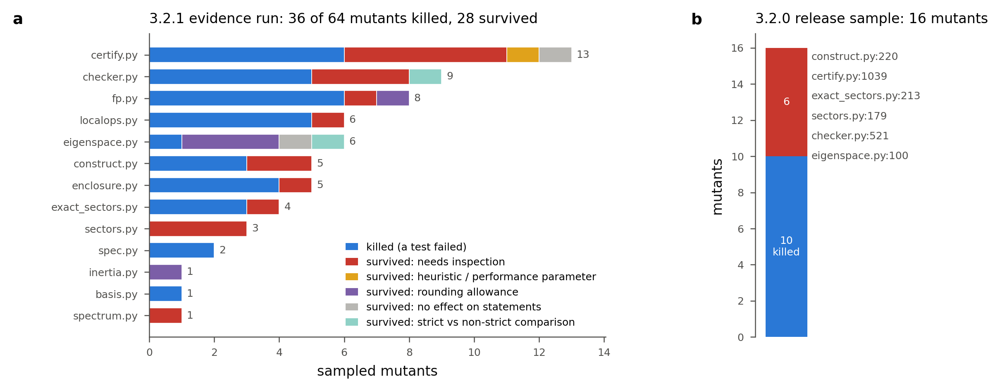

# E6: mutation analysis of the certifier

## Why this experiment

A test suite that passes says only that the tests found nothing. Mutation analysis measures how much the suite would
find: each mutant changes one operator or constant in the verification core, and a mutant that the suite does not
detect points either to a gap in the tests or to a change with no observable effect. Decision D-35 made E6 part of the
evidence, with the rule that the score is reported only together with a classification of the survivors, because a
single score hides whether the undetected mutants matter. A survivor that could make a statement wrong is a reason to
add a test before a version is cited (the revisit clause of decision D-60).

## Design

The script is `experiments/e6_mutation.py`; the method is described in `docs/project/software/08_tests_and_mutation.md`. It
enumerates the mutation sites of the core modules (arithmetic, comparison, boolean, sign and constant mutations),
samples 64 mutants with a fixed seed, copies the repository (every file git tracks) into a work folder per mutant, and
runs the whole test suite against each mutant on two workers. A mutant is killed if any test fails or errors, and it
times out if the suite exceeds its limit. The unmutated copy (the baseline) must survive first; its limit was raised
from 900 s to 3600 s for 3.2 because the 3.2 suite takes about 25 minutes. After the run the driver classifies the
survivors with `experiments/e6_classify.py` into the five rule-based classes of the table below; the class "needs
inspection" is left to a person (finding RA-25).

## How the instrument is checked

The baseline is the control: if the unmutated copy fails the suite, the copy is broken and every kill would be
meaningless. The first 3.1.0 attempt showed exactly this failure mode: the copy then held three folders, six tests
read files outside them, the baseline failed, and the copy was changed to every tracked file
(`docs/project/failures/04_failed_runs_and_attempts.md`). The classification is stamped with the source and test fingerprints
of the tree it read, and the number scripts refuse an unstamped post-run file (MS-N03).

## Results

| Run | Version | Mutation sites | Mutants | Killed | Survived | Timeouts | Score | Files copied | Baseline suite (s) |
|---|---|---|---|---|---|---|---|---|---|
| `run_full_final` | 3.0.0 (18 October 2026) | 2805 | 64 | 35 | 29 | 0 | 0.546875 | not recorded | 46.3 |
| `run_full_20261021` | 3.0.0 | 2834 | 64 | 30 | 34 | 0 | 0.46875 | not recorded | 53.6 |
| `run_full_20261022` | 3.1.0 | 3051 | 64 | 38 | 26 | 0 | 0.59375 | 215 | 511.1 |
| `run_full_20261104` | 3.2.0 | 3639 | 64 | 36 | 28 | 0 | 0.5625 | 915 | 2855.2 |
| `run_full_20261105` | 3.2.1 | 3639 | 64 | 36 | 28 | 0 | 0.5625 | 915 | 1714.7 |

The values are from the E6 record of each run (`summary`, `copy`, `baseline` and `sites_per_module` of `data.json`).
The very first mutation run, before 3.0.0, killed 66 of 160 mutants; its real gaps were closed by tests, and the 37
survivors that needed inspection then received verdicts, 12 of them real test gaps (decisions D-35 and D-39). The 3.2
integration ran a 16-mutant sample that killed 13, and the release sample of 16 mutants at `e1ebaed`, before the tag,
killed 10 (`code/certify-ed/RESULT_integration_3.2.md`); in the first sample the three survivors at `certify.py:1236`,
`sectors.py:240` and `checker.py:261` were turned into tests before 3.2.0 (decision D-60).

The scores of different versions are not comparable as measures of improvement: the mutation sites belong to the code
that ran (2834 sites in 3.0.0, 3051 in 3.1.0, 3639 in 3.2), so each score describes a different test suite against a
different code. The 3.2.0 and 3.2.1 samples are the same 64 mutants with the same outcomes, mutant by mutant (the
`mutants` lists of the two records agree in module, line, mutation and status), as expected from the fixed seed and
from code that differs only in the default thread count of the residual.

| Class of survivor (`e6_classify.py`) | 3.0.0 | 3.1.0 | 3.2.1 |
|---|---|---|---|
| needs inspection | 16 | 15 | 18 |
| rounding allowance in a worst-case bound (looser: sound; tighter: below test resolution) | 5 | 3 | 5 |
| strict vs non-strict comparison (differs only at exact equality) | 7 | 2 | 2 |
| heuristic or performance parameter (shift placement, method choice, caching) | 6 | 2 | 1 |
| no effect on statements (timing, messages) | 0 | 4 | 2 |

The classes are from `classification.json` of each record. The 28 survivors of the 3.2.1 run, with their classes, are:

| Site | Mutation | Class |
|---|---|---|
| `construct.py:220` | constant 0->1 | needs inspection |
| `fp.py:40` | drop USub | needs inspection |
| `certify.py:640` | And->Or | needs inspection |
| `checker.py:535` | Add->Sub | needs inspection |
| `eigenspace.py:154` | Pow->Mult | rounding allowance in a worst-case bound (looser: sound; tighter: below test resolution) |
| `checker.py:234` | constant 0->1 | needs inspection |
| `inertia.py:129` | constant 2->3 | rounding allowance in a worst-case bound (looser: sound; tighter: below test resolution) |
| `certify.py:519` | Mult->Div | needs inspection |
| `sectors.py:57` | Or->And | needs inspection |
| `fp.py:124` | constant 1.0->2.0 | rounding allowance in a worst-case bound (looser: sound; tighter: below test resolution) |
| `construct.py:139` | constant 1->2 | needs inspection |
| `certify.py:493` | constant 0->1 | needs inspection |
| `certify.py:798` | constant 1.0->2.0 | heuristic or performance parameter (shift placement, method choice, caching) |
| `eigenspace.py:151` | Mult->Div | rounding allowance in a worst-case bound (looser: sound; tighter: below test resolution) |
| `certify.py:1039` | constant 8->9 | no effect on statements (timing, messages) |
| `sectors.py:179` | drop Not | needs inspection |
| `checker.py:521` | Gt->GtE | strict vs non-strict comparison (differs only at exact equality) |
| `checker.py:443` | constant 4->5 | needs inspection |
| `eigenspace.py:147` | Div->Mult | no effect on statements (timing, messages) |
| `eigenspace.py:103` | Lt->LtE | strict vs non-strict comparison (differs only at exact equality) |
| `sectors.py:120` | Mult->Div | needs inspection |
| `enclosure.py:537` | Eq->NotEq | needs inspection |
| `exact_sectors.py:202` | FloorDiv->Mult | needs inspection |
| `certify.py:558` | constant 16->17 | needs inspection |
| `localops.py:189` | constant 0.0->1.0 | needs inspection |
| `certify.py:1054` | IsNot->Is | needs inspection |
| `eigenspace.py:129` | Mult->Div | rounding allowance in a worst-case bound (looser: sound; tighter: below test resolution) |
| `spectrum.py:103` | And->Or | needs inspection |

A person has not yet given verdicts on the survivors that need inspection, neither for 3.1.0 (15) nor for 3.2.1 (18).
Readings prepared as suggestions for that verdict are in `results/run_full_20261022/E6_inspection_worksheet.md` for
3.1.0 and in `code/certify-ed/E6_inspection_worksheet_3.2.0.md` for the 3.2 sample, which is the 3.2.1 sample. The 3.2
worksheet suggests, among the 28, 3 equivalent mutants, 4 looser bounds, 4 heuristic parameters, one test gap through
which a false FAILED (never a false CERTIFIED) is possible (`checker.py:535`), and 7 soundness-relevant test gaps:
`sectors.py:57`, `eigenspace.py:151`, `eigenspace.py:147`, `eigenspace.py:129`, `exact_sectors.py:202`,
`localops.py:189` and `spectrum.py:103`. Each of the seven is a constant or a branch that a test pinning the formula
would catch, such as the rounding scale of the label bound, the real embedding factor of a complex sector block, the
amplitude vector of the fermion lowering letter, and the merge of a counted with an uncounted sector interval. None of
them changes a statement of the evidence runs, because the records were produced by the unmutated code; the
recommended tests belong to a 3.2.2 together with the verdicts (`docs/project/failures/05_open_items.md`). One suggestion of
the worksheet does not cover every input. For `construct.py:220` (the constant 0 of `asym.nnz == 0` in the early
return of `hermitian_part` changed to 1) it reads the mutant as equivalent, but when H - H^H has exactly one stored
nonzero entry, which happens when one diagonal entry of H is not real, the mutant returns H unsymmetrised where the
original returns (H + H^H)/2. Whether a matrix that certify-ed receives can reach that case is part of the verdict.

Figure: killed and surviving mutants per module of the 3.2.1 sample, with the survivor classes of
`classification.json` (a), and the 16-mutant release sample of 3.2.0 (b), drawn by
`experiments/figures/fig_mutation.py` (copied from `code/certify-ed/docs/figures_run_3.2.1/`, where `INDEX.md` gives
the numbers of its caption with their data sources).

## What the result shows and does not show

E6 shows how much of the verification core the test suite constrains, and lists where it does not. It cannot detect a
mutant that shrinks a worst-case rounding term, because real rounding is far below the worst case (decision D-35);
such terms are covered by pinning tests of the formulas and by the exact checker. It did not find either of the two
soundness gaps that writing the proofs against the code found (decision D-46). A survivor marked soundness-relevant is
a gap in the tests, not a defect of the code: the code that ran is the unmutated code.
