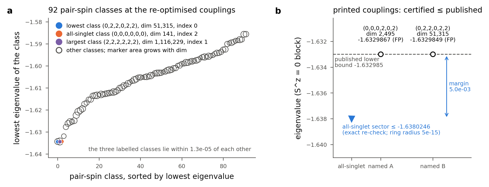

# E9: the pyrochlore crown cluster of Kránitz and Penc

## Why this experiment

Kránitz and Penc (arXiv:2601.07800) prove an Anderson-type lower bound on the ground-state energy of the pyrochlore
Heisenberg antiferromagnet: the energy per site is bounded below by the lowest eigenvalue of a finite cluster
Hamiltonian, the 18-site crown, with couplings chosen to make the bound as tight as possible. The bound is only as
valid as the cluster eigenvalue, and decision D-32 recorded that published proofs of this type rest on Lanczos or DMRG
numbers that are not certified. Decision D-34 made this the flagship application: certify the numerical lemma of a
published proof. For S = 1/2 the question is whether the published value is a certified lower bound; for S = 1 it
turned into the question whether the published bound is reproduced at the printed couplings at all.

## Design

The script is `experiments/e9_pyrochlore.py`, using `certify_ed.apps.pyrochlore`. The model is the reduced crown model
with c3 = c12 and c5 = 0, the form in which the paper states it neglects c5 (decision D-51). For S = 1/2, the cluster
Hamiltonian at the published couplings is split into the 128 integer sectors of the symmetry group Z2^7, and the
lowest eigenvalue is bounded below in exact arithmetic by inertia counts (`exact_count_below`), giving a rational
lower bound with no floating-point assumption. For S = 1, the cluster is decomposed by the conserved spin of each
outer pair, which gives 92 classes in the S^z = 0 block; in the class in which every pair forms a singlet, the energy
is -12 c1 + c17 E0, where E0 is the ground energy of the spin-1 ring of six sites, and E0 is enclosed by certify-ed
(S2 and S3 certified) and re-checked exactly. The lowest eigenvalue of every class is also computed in floating point
(the scan stored as `spin1_landscape`), and since 3.1.0 the two pair-spin sectors the paper names are computed as
well.

## How the instrument is checked

The published S = 1/2 values serve as a check of the model: the reduced model reproduces the paper's reduced-model
value -0.550158(2), and the nine-coupling headline -0.549832(8) is a different model, named as reproduced but not
certified (decision D-51). For S = 1, the two named sectors reproduce the published -1.632985 at the printed
couplings, which shows that the couplings and the model were read correctly; this check was added after version 0.2 of
the note to the authors wrongly said the bound could not be reproduced (decision D-51). The exact rational evaluation
of the all-singlet sector is independent of the floating-point scan.

## Results

| Quantity | 3.0.0 | 3.1.0 | 3.2.1 |
|---|---|---|---|
| S = 1/2: certified lower bound on λ_min, rounded down | -0.550158299 | -0.550158299 | -0.550158299 |
| S = 1/2: floating-point estimate of λ_min | -0.5501582979 | -0.5501582979 | -0.5501582979 |
| S = 1/2: published reduced-model value (literature) | not recorded | -0.550158(2) | -0.550158(2) |
| S = 1/2: published nine-coupling headline (literature) | not recorded | -0.549832(8) | -0.549832(8) |
| S = 1: all-singlet eigenvalue, upper bound (certified) | -1.6380246 | -1.6380246 | -1.6380246 |
| S = 1: published bound (literature) | -1.632985 | -1.632985 | -1.632985 |
| S = 1: margin below the published bound | 5.0e-3 | 5.0e-3 | 5.0e-3 |
| S = 1: six-ring E0 | not recorded | -8.617423181814 | -8.617423181814 |
| S = 1: its radius in floating point (S2 and S3) | not recorded | 1.4e-13 | 1.4e-13 |
| S = 1: its exact radius | not recorded | 5.1e-15 | 5.1e-15 |
| S = 1: lowest class of the floating-point scan | -1.6343596 | -1.6343596 | -1.6343596 |
| S = 1: dimension of the minimising class | not recorded | 51,315 | 51,315 |
| S = 1: dimension of the largest class (all pair spins 2) | not recorded | 1,116,229 | 1,116,229 |
| S = 1: its energy above the minimum, rounded up | not recorded | 7e-6 | 7e-6 |
| S = 1: named sector [0,0,0,2,0,2] (floating point) | not recorded | -1.6329867 | -1.6329867 |
| S = 1: named sector [0,2,2,0,2,2] (floating point) | not recorded | -1.6329849 | -1.6329849 |

The values are the macros of `code/certify-ed/results/<run>/paper/numbers_apps.tex` of each run ("not recorded" means
that the number scripts of that run did not write the macro); the rows marked literature are values typed from the
paper, which the macro comments mark as such. From the records (`code/certify-ed/RESULT_evidence_run_3.1.0.md` and
`code/certify-ed/RESULT_evidence_run_3.2.1.md`): the exact S = 1/2 lower bound is -0.5501582988212038, identical in
the 3.0.0, 3.1.0 and 3.2.1 runs, obtained over 128 sectors with the largest of dimension 3890, with no floating-point
assumption; the S = 1 upper bound is -1.6380246425131773, bit-identical on both stacks and in 3.2.1, with the exact
re-check CERTIFIED, 5.039643e-03 below the published -1.632985. The floating-point scan of the 92 classes, made at the
re-optimised couplings c1 = 0.05397514068 and c3 = 0.08288267138, has its minimum -1.6343596 in the class [0, 4, 4, 0,
4, 4] on both stacks. In the comparison of 3.2.1 with 3.1.0, 893 of the 895 leaves of E9 are identical and the other 2
are timings (`03_comparisons.md`).

Figure: the lowest eigenvalue of each of the 92 pair-spin classes of the S = 1 crown at the re-optimised couplings,
from the floating-point scan (a), and the certified all-singlet bound at the printed couplings against the published
bound and the two named sectors (b), drawn by `experiments/figures/fig_crown_sectors.py` from the E9 record (copied
from `code/certify-ed/docs/figures_run_3.2.1/`, where `INDEX.md` gives the numbers of its caption with their data
sources). The figure labels the classes by the pair spins; the record labels the minimising class [0, 4, 4, 0, 4, 4].

## What the result shows and does not show

For S = 1/2, E9 shows that the lowest eigenvalue of the reduced crown model at the published couplings is at least
-0.550158299, a certified bound consistent with the paper's reduced-model value -0.550158(2); the bound on the
pyrochlore energy follows from the paper's theorem, which is not re-derived here. For S = 1, E9 shows, with a
certified bound, that at the printed couplings the cluster has an eigenvalue of at most -1.6380246, 5.0e-3 below the
published bound -1.632985, which the paper reproduces in the two sectors it names; the all-singlet sector was
evidently not included in the published search. The corrected max-min value, -1.6343596 from the floating-point scan,
is an estimate: certifying it would need exact inertia in a class of 1,116,229 states, beyond reach here (decision
D-40), and a cutting-plane bound shows that no value of c5 raises the max-min above about -1.6342 (decision D-51). The
project's rule is that nothing about the S = 1 discrepancy is stated publicly before the authors reply; the note to
them (version 0.3) waits for Sarang Vehale's check against the paper (decisions D-34 and D-51). The application
documents of this repository describe the physics in more detail.
