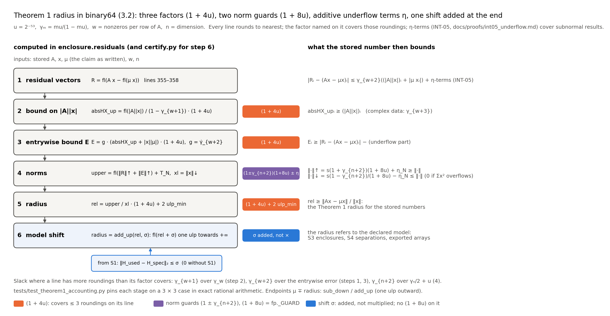

# The floating-point arithmetic model

Every bound in statements S1 to S5, S7 and S8 is computed in IEEE 754 binary64 arithmetic (double precision) and then
replaced by a bound on its exact value. That replacement is only as good as the model of how a computer rounds, and this
document states that model, the places where the code relies on it, the run-time checks of its hypotheses, and the two
known issues about very small numbers (INT-01 and INT-05). The exact layer (S6, the exact bracket C-16, the dyadic
intervals of S7 and the application computations) uses integer and rational arithmetic and does not depend on this
model; it is described at the end. Sources: `code/certify-ed/docs/theory.md` (section 1 and the list of section 2),
`code/certify-ed/certify_ed/fp.py`, `code/certify-ed/docs/what_certified_means.md`,
`code/certify-ed/docs/proofs/thm1_fp-accounting.md` and `code/certify-ed/docs/proofs/int05_underflow.md`.

## The standard model

A binary64 number has a 53-bit significand. The *unit roundoff* is $u = 2^{-53}$ (`fp.U`), half the distance from 1 to
the next larger number. The standard model of floating-point arithmetic (Higham 2002, equation 2.4) says that each basic
operation $\circ \in \{+, -, \times, /\}$ and the square root, applied to two stored numbers, returns the exact result
rounded to nearest:

$$\mathrm{fl}(a \circ b) = (a \circ b)(1 + \delta), \qquad \lvert \delta \rvert \le u .$$

This holds whenever the exact result is a normal number (magnitude at least $2^{-1022}$) or zero and does not overflow.
Errors accumulate through products of such factors, and the standard bookkeeping device is the constant

$$\gamma_m = \frac{m u}{1 - m u} \quad (m u < 1/2),$$

computed by `fp.gamma(m)`, which refuses $m u \ge 1/2$. If m roundings act on one quantity, the product of their factors
lies between $1 - \gamma_m$ and $1 + \gamma_m$ (Higham 2002, Lemma 3.1). For an inner product of k terms, evaluated in
any order and with or without fused multiply-add,
$\lvert \mathrm{fl}(x^T y) - x^T y \rvert \le \gamma_k \lvert x \rvert^T \lvert y \rvert$ (Higham 2002, section 3.1).
The code uses `fp.gamma_dot(n, complex)`, which is $\gamma_n$ for real data and the deliberately larger $2\gamma_{n+4}$
for complex data, which dominates the complex inner-product bounds of Higham 2002, section 3.6. Because these bounds
hold for any summation order, the certificates do not depend on how a BLAS library or a sparse kernel orders its sums.

The model fails for products computed by Strassen-type algorithms, for reduced-precision BLAS modes, when the processor
flushes small results to zero (flush-to-zero, FTZ) or treats small inputs as zero (denormals-are-zero, DAZ), and under a
rounding mode other than round-to-nearest. Shared libraries compiled with aggressive optimization flags can switch on
FTZ and DAZ for a whole process when they are imported. For this reason `fp.probe_float_environment` runs in the
certifying process on every run and tests gradual underflow, DAZ, the rounding mode (including round toward zero) and
the precision of the BLAS; if a probe fails, every CERTIFIED floating-point statement is downgraded to INCONCLUSIVE and
the certificate records the failed probe under `arithmetic.runtime_probe` (`what_certified_means.md`). One hypothesis is
not tested at run time: that the BLAS in use satisfies the $\gamma_n$ bounds. It is the standard assumption for
reference and vendor BLAS, and every certificate names it under `arithmetic.assumptions`.

## Guards and directed rounding of endpoints

A computed upper bound is made safe by a relative guard. The constant `fp._GUARD` is $1 + 8u$, and `fp.up(x)` returns
$x(1 + 8u)$ for a non-negative computed quantity; the factor covers the few roundings that form the bound itself. The
code also uses factors $(1 + 4u)$ in the Theorem 1 chain below; each line of that chain says which roundings its factor
covers.

The certified statement $\lvert \lambda - \mu \rvert \le r$ is about the stored numbers $\mu$ and r. An endpoint
$\mu - r$ computed with round-to-nearest can land half a unit in the last place inside the exact interval; for example
$1 - 2^{-60}$ rounds to 1.0. Since 3.1 every endpoint, every shift margin $\sigma \mp \beta$, every separation and every
comparison with a cut is formed with `fp.sub_down` or `fp.add_up`, which compute the difference or sum in
round-to-nearest and then step one unit in the last place outward with `numpy.nextafter` (`theory.md`, section 1). The
finding that led to this change, together with a second soundness gap in the exact layer, is recorded as decision D-46
(21 October 2026); both were fixed with tests. Bounds that are computed exactly as rationals (the AKLT values of $\eta$,
the crown bound) are converted to binary64 in the safe direction.

## The Theorem 1 radius in floating point (INT-04)

Theorem 1 says that for a nonzero vector x and a real number $\mu$, some eigenvalue $\lambda$ of the Hermitian matrix A
satisfies $\lvert \lambda - \mu \rvert \le \lVert Ax - \mu x \rVert / \lVert x \rVert$. The code evaluates the
right-hand side for the stored A, x and $\mu$ and must return a number that is at least the exact value. The chain of
`enclosure.residuals` has six steps, listed in `theory.md`, section 2, and proved in `docs/proofs/thm1_fp-accounting.md`
(the notation is w for the largest number of nonzeros in a row of A, n for the dimension, and $g$ = `gamma_dot(w + 2)`,
which is $\gamma_{w+2}$ for real data and $2\gamma_{w+6}$ for complex data).

The first step forms the residual vector $R = \mathrm{fl}(Ax - \mathrm{fl}(\mu x))$; each entry of $\mathrm{fl}(Ax)$ is
an inner product of at most w terms, and the entrywise error is at most
$\gamma_{w+2}((\lvert A \rvert \lvert x \rvert)_i + \lvert \mu \rvert \lvert x_i \rvert)$, with a relative slack of
order $1/(w+2)$ that later steps use. The second step bounds $\lvert A \rvert \lvert x \rvert$ from above by `absHX_up`
$= \mathrm{fl}(\lvert A \rvert \lvert x \rvert)/(1 - \gamma_{w+1}) \cdot (1 + 4u)$; since a correction of 3 November
2026 the constant is $\gamma_{w+3}$ for complex data (see below). The third step forms the entrywise error bound
$E = g(\text{absHX\_up} + \lvert x \rvert \lvert \mu \rvert)(1 + 4u)$, so that
$\lVert Ax - \mu x \rVert \le \lVert R \rVert + \lVert E \rVert$ by the triangle inequality. The fourth step bounds the
norms: `fp.norm2_upper(v)` multiplies the computed norm by $(1 + \gamma_{n+2})(1 + 8u)$ and `fp.norm2_lower(v)` divides
it by the same kind of factor, which undoes the error of the sum of squares and of the square root. The fifth step forms
the radius $\mathrm{rel} = \mathrm{upper}/\mathrm{xl} \cdot (1 + 4u)$, where upper bounds
$\lVert R \rVert + \lVert E \rVert$ and xl is the lower bound on $\lVert x \rVert$; a zero vector gives
$\mathrm{xl} = 0$ and an infinite radius, never radius 0. The sixth step, outside `residuals`, adds the S1 model shift
with `fp.add_up` wherever the radius refers to the declared model; the shift is added, not multiplied in.

The test `tests/test_theorem1_accounting.py` recomputes a fixed 3 by 3 case in exact rational arithmetic and checks
stage by stage that each computed quantity is at least what it bounds. Known issue INT-04 (CHANGELOG of 3.2.0.dev0) was
that the manuscript's Appendix A described this accounting differently from the code (at most six roundings, one factor
$1 + 8u$, the shift multiplied in); the code's bound was sound throughout, and the appendix is to be rewritten by Sarang
Vehale from the code-facing list (decision D-16; a statement-level scaffold is `docs/proofs/appendixA_scaffold.tex`).

The independent re-derivation of `thm1_fp-accounting.md` returned the verdict GAP for complex data: the moduli
$\lvert a_{ij} \rvert$ and $\lvert x_j \rvert$ of complex numbers are each rounded once more (by the C function
`hypot`), so the second step gives only $\text{absHX\_up}_i \ge a_i (1 - 8wu^2)$, not $\ge a_i$. The certified radius
was not affected, because the factor 2 in the complex constant of the third step absorbs the shortfall, but the proof
step as written does not hold. The looser code correction (`enclosure._rounding_bound` uses `gamma(width + 3)` for
complex data, with the test `test_rounding_bound_uses_width_plus_three_for_complex_data`) restores the inequality in the
code; the proof text is to be repaired by Sarang Vehale (`docs/proofs/VERDICTS.md`, "Required corrections"). The same
review measured the relative error of NumPy's complex absolute value on the development machine at up to 1.88u over 140
000 arguments, which is more than one rounding; the hypothesis
$\lvert \mathrm{fl}(\lvert z \rvert) - \lvert z \rvert \rvert \le h u \lvert z \rvert$ with $h \ge 2$ should be stated
in the documents that count these roundings (D-01 uses $h = 3$).

The figure (`code/certify-ed/docs/figures/fig_rounding_accounting.png`) draws the same chain: the residual vectors, the
bound on $\lvert A \rvert \lvert x \rvert$ and the entrywise bound E, each with one factor $(1 + 4u)$; the norms with
their guards; the radius with a third factor $(1 + 4u)$; and the model shift added with `add_up`, never multiplied in.

## Underflow: the no-underflow hypothesis (INT-01)

The standard model fails for results in the subnormal range, below $2^{-1022}$ in magnitude, where the rounding error is
absolute (at most $u_{\min} = 2^{-1075}$) rather than relative. Until 3.1.0 the floating-point statements assumed that
no operation underflows and did not check it (known issue INT-01). Since 3.2.0.dev0 the hypothesis is enforced on the
inputs: every nonzero stored operand must have magnitude at least $2^{-900}$ (`fp.UNDERFLOW_THRESHOLD`). `certify()`
scans the claimed eigenvalues, the eigenvector entries, the stored entries of the operator (for a spec or matrix-free
operator: its norm bound and one product with a seeded random probe vector) and the model shift (`fp.underflow_scan`).
Exact zeros are allowed. A finding makes S2 INCONCLUSIVE with the reason code `UNDERFLOW_RISK`, and S3, S4, S7 and S8
INCONCLUSIVE with the same code, because each rests on the S2 enclosures; S1 and the exact layer S6 are not affected. A
user who prefers to assume the hypothesis can pass `Options(underflow_check=False)` (command-line flag
`--assume-no-underflow`), and the choice is recorded in `scope.options.underflow_check` and `arithmetic.underflow_check`
(`theory.md`, section 1).

## Underflow in intermediate quantities (INT-05)

The input scan does not cover the quantities formed inside the bound. Routine LAPACK eigenvectors have entries of order
$10^{-265}$, which are numerical zeros of a symmetry sector; their squares and their products with matrix entries fall
into the subnormal range, so the residual entries, the entrywise bound E and the squares inside the norms violate the
hypothesis for almost every LAPACK input. This was recorded as known issue INT-05 in the CHANGELOG of 3.2.0.dev0. There
were two ways to respond: flag such inputs, which would have made S2 INCONCLUSIVE for almost every LAPACK input, or
carry the absolute error term through the bound. The derivation document `docs/proofs/int05_underflow.md` does the
second, under the model (M-U), which it derives from the binary64 format:

$$\mathrm{fl}(z) = z(1 + \delta) + \eta, \qquad \lvert \delta \rvert \le u, \quad \lvert \eta \rvert \le u_{\min} = 2^{-1075}, \quad \delta\eta = 0, \quad \eta = 0 \text{ for } + \text{ and } - .$$

The last condition holds because a sum or difference that underflows is exact. Higham 2002, section 2.5, gives a model
of this form (his equation 2.6); the document proves (M-U) from the format and does not rely on that text. Under (M-U)
the code adds small terms to the bounds: `fp.norm_underflow_term(N)`
$= T_N \ge \sqrt{N u_{\min}} \sqrt{(1 + \gamma_N)/(1 - \gamma_N)}$ for the squares that may underflow in a norm of N
real components (Lemma U3); `fp.residual_additive_term(n, w, complex)` $= A_{n,w} \ge \sqrt{n}\, c_w u_{\min}$ for the
per-entry additive errors of $Ax$, $\mu x$ and E, where $c_w$ = `fp.residual_entry_count(w, complex)` counts the
products in one entry (Lemma U4); `fp.exact_dot` leaves products below $2^{-967}$ out of its error-free sum and adds
their largest possible total to its error bound (Lemma U2); and the radius gets $+ 2$ ULP_MIN, with ULP_MIN
$= 2^{-1074}$ the smallest positive binary64 number (Theorem U5). These terms are of order $10^{-160}$. Theorem U6 shows
that the radii never shrink relative to the 3.2.0.dev0 code and are bit-identical to it for every input whose radius
exceeds about $10^{-145}$; Corollary U7 extends the additive terms to the Gram matrix and cluster bounds of Theorems 2,
2' and 8. With these terms the Theorem 1 radius and the cluster bound hold for inputs of any magnitude, the radii and
residual bounds are no longer scanned, and the scan of INT-01 is reduced to the stored inputs and the model shift, on
which the remaining standard-model bounds (inertia backward errors, Rayleigh quotients, Kato-Temple arithmetic) still
rest. INT-05 is closed on `dev/3.2` by these terms; the text of `code/certify-ed/docs/limitations.md`, which still calls
it open, predates that change.

The independent re-derivation of `int05_underflow.md` returned the verdict ERROR, and the error was real. Theorem U5
claimed its bound for every finite stored input "with no magnitude hypothesis", but when $\lVert x \rVert^2$ overflows
(for $\lVert x \rVert$ above about $1.3 \cdot 10^{154}$) `fp.norm2_lower` returned infinity and the radius became 2
ULP_MIN, a finite and far too small number. The exact counterexample in `docs/proofs/VERDICTS.md` is
$A = \mathrm{diag}(1, 2)$, $\mu = 1 + 10^{-8}$, $x = (10^{160}, 0)$: the true radius is $10^{-8}$, the code returned
about $10^{-323}$, and the pair was marked distinct. The fault was older than the INT-05 work; the input scan of INT-01
looks for small magnitudes and does not detect large ones. The correction is looser: `fp.norm2_lower` returns 0 when the
computed norm is not finite, so that the radius is infinite and no enclosure is claimed; two negative-control tests in
`tests/test_independent_check.py` fail on the previous code and pass on the corrected one. The same verdict records a
GAP in Lemma U4 for complex data (the absolute errors of the `hypot` moduli are not counted), which the factor 2 of the
complex constant covers.

## Arithmetic that does not use the model

Statement S6, the exact bracket of C-16 and the application computations (the crown bound and the AKLT values of $\eta$,
`docs/applications/`) work with integers, rationals and Gaussian integers through python-flint; their only hypothesis is
that FLINT's integer and rational arithmetic, characteristic polynomials and factorizations are exact. Statement S7
works on intervals whose ends are dyadic rationals $p \cdot 2^{-192}$ with outward rounding at every step (Lemma 17);
the only floating-point steps are the reading of the input interval ends, which are taken as the exact binary64 values
they are, and the final conversion of each result, which rounds outward (`ivl.to_float_down`, `ivl.to_float_up`). The
module `rigorous.py` provides ball-arithmetic radii with Arb (`rigorous.arb_residual_radii`) as an independent reference
for the floating-point radii.
