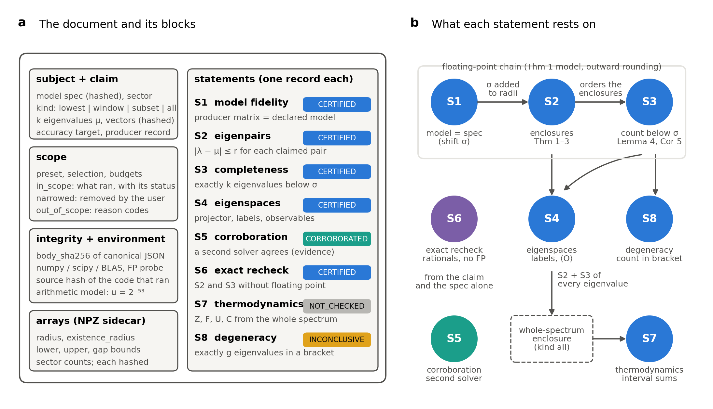

# What a certificate states

A CERTIFY-ED certificate (schema `certify-ed/certificate/2.1`) is a record about one claimed result of an
exact-diagonalization computation: a list of claimed eigenvalues of a Hermitian matrix, usually with the claimed
eigenvectors, together with the declared model that the matrix is supposed to represent. The certificate does not repeat
the claim as true. It contains a list of statements, and each statement has an identifier, a status, the evidence that
decided the status, and the assumptions it rests on. This document says what each statement asserts when its status is
CERTIFIED, which theorem it rests on (the theorems are in [theorems.md](theorems.md)), and which module of the code
implements it. It is written from `code/certify-ed/docs/what_certified_means.md`,
`code/certify-ed/docs/SCOPE_MATRIX.md`, `code/certify-ed/docs/limitations.md` and `code/certify-ed/docs/theory.md`, at
commit `a814d28` of `dev/3.2`.

## Terms used throughout

The *declared model* is a `ModelSpec`: a list of operator strings with coefficients on a lattice of local spaces (spin
S, spinless fermions, bosons with a cutoff), written by the user independently of the solver. The *producer* is the
program that computed the claim; its *operator* is the matrix it actually diagonalized, either stored (dense or sparse),
given as a symmetry block with an isometry onto it, or available only as a function that multiplies vectors
(*matrix-free*). A *claim* has a kind: `lowest` (the k lowest eigenvalues), `window` (every eigenvalue in an interval
(a, b)), `all` (the whole spectrum) or `subset` (some eigenvalues, with no claim about the others). An *enclosure* is an
interval $[\mu - r, \mu + r]$ around a claimed value $\mu$ that provably contains an eigenvalue; r is its *radius*. A
*cluster* is a group of claimed pairs whose single-pair enclosures overlap, such as the members of a degenerate level.
The *model shift* is a certified upper bound $\Delta$ on $\lVert H_{\rm used} - H_{\rm spec} \rVert_2$, the distance in
spectral norm between the matrix the bounds were computed for and the exact matrix of the declared model; it comes from
the rounding of the matrix construction (Appendix A in [theorems.md](theorems.md)).

The figure (`code/certify-ed/docs/figures/fig_certificate_anatomy.png`) shows in panel (a) the parts of the JSON body
(subject and claim, one record per statement S1 to S8 with a status, the scope block, integrity and environment, the
arrays sidecar; the statuses shown are an example, not a record) and in panel (b) how the floating-point statements
depend on each other: S1 fixes the matrix to which the enclosures refer, S2 encloses each claimed value, and S3 counts
eigenvalues below a shift and orders the enclosures.

## Statuses

A statement has one of four main statuses (`what_certified_means.md`). CERTIFIED means that the statement holds for the
stored numbers under the assumptions listed with it; nothing else in a certificate is a claim. FAILED means that what
was computed contradicts the statement: the producer's matrix differs from the declared model, a certified radius
exceeds the accuracy target, or an inertia count finds an eigenvalue that the claim does not contain. A FAILED statement
is a finding about the claim, not about CERTIFY-ED. INCONCLUSIVE means that the statement was attempted and the evidence
neither establishes nor contradicts it, for example when the claimed vectors of a cluster are too far from orthonormal,
when a "k lowest" claim cuts through a multiplet, or when an input violates the floating-point hypotheses. NOT_CHECKED
means that the statement did not run, and a reason code says why: not selected by the user (`NARROWED_BY_USER`,
`DEFAULT_SELECTION`), a missing input (`NEEDS_EIGENVECTORS`, `NEEDS_SPEC`, `NEEDS_MATRIX` and others), a budget or size
limit (`BUDGET_TIME`, `BUDGET_MEMORY`, `SIZE_LIMIT`), or a design slot whose mathematics is not implemented
(`NOT_IMPLEMENTED`). Three further statuses occur only in specific places: CORROBORATED for statement S5, and
CERTIFIED_UNDER_HYPOTHESIS and DECLARED in the standalone records of E-05 and E-03 described below. Every statement
identifier appears exactly once in the certificate's `scope` block, as in scope, narrowed or out of scope, and
`Certificate.load` refuses a certificate whose scope block does not account for every statement (known issue INT-02,
fixed in the branch `fix/3.1.1`).

The statuses and the integer evidence (counts, degeneracies, numbers of missing eigenvalues) are the claims of a
certificate, and two correct runs on different machines agree on them. Floating-point evidence (radii, residual bounds,
gap bounds, model shifts, backward errors, timings) depends on the operating system, the BLAS library and the library
versions, and may differ in its last digits between runs; each such value is a valid bound for the run that produced it
(`what_certified_means.md`, section "Run-stack values").

## S1, model fidelity

Statement `S1.model_fidelity` asserts that the producer's operator is the operator of the declared model. For a stored
matrix the comparison is entrywise against a reference matrix built from the spec (`construct.build_bitwise`,
`construct.matrix_difference` within `construct.product_tolerance`), and the result is the model shift $\Delta$ of
Theorem A4 (Appendix A in [theorems.md](theorems.md)); for a symmetry block the statement checks the invariance and the
orthonormality of the isometry (`sectors.audit_sector`); for a matrix-free producer it compares the two operators on
random probe vectors (`certify._probe_comparison`), which is agreement on a few vectors, not an entrywise identity. The
reference matrix is built up to `Options.reference_max_dim` = 2^22 states, and a Kronecker-product cross-check of the
builder runs up to 2^14 states (`limitations.md`). What S1 does not assert is that the declared model is the Hamiltonian
the authors intend: a spec written from the paper independently of the solver's input is what makes S1 meaningful.
Implemented in `certify.check_model_fidelity` and `certify._builder_shift`.

## S2, enclosures and distinctness

Statement `S2.eigenpairs` asserts that each claimed eigenvalue lies within a certified radius of an eigenvalue of the
declared model, and that the claimed pairs are matched to distinct eigenvalues. A single pair rests on Theorem 1 (the
residual bound $\min_i \lvert \lambda_i - \mu \rvert \le \lVert Ax - \mu x \rVert / \lVert x \rVert$) evaluated in
floating point with every rounding error bounded (Theorem 1-fl, `enclosure.residuals`). Pairs whose Theorem 1 intervals
overlap form a cluster and get the radius $\min(\rho, \varepsilon^*)$ of Theorems 2 and 2', which matches the g members
of the cluster to g distinct eigenvalues even when the claimed vectors are not orthonormal (`enclosure._cluster_bound`).
If the orthonormality defect $\eta = \lVert X^H X - I \rVert_2$ of a cluster is 1 or more, the cluster keeps existence
only and S2 is INCONCLUSIVE. When S1 certified a model shift, $\Delta$ is added to every radius that refers to the
declared model (Theorem A5). A Kato-Temple refinement (Theorem 3) of each isolated eigenvalue is reported when the
neighbouring levels are known (`enclosure.kato_temple`, `enclosure.rayleigh_interval`). Each cluster member carries two
radii: its *existence radius*, the Theorem 1 radius (some eigenvalue lies within it), and the *cluster radius*, under
which the members are matched to distinct eigenvalues; every indexed statement ("$\lambda_K$ lies within ... of
$\mu_K$") uses the cluster radius. The accuracy target of a claim is applied in two steps: if the cluster radius meets
it, S2 is CERTIFIED; if only the existence radii meet it, S2 is INCONCLUSIVE with that diagnosis; if an existence radius
misses it, S2 is FAILED (`theory.md`, section 2). Since 3.2 the radius can also be computed for a claim with no stored
matrix at all, from the spec applied term by term (D-02, below).

## S3, completeness

Statement `S3.completeness` asserts that no eigenvalue is missing: for a `lowest` claim, that the claimed values enclose
exactly $\lambda_1, \dots, \lambda_k$ and that $\lambda_{k+1}$ is at least a certified bound (which gives a certified
lower bound on the gap $\lambda_{k+1} - \lambda_k$); for a `window` claim, that the claimed values are all the
eigenvalues in the window; for an `all` claim, that the number of enclosed eigenvalues equals the dimension. It rests on
Lemma 4 (an $LDL^H$ factorization of $A - \sigma I$ with a bounded backward error counts the eigenvalues below $\sigma$
up to a collar of width $\beta$) and on Corollary 5 (the count and the S2 enclosures together pin the indices).
Implemented in `certify._certify_lowest`, `certify._certify_window`, `inertia.inertia_dense`, `inertia.inertia_sparse`
and `inertia.count_bounds`. The dense and sparse factorizations run up to `Options.inertia_max_dim` = 60 000
(`limitations.md`); a factorization that does not fit the memory budget is not attempted and the statement is
NOT_CHECKED, never a count. Two additions of 3.2 belong here. First, D-01: on the sparse path the backward error $\beta$
is measured from the stored factors instead of being bounded a priori (`ldl_residual.sparse_ldl_residual_bound`; details
below). Second, C-02: a window claim without eigenvectors gets a count of the eigenvalues in the window from Lemma 4 at
three shifts per edge and the count inequality of Proposition 14, with no pairing of claimed values to eigenvalues
(`certify._certify_window_vectorless`; `evidence.vectorless` is true and S2 stays NOT_CHECKED). C-02 is not one of the
22 derivation documents; its argument is written out in `theory.md`, section 3.

## S4, eigenspaces, observables and labels

Statement `S4.eigenspaces` asserts, for each certified cluster, a bound on the distance between the projector onto the
span of the claimed vectors and the true spectral projector P of the level, and, from it, certified values of
observables and quantum numbers. Theorem 6 gives $\lVert \hat Q \hat Q^H - P \rVert_2 \le s$ with
$s = \rho/\mathrm{sep}$, where $\hat Q$ is the orthonormal polar factor of the claimed vectors and sep is the distance
to the rest of the spectrum, and
$\lvert \mathrm{tr}(X^H O X) - \mathrm{tr}(PO) \rvert \le 2g \lVert O \rVert (s + \eta)$ for a Hermitian observable O
(`eigenspace.certify_eigenspace`, `eigenspace.certify_observable`). Proposition 7 turns this into quantum numbers: the
eigenvalues of $X^H S X$ for a conserved Hermitian S lie within a stated distance of the eigenvalues of S on the level,
and a bound below half the spacing of the possible values fixes the label exactly (`eigenspace.certify_quantum_numbers`;
total spin through the Casimir operator in `su2.py`; momentum labels through `sectors.audit_label`). Proposition 15
extends the observables to linear combinations: batches of observables, two-point correlation functions
$\mathrm{tr}(P O_i O_j)$ and static structure factors (`correlations.combine_certified`,
`correlations.certify_correlations`, `correlations.structure_factor`). Since 3.2.0.dev0 (roadmap item C-05) a
non-Hermitian operator such as $S^+_i S^-_j$ is certified through its Hermitian decomposition $O = H + iK$, with
$H = (O + O^H)/2$ and $K = (O - O^H)/(2i)$, two Theorem 6 records recombined by Proposition 15; when the parts cannot be
formed exactly in floating point the record is INCONCLUSIVE (`correlations.hermitian_parts`,
`correlations.certify_observable_general`). The further S4 evidence added in 3.2 (E-07, C-12, C-13, C-03, C-04) is
described below.

## S5, corroboration

Statement `S5.corroboration` recomputes the claim with solvers that are algorithmically different from the producer's
(for example a Jacobi eigenvalue routine, `corroborate.jacobi_eigvalsh`, and the other oracles of
`corroborate.run_oracle`) and reports whether they agree. Its status is CORROBORATED or not, never CERTIFIED: agreement
of two floating-point solvers is evidence, not a bound. Nothing else in the certificate rests on S5.

## S6, exact re-check

Statement `S6.exact_recheck` re-derives the S2 radii and the S3 count of a `lowest` claim in integer and rational
arithmetic, with no floating-point hypothesis. The declared model, with its binary64 couplings taken as exact rationals,
is written in a scaled basis in which every operator letter has rational matrix entries (Lemma 10), the residuals of the
claimed vectors are evaluated exactly, and the counts come from floating-point $LDL^T$ factors that are moved to dyadic
grids and whose residual is computed exactly with FLINT (Lemma 11). Symmetry sectors enter through Gaussian-integer
orbit sums (Lemma 12), and the "k lowest" statement is assembled by Proposition 13. The statement needs the spec, the
eigenvectors, python-flint and a dimension of at most `Options.exact_max_dim` = 4 000; `window`, `all` and `subset`
claims have no exact path (`UNSUPPORTED_CLAIM`). Implemented in `checker.exact_recheck_lowest`,
`checker.certify_by_counts` and, for symmetry-adapted claims, `exact_sectors.exact_recheck_sector_lowest`. The
mathematics of this layer (`theory.md`, section 7) is marked UNVERIFIED and has no derivation document among the 22.

## S7, thermodynamics

Statement `S7.thermodynamics` gives intervals that contain the partition function Z, the free energy F, the internal
energy U, the variance of the energy and the heat capacity C at the requested temperatures. It needs a complete
whole-spectrum enclosure (Proposition 9: intervals with exact counts that together hold every eigenvalue) and evaluates
Proposition 16 in dyadic interval arithmetic with outward rounding (Lemma 17), so that the only floating-point
operations are the reading of the input interval ends and the final conversion of each result. Since 3.2 (C-06) it also
accepts a `lowest` claim whose S3 is CERTIFIED: the n - k eigenvalues that were not computed enter through the bound
$\sum_{j>k} e^{-\beta \lambda_j} \le (n-k) e^{-\beta L}$, with L the S3 lower bound on $\lambda_{k+1}$, and through the
moment envelopes of Proposition 16', which gives two-sided intervals for Z, F, U and C that are narrow only at
temperatures well below $L - E_0$ (evidence `tail_bound`). Implemented in `thermo.thermodynamics`,
`thermo.thermo_intervals_from_enclosure` and `thermo.thermodynamics_truncated`, on top of `ivl.exp_interval` and
`ivl.ln_interval`. A `subset` or `window` claim, or a `lowest` claim without S3, is NOT_CHECKED with
`NEEDS_WHOLE_SPECTRUM`.

## S8, degeneracy

Statement `S8.degeneracy` asserts, for each cluster of g claimed pairs certified distinct by S2, that an open bracket
$I_{\rm in}$ around the level contains exactly g eigenvalues. It rests on Proposition 14: two inertia counts (Lemma 4)
at shifts below and above the level give
$\#\{\lambda \in I_{\rm in}\} \le \nu_{\rm hi} - \nu_{\rm lo} \le \#\{\lambda \in I_{\rm out}\}$
(`degeneracy.degeneracy_counts`). The certified statement is a count in an interval of stated width, never "g exactly
equal eigenvalues", because exact equality cannot be decided in floating point. Since 3.2 (C-16,
`Options.exact_recheck`) the S8 evidence `exact_bracket` adds the exact count, the number of distinct values and their
multiplicities of the eigenvalues of the declared model in a rational bracket, from the characteristic polynomial, its
squarefree factorization and Sturm sequences, with no floating-point hypothesis, for dimensions up to 600
(`exact_degeneracy.exact_bracket`). Only then can a certificate say "exactly g eigenvalues in [a, b], all equal".

## The statements added in 3.2

The items below were added on the branch `dev/3.2` for version 3.2.0 (tag `v3.2.0`, commit `55d9f61`). Each has a
derivation document in `code/certify-ed/docs/proofs/` (described one by one in
[derivation_documents.md](derivation_documents.md)), and each has the status: derived, machine-checked, independently
re-derived (a second derivation written from the statement alone, not a human check), Sarang's check pending. Some
extend a statement of the certificate; four (E-03, E-04, E-05, C-07) produce standalone records, because they concern
objects other than one claim of eigenpairs.

| id | what is certified | where it appears | derivation document | module and function |
|---|---|---|---|---|
| C-03 | an interval for the entanglement entropy $S(\rho_A)$ of a certified level across a declared cut A, the entanglement spectrum as intervals, and the trace-distance bound $T^*$ | S4 evidence `entanglement[name]` when `Options.entanglement` declares a cut | `C-03_entanglement.md` | `entanglement.certify_entanglement` |
| C-04 | the value $\mathrm{tr}(\Pi_Q O)$ of an observable for a symmetry-adapted claim, lifted through the sector isometry with the isometry term $2g \Vert O \Vert_2 \delta (1 + \sqrt{1+\iota})$ | S4 correlation records of isometry claims; NOT_CHECKED without the S1 audit | `C-04_correlation_lift.md` | `correlations.certify_observable_lifted`, `correlations.certify_correlations_lifted` |
| C-06 | two-sided intervals for Z, F, U, C from the k lowest eigenvalues, the S3 bound on $\lambda_{k+1}$ and optionally a norm bound | S7 evidence `tail_bound` | `C06_truncated_thermodynamics.md` | `thermo.thermodynamics_truncated` |
| C-07 | intervals for the moments $m_k = \mathrm{tr}(P O H^k O)/g$, $k = 0, \dots, K$, of a local operator on a certified level, and two sum-rule consistency statements | standalone record `certify-ed/moments/1.0` (statements M1 to M3; M4, the continued fraction, is NOT_IMPLEMENTED) | `C-07_moments.md` | `moments.certified_moments`, `moments.moments_from_certificate` |
| C-12 | a label for an operator S that commutes with H only approximately: each eigenvalue of $Q^H S Q$ lies within a stated distance of an eigenvalue of S, given the computed commutator bound $c \ge \Vert [H, S] \Vert$, which is recorded as the hypothesis | S4 evidence under `Options.approximate_symmetries` | `E-07_davis_kahan.md` | `davis_kahan.approximate_symmetry_label`, `davis_kahan.commutator_bound` |
| C-13 | the fidelity $\mathrm{tr}(P_1 P_2)$ between two certified eigenspaces, within $g(s_1 + \eta_1) + g(1 + \eta_1)(s_2 + \eta_2)$ of the computed overlap | a separate record computed from two certificates | `E-07_davis_kahan.md` | `davis_kahan.certified_fidelity`, `davis_kahan.fidelity_from_certificates` |
| C-16 | the exact count and multiplicities of the eigenvalues of the declared model in a rational bracket | S8 evidence `exact_bracket` | `C16_exact_bracket.md` | `exact_degeneracy.exact_bracket` |
| E-03 | for a generalized problem $Ax = \lambda Bx$ with B positive definite: a certified lower bound on $\lambda_{\min}(B)$ (G1), an enclosure per pair (G2) and completeness of a `lowest` claim (G3) | standalone record `certify-ed/generalized/1.0` | `E-03_generalized.md` | `generalized.certify_generalized` |
| E-04 | eigenvalue tubes over a coupling interval from certificates at grid couplings and a bound $B \ge \Vert dH/dc \Vert_2$, and coupling intervals that contain level crossings | the record of `certify-ed sweep` | `E-04_parameter_intervals.md` | `sweep.certified_sweep`, `sweep.certified_crossing_interval` |
| E-05 | for a trial state that is not an eigenvector (an MPS contracted to a vector, a variational or selected-CI state): $\lambda_1 \le \theta$ (V1), an eigenvalue within r of $\theta$ (V2), and Temple's lower bound on $\lambda_1$ (V3) | standalone record `certify-ed/variational/1.0` | `E-05_variational.md` | `variational.certify_variational` |
| E-07 | a second projector bound, the Frobenius form of the Davis-Kahan $\sin\Theta$ theorem, used together with Theorem 6 as $\min(s_6, s_{DK})$ | S4 evidence `sin_theta_bounds` | `E-07_davis_kahan.md` | `davis_kahan.sin_theta_davis_kahan` |
| D-01 | an a-posteriori backward error $\beta$ of the stored sparse factors $L D L^H$, valid with no hypothesis on how SuperLU computed them | S3 evidence on the sparse path | `D-01_sparse-residual.md` | `ldl_residual.sparse_ldl_residual_bound`, `inertia.inertia_sparse` |
| D-02 | the S2 radius for a claim with no stored matrix, from a rounding width W derived from the spec and the norm bound $\sum_t \vert c_t \vert \prod_l \Vert o_{t,l} \Vert_2$ | S2 with `Options(matrix_free=True)`; S3 and S8 are NOT_CHECKED with `NEEDS_MATRIX` | `D-02_matrix-free.md` | `matrixfree.matrix_free_operator`, `matrixfree.local_norm_bound` |

Four of these need a word on what they do not assert. C-04 certifies a statement about the projector $\Pi_Q$ built from
the polar factor of the isometry; whether the range of $\Pi_Q$ is an eigenspace of the full operator rests on the
recorded invariance defect, and other sectors may share the level (`SCOPE_MATRIX.md`). The tubes of E-04 concern the
affine interpolant of the certified grid Hamiltonians; a spec built at an intermediate coupling may round its
coefficients, and a critical point in the thermodynamic limit remains an extrapolation. The Temple bound of E-05 is
CERTIFIED only when the lower bound $\rho$ on $\lambda_2$ is read from a certificate of a `lowest` claim on the same
operator; a declared $\rho$ gives the status CERTIFIED_UNDER_HYPOTHESIS with the hypothesis `declared_gap` named in the
record, and a producer-declared stochastic estimate is recorded as DECLARED with reason code `DECLARED_ESTIMATE`, and
nothing rests on it. In the same way a declared $\lambda_{\min}(B)$ in E-03 gives CERTIFIED_UNDER_HYPOTHESIS with the
hypothesis `declared_lambda_min_B`.

## What no certificate states

Every certificate lists, under `not_verified`, what it does not claim (`what_certified_means.md`): that the declared
model is the Hamiltonian the authors intend; that the producer's code is correct in general (only this result is
checked); an interval-arithmetic proof, unless S6 ran (the other bounds rely on the standard model of floating-point
arithmetic, [arithmetic_model.md](arithmetic_model.md)); anything outside the certified window, and completeness at all
for a `subset` claim; eigenvector subspaces of isolated pairs beyond their residuals unless `eigenspaces="all"` was
requested. Dynamical response, time evolution, level statistics, finite-size extrapolation and phase boundaries are
listed in `scope.out_of_scope` with the reason codes `OUT_OF_SCOPE_DYNAMICS`, `OUT_OF_SCOPE_EXTRAPOLATION` or
`NOT_IMPLEMENTED`; the three tools of 3.2 that read saved certificates (`certify-ed levelstats`, `certify-ed crossing`,
`certify-ed extrapolate`) add no statement, and an extrapolated value is never certified. `SCOPE_MATRIX.md` names, for
every quantity that ED papers report, what a certificate states about it today and what mathematics would be needed for
the rest.

A radius is a bound, not an error estimate: the true eigenvalue lies within it, and the radius is typically some orders
of magnitude larger than the solver's actual error.
