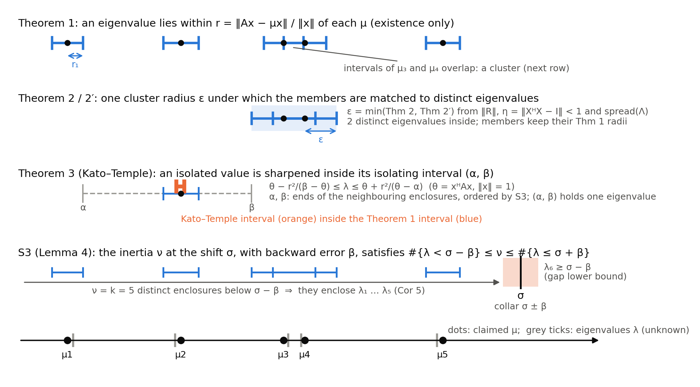
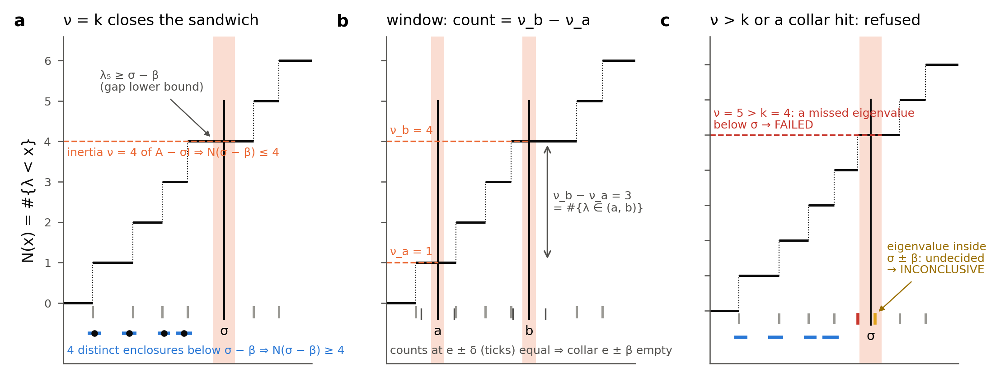

# Theorems and lemmas: hypotheses, statements, proofs, implementation, status

This document states every theorem and lemma on which a CERTIFY-ED statement rests. For each result it gives the
hypotheses, the statement in mathematical notation, an outline of the proof, the module and function that implement it
at commit `a814d28` of `dev/3.2`, and its check status. The names follow `code/certify-ed/docs/theory.md`; the LaTeX
label of the fourth manuscript scaffold (`manuscript_v4/sections/s3_math.tex`, proofs in
`manuscript_v4/sections/appA_proofs.tex`) is given in parentheses. The table at the end collects the check status of
every result. What the statements of a certificate assert is in [certificate_statements.md](certificate_statements.md);
the floating-point model is in [arithmetic_model.md](arithmetic_model.md); the derivation documents cited below are
described one by one in [derivation_documents.md](derivation_documents.md).

Notation. A is a Hermitian $n \times n$ matrix with eigenvalues $\lambda_1 \le \dots \le \lambda_n$, counted with
multiplicity. In a certificate A is the operator of the declared model on the producer's basis. $\lVert \cdot \rVert$ is
the Euclidean norm of a vector and the spectral norm (largest singular value) of a matrix; $\lVert \cdot \rVert_F$ is
the Frobenius norm; $X^H$ is the conjugate transpose. For a set S of reals, $\#\{\lambda \in S\}$ is the number of
eigenvalues of A in S, counted with multiplicity.

## Enclosures (statement S2)

### Theorem 1, the residual bound (`thm:residual`)

**Hypotheses.** A Hermitian, $x \ne 0$, $\mu$ real.

**Statement.**
$$\min_i \lvert \lambda_i - \mu \rvert \le \frac{\lVert Ax - \mu x \rVert}{\lVert x \rVert}.$$

**Proof outline.** Expand x in an orthonormal eigenbasis, $x = \sum_k c_k v_k$. Then
$\lVert Ax - \mu x \rVert^2 = \sum_k \lvert c_k \rvert^2 (\lambda_k - \mu)^2 \ge \min_k (\lambda_k - \mu)^2 \lVert x \rVert^2$
(Parlett 1998, Theorem 4.5.1). The theorem gives existence only: two copies of one vector satisfy it with the same
eigenvalue, so it never shows that two claimed values belong to two different eigenvalues. The hypothesis $x \ne 0$ is
checked; a zero vector gives an infinite radius, not radius 0 (review finding IMP-18).

**Implementation.** `enclosure.residuals` evaluates the right-hand side in floating point with every rounding bounded
(Theorem 1-fl, the six steps of [arithmetic_model.md](arithmetic_model.md)); `enclosure._rounding_bound` forms the
entrywise bound; `fp.norm2_upper` and `fp.norm2_lower` bound the norms.

**Status.** Classical. Its floating-point evaluation is the subject of two derivation documents: `thm1_fp-accounting.md`
(verdict GAP for complex data, closed in the code by a looser constant) and `int05_underflow.md` (verdict ERROR for
overflowing vectors, corrected in the code).

### The polar-factor lemma (`lem:polar`)

**Hypotheses.** $X \in \mathbb{C}^{n \times g}$ with orthonormality defect $\eta = \lVert X^H X - I \rVert < 1$;
$\Lambda$ a Hermitian $g \times g$ matrix (in the code a real diagonal matrix of claimed values); $R = AX - X\Lambda$;
$\delta = 1 - \sqrt{1 - \eta}$; $M = (X^H X)^{1/2}$ and $\hat Q = X M^{-1}$, the unitary polar factor of X.

**Statement.** (a) $\hat Q^H \hat Q = I$; (b) $\lVert M - I \rVert \le \delta$ and
$\lVert M^{-1} \rVert \le (1 - \eta)^{-1/2}$; (c) $\lVert X - \hat Q \rVert \le \delta$; (d)
$$\lVert A \hat Q - \hat Q \Lambda \rVert \le \rho := \lVert R \rVert + (\lVert A \rVert + \lVert \Lambda \rVert)\,\delta .$$

**Proof outline.** The eigenvalues of $X^H X$ lie in $[1 - \eta, 1 + \eta]$, so those of M lie in
$[\sqrt{1-\eta}, \sqrt{1+\eta}]$, and both $1 - \sqrt{1-\eta}$ and $\sqrt{1+\eta} - 1$ are at most $\delta$. Then
$X - \hat Q = \hat Q (M - I)$ gives (c), and $A\hat Q - \hat Q \Lambda = R - A(X - \hat Q) + (X - \hat Q)\Lambda$ gives (d)
by the triangle inequality.

**Implementation.** Inside `enclosure._cluster_bound`, which computes $\eta$ from accurately rounded Gram entries
(`fp.exact_gram`) or, above `enclosure.EXACT_GRAM_BUDGET` entries, from the $\gamma_n$ bound.

**Status.** Marked UNVERIFIED in the manuscript scaffold; derived in `thm2_polar-factor.md` (verdict
AGREES-WITH-REMARKS).

### Theorem 2, clusters with non-orthonormal vectors (`thm:cluster`)

**Hypotheses.** Those of the polar-factor lemma; $\mu_1, \dots, \mu_g$ the eigenvalues of $\Lambda$.

**Statement.** There are distinct indices $i_1, \dots, i_g$ with
$$\lvert \lambda_{i_j} - \mu_j \rvert \le \rho \qquad (j = 1, \dots, g).$$

**Proof outline.** Kahan's inclusion theorem (Kahan 1967; Parlett 1998, Theorem 11.5.1) says that for an isometry Q and
any Hermitian $g \times g$ matrix H the eigenvalues of H can be matched to g distinct eigenvalues of A within
$\lVert AQ - QH \rVert$; its proof uses the Courant-Fischer characterization to count eigenvalues in intervals and
Hall's marriage theorem to build the matching. Applied to $Q = \hat Q$ and $H = \Lambda$ with part (d) of the lemma it
gives the theorem. For orthonormal Ritz pairs it is Kahan's theorem with $\rho = \lVert R \rVert$.

**Implementation.** `enclosure._cluster_bound`; the same radius is returned by `certify._subspace_shift` (a single
symmetry sector against the full operator, with X = V) and `sectors.decomposition_shift`. Every term is an upper bound
guarded with `fp.up` and the INT-05 additive terms.

**History.** Until the branch `track/backlog-proofs` the radius was
$\varepsilon = (w + \sqrt{w^2 + 4\rho^2})/2 \ge \rho$, from a Weyl-perturbation argument of the manuscript appendix. The
review of 21 October 2026 observed that this constant is never smaller than Kahan's $\rho$ and measured
$\varepsilon/\rho$ between 1.000148 and 1.618 (finding IMP-12); decision D-52 restated the theorem as Kahan's theorem
applied to the polar factor (`project_docs/DECISIONS_LOG.md`).

**Status.** The theorem is labelled classical in the manuscript scaffold (Kahan's theorem applied to the polar factor);
the derivation that the code now relies on, including the change of constant, is `thm2_polar-factor.md` (verdict
AGREES-WITH-REMARKS).

### Theorem 2', the sharper cluster radius (`lem:epsstar`)

**Hypotheses.** Those of Theorem 2; $\mathrm{spread}(\Lambda) = \lambda_{\max}(\Lambda) - \lambda_{\min}(\Lambda)$.

**Statement.** There are distinct indices $i_1, \dots, i_g$ with
$\lvert \lambda_{i_j} - \mu_j \rvert \le \varepsilon^*$, where
$$\varepsilon^* = \frac{\lVert R \rVert}{\sqrt{1-\eta}} + \frac{\lVert X^H R \rVert}{1-\eta} + \frac{\delta\, \mathrm{spread}(\Lambda)}{\sqrt{1-\eta}} .$$
Consequently $\min(\rho, \varepsilon^*)$ is a valid common radius for the cluster.

**Proof outline.** Put $H' = \hat Q^H A \hat Q$. From $AX = R + X\Lambda$ one gets
$A\hat Q = R M^{-1} + \hat Q M \Lambda M^{-1}$, so $(I - \hat Q \hat Q^H) A \hat Q = (I - \hat Q \hat Q^H) R M^{-1}$ and
$\lVert A\hat Q - \hat Q H' \rVert \le \lVert R \rVert / \sqrt{1-\eta}$; Kahan's theorem matches the eigenvalues of $H'$
to g distinct eigenvalues of A within that distance. Next,
$H' - \Lambda = M^{-1} X^H R M^{-1} + [M - I, \Lambda - cI] M^{-1}$ for any scalar c; with c the midpoint of the
spectrum of $\Lambda$ this gives
$\lVert H' - \Lambda \rVert \le \lVert X^H R \rVert/(1-\eta) + \delta\,\mathrm{spread}(\Lambda)/\sqrt{1-\eta}$, and
Weyl's inequality pairs the sorted eigenvalues of the Hermitian matrices $H'$ and $\Lambda$ within that bound. Composing
the two matchings proves the statement. For exact eigenvectors of one degenerate level $\varepsilon^*$ is of the order
of the residual, while $\rho$ is dominated by $(\lVert A \rVert + \lVert \Lambda \rVert)\delta$; this is why a correct
claim with valid non-orthogonal eigenvectors of a degenerate level was FAILED before 3.1.0 (review finding IMP-13).

**Implementation.** `enclosure._cluster_bound` computes $\rho$ and $\varepsilon^*$ and uses their minimum.

**Status.** New mathematics, proposed by the review of 21 October 2026, with 15 876 random cases and no violation at the
time (`docs/what_certified_means.md`); derived in `thm2prime_eps-star.md` (verdict AGREES-WITH-REMARKS).

### Theorem 3, Kato-Temple (`thm:kato`)

**Hypotheses.** $\lVert x \rVert = 1$, $\theta = x^H A x$, $r = \lVert Ax - \theta x \rVert$, and an interval
$(\alpha, \beta)$ that contains $\theta$ and exactly one eigenvalue $\lambda$.

**Statement.**
$$\theta - \frac{r^2}{\beta - \theta} \le \lambda \le \theta + \frac{r^2}{\theta - \alpha}.$$

**Proof outline.** For real a, b, $x^H (A - a)(A - b) x = r^2 + (\theta - a)(\theta - b)$ because
$x^H (A - \theta) x = 0$. Every other eigenvalue lies outside $(\alpha, \beta)$, so $(A - \lambda)(A - \beta)$ and
$(A - \lambda)(A - \alpha)$ are positive semidefinite. Hence $r^2 + (\theta - \lambda)(\theta - \beta) \ge 0$ and
$r^2 + (\theta - \lambda)(\theta - \alpha) \ge 0$, which rearrange to the two bounds (Kato 1949; Temple 1928).

**Implementation.** `enclosure.kato_temple` and `enclosure.rayleigh_interval` (the Rayleigh quotient from error-free
products, so that its error is at most $2u\lvert\theta\rvert$ plus the tiny-product term of `fp.exact_dot`), called from
`certify.certify` and `certify._kt_block`; $\alpha$ and $\beta$ come from the enclosures of the neighbouring levels or
from the window certified by S3, and $\theta$ and r are replaced by enclosing intervals.

**Status.** Classical.

The figure (`code/certify-ed/docs/figures/fig_enclosure_geometry.png`; positions are illustrative) places Theorems 1 to
3 on the real line: a Theorem 1 interval around each claimed value, one cluster radius for overlapping intervals
(Theorems 2 and 2'), the Kato-Temple refinement inside an isolating interval, and the inertia count of Lemma 4 that
closes the argument of Corollary 5.

## Counting (statement S3)

### Lemma 4, inertia with backward error (`lem:inertia`)

**Hypotheses.** A unit lower-triangular L, a block-diagonal D with $1 \times 1$ and $2 \times 2$ blocks and $\nu$
negative eigenvalues, a permutation P and a real $\sigma$ with $\lVert L D L^H - P(A - \sigma I)P^T \rVert \le \beta$.

**Statement.**
$$\#\{\lambda < \sigma - \beta\} \le \nu \le \#\{\lambda < \sigma + \beta\}.$$

**Proof outline.** Put $E = P^T L D L^H P - (A - \sigma I)$, so $\lVert E \rVert \le \beta$. Since L is invertible,
Sylvester's law of inertia gives that $A + E - \sigma I$ has exactly $\nu$ negative eigenvalues. Weyl's inequality gives
$\lambda_i(A) - \beta \le \lambda_i(A + E) \le \lambda_i(A) + \beta$, so an eigenvalue of A below $\sigma - \beta$
produces one of $A + E$ below $\sigma$, and one of $A + E$ below $\sigma$ comes from one of A below $\sigma + \beta$.
The strict upper count is what the proof gives; `theory.md` writes the weaker $\le \#\{\lambda \le \sigma + \beta\}$.

**Implementation.** `inertia.inertia_dense` and `inertia.inertia_sparse`, with `inertia.count_bounds`. The count $\nu$
is exact: $1 \times 1$ pivots are counted by sign, $2 \times 2$ blocks by the signs of their determinant and trace
evaluated in rational arithmetic from the stored entries (`inertia._exact_sign`, `inertia._count_block_diagonal`); a
zero pivot or a singular block makes the count INCONCLUSIVE. On the dense path
$\beta = \lVert \hat R \rVert_F + \gamma_{2n+2} \lVert \lvert L \rvert \lvert D \rvert \lvert L \rvert^T \rVert_F + 2u \max_i \lvert a_{ii} - \sigma \rvert$,
with $\hat R$ the computed residual of the factors (`manuscript_v4/sections/appA_proofs.tex`). On the sparse path 3.1
used an a-priori bound that assumed how SuperLU computes its factors; since 3.2 $\beta$ is measured from the stored
factors (D-01, `ldl_residual.sparse_ldl_residual_bound`, described in
[derivation_documents.md](derivation_documents.md)), and the a-priori bound remains available as
`inertia_method='sparse-apriori'`. When S1 certified a model shift $\Delta$, every $\beta$ is replaced by
$\beta + \Delta$ (Theorem A5).

**Status.** Classical (Sylvester's law of inertia and Weyl's inequality); the measured $\beta$ of the sparse path is
derived in `D-01_sparse-residual.md` (verdict AGREES-WITH-REMARKS).

### Corollary 5, completeness, and the sorted-pairing lemma (`cor:complete`)

**Hypotheses.** Claimed values $\mu_1 \le \dots \le \mu_k$ with enclosures $[\mu_j - r_j, \mu_j + r_j]$ matched to k
distinct eigenvalue indices (by Theorem 1 for isolated values and Theorem 2 or 2' within clusters), all inside
$(-\infty, \sigma - \beta)$; an inertia count with $\nu = k$ at the shift $\sigma$ with backward error $\beta$.

**Statement.** The matched eigenvalues are $\lambda_1, \dots, \lambda_k$, and $\lambda_{k+1} \ge \sigma - \beta$. If in
addition the enclosures are pairwise disjoint, or the members of each group of overlapping enclosures share one radius,
then $\lvert \lambda_j - \mu_j \rvert \le r_j$ in sorted order. With a model shift $\Delta$ the radii and $\beta$ grow
by $\Delta$.

**Proof outline.** The k matched eigenvalues are distinct and lie below $\sigma - \beta$, and Lemma 4 with $\nu = k$
allows at most k eigenvalues there; so they are exactly the k lowest, and the next one is at least $\sigma - \beta$. The
sorted-pairing lemma says that if a bijection between two lists of k reals moves no element by more than a common r,
then the pairing in sorted order also moves no element by more than r; it fails for non-uniform radii, which is why the
code merges overlapping intervals into groups and gives each group one radius. The model shift enters by Weyl's
inequality.

**Implementation.** `certify._certify_lowest` and `certify._certify_window`, with the grouping of overlapping intervals
in `enclosure.enclose`; every endpoint is rounded outward.

**Status.** Marked UNVERIFIED in the manuscript scaffold (the sorted-pairing hypothesis was missing in the third
scaffold, review findings M-03, MS-M09, MS-A05) and listed as classical in
`code/certify-ed/docs/what_certified_means.md`; derived in `cor5_pairing.md` (verdict AGREES).

The figure (`code/certify-ed/docs/figures/fig_inertia_completeness.png`; spectra illustrative,
$N(x) = \#\{\lambda < x\}$) shows in panel (a) the sandwich of Corollary 5 for a `lowest` claim, in panel (b) the
vectorless window count C-02 with two further counts per edge, and in panel (c) what a count refuses: $\nu > k$ means an
eigenvalue below $\sigma$ is missing from the claim (FAILED), and an eigenvalue inside the collar leaves the count
undecided (INCONCLUSIVE).

## Eigenspaces and labels (statement S4)

### Theorem 6, the projector bound (`thm:dk`)

**Hypotheses.** The setting of the polar-factor lemma; an interval I that contains the enclosures of
$\mu_1, \dots, \mu_g$, each of radius at least $w := \lVert \hat Q^H (A \hat Q - \hat Q \Lambda) \rVert$, and exactly g
eigenvalues of A, with spectral projector P; the remaining eigenvalues at distance at least sep from the Ritz values
(the eigenvalues of $\hat Q^H A \hat Q$); $s = \rho/\mathrm{sep} < 1$.

**Statement.**
$$\lVert \hat Q \hat Q^H - P \rVert \le s, \qquad \lVert X X^H - P \rVert \le s + \eta, \qquad \lvert \mathrm{tr}(X^H O X) - \mathrm{tr}(PO) \rvert \le 2g \lVert O \rVert (s + \eta)$$
for every Hermitian O.

**Proof outline.** The Ritz values lie within w of the $\mu_j$ and hence inside I. No remaining eigenvalue lies between
a Ritz value and I, because such an eigenvalue would be closer than $w \le \rho < \mathrm{sep}$ to that Ritz value. For
any $g \times g$ matrix K, $A\hat Q - \hat Q K$ splits into two terms with orthogonal ranges, so
$\lVert A \hat Q - \hat Q \Lambda_Q \rVert \le \lVert A \hat Q - \hat Q \Lambda \rVert \le \rho$ with
$\Lambda_Q = \hat Q^H A \hat Q$. The Davis-Kahan $\sin\Theta$ theorem (Davis and Kahan 1970) then gives
$\lVert \sin\Theta \rVert \le \rho/\mathrm{sep}$, which equals $\lVert \hat Q \hat Q^H - P \rVert$ for subspaces of
equal dimension. Further $XX^H - \hat Q \hat Q^H = \hat Q (M^2 - I) \hat Q^H$ has norm $\eta$, and
$\lvert \mathrm{tr}(ZO) \rvert \le \lVert Z \rVert_{\rm tr} \lVert O \rVert$ with trace norm at most
$\mathrm{rank}(Z) \lVert Z \rVert \le 2g \lVert Z \rVert$.

**Implementation.** `eigenspace.certify_eigenspace` and `eigenspace.certify_observable`. Since 3.2 the projector bound
is $\min(s_6, s_{DK})$, where $s_{DK}$ is the Frobenius-norm bound of E-07 (`davis_kahan.sin_theta_davis_kahan`); both
are recorded under `sin_theta_bounds`.

**Status.** Marked UNVERIFIED in the manuscript scaffold (the Davis-Kahan theorem applied to the polar factor, with the
separation argument added after review findings M-14 and MS-M03) and listed as classical in `what_certified_means.md`.
There is no derivation document for Theorem 6 itself; the E-07 bound that is used beside it is derived in
`E-07_davis_kahan.md`.

### Proposition 7, quantum numbers (`prop:qn`)

**Hypotheses.** Those of Theorem 6; S Hermitian with $[A, S] = 0$; $q_1, \dots, q_g$ the eigenvalues of S on the range
of P; $\kappa = (1 - \eta)^{-1/2} - 1$.

**Statement.** The eigenvalues $m_j$ of $X^H S X$ satisfy
$$\lvert m_j - q_j \rvert \le 2 s^2 \lVert S \rVert + (2\kappa + \kappa^2)(1 + \eta) \lVert S \rVert .$$
If the possible eigenvalues of S lie on a lattice of spacing h and this bound is below h/2, each $m_j$ rounds to the
exact label.

**Proof outline.** Because S commutes with A, $P S P^\perp = 0$. Write $\hat Q = PC + P^\perp \hat Q$; the singular
values of C are the cosines of the principal angles, in $[\sqrt{1 - s^2}, 1]$. By Ostrowski's theorem the eigenvalues of
$C^H (PSP) C$ differ from the $q_j$ by at most $s^2 \lVert S \rVert$, the remaining term has norm at most
$s^2 \lVert S \rVert$, and Weyl's inequality adds the two. Finally $\hat Q^H S \hat Q - X^H S X = KN + NK + KNK$ with
$(X^H X)^{-1/2} = I + K$, $\lVert K \rVert \le \kappa$ and $N = X^H S X$,
$\lVert N \rVert \le (1 + \eta)\lVert S \rVert$.

**Implementation.** `eigenspace.certify_quantum_numbers`; total spin through the Casimir operator (`su2.casimir_spec`,
`su2.allowed_casimir_values`); momentum labels are audited through $\lVert GV - \lambda V \rVert$ with a leakage bound
(`sectors.audit_label`). Since 3.2 an operator that commutes with A only approximately is handled by C-12
(`davis_kahan.approximate_symmetry_label`).

**Status.** Marked UNVERIFIED in the manuscript scaffold; no derivation document.

## Symmetry sectors and the whole spectrum

### Theorem 8, sector assembly (`thm:compose`)

**Hypotheses.** Sector isometries $V_1, \dots, V_m$ with $\sum_s d_s = n$; $W = [V_1 \cdots V_m]$ (square) and
$B = \bigoplus_s H_s$ the block-diagonal matrix of the sector blocks; $\eta = \lVert W^H W - I \rVert < 1$,
$\delta = 1 - \sqrt{1-\eta}$, and $\rho = D + (\lVert H \rVert + \lVert B \rVert)\delta$ with
$D \ge \lVert HW - WB \rVert$; in each sector the claims below a cut $E_{\rm cut}$ are certified, distinct, of common
radius at most r, inside $(-\infty, E_{\rm cut} - \max_s \beta_s)$, and an inertia count shows no other eigenvalue of
$H_s$ below $E_{\rm cut} - \beta_s$. H is the symmetrised built matrix, whose distance to the declared model is the
builder shift m (Appendix A).

**Statement.** The K pooled claimed values, sorted as $c_{(1)} \le \dots \le c_{(K)}$, satisfy
$\lvert \lambda_j - c_{(j)} \rvert \le r + \varepsilon$ for $j \le K$, and
$\lambda_{K+1} \ge E_{\rm cut} - \max_s \beta_s - \varepsilon$, with $\varepsilon = \rho + m$, for the eigenvalues
$\lambda_j$ of the declared model.

**Proof outline.** Because W is square, its polar factor $\hat Q$ is unitary. With $\hat R = H\hat Q - \hat Q B$ and
$\lVert \hat Q - W \rVert \le \delta$, the polar-factor lemma gives $\lVert \hat R \rVert \le \rho$;
$\hat Q^H H \hat Q - B = \hat Q^H \hat R$ is Hermitian and $\hat Q^H H \hat Q$ has the spectrum of H, so Weyl's
inequality pairs the sorted eigenvalues of H and B within $\rho$. In each sector Corollary 5 gives the claimed values
within r of the eigenvalues of $H_s$ below the cut; because every unclaimed eigenvalue of every block lies at or above
$E_{\rm cut} - \max_s \beta_s$, the K smallest eigenvalues of B are the matched ones, and the sorted-pairing lemma pairs
them in order. A second application of Weyl's inequality adds the builder shift. The third manuscript scaffold had
$\varepsilon = \tfrac{1+\sqrt5}{2}\rho$ here, from a bordered argument; for square W the polar factor is unitary and
$\rho$ suffices (review findings IMP-12, IMP-20).

**Implementation.** `compose.certify_low_energy`.

**Status.** Marked UNVERIFIED in the manuscript scaffold; derived in `thm8_rho.md` (verdict AGREES). The independent
derivation remarks that `sectors.audit_orthogonality` omits the rounding term of the computed product $V_a^H V_b$; that
function feeds only `sectors.decomposition_shift`, which no certified path calls.

### Proposition 9, the complete whole-spectrum enclosure (`prop:spectrum`)

**Hypotheses.** A has finite entries and is block diagonal in a basis where a conserved quantity is diagonal, with no
stored entry between different values of it (checked exactly). In each block s the computed pairs are grouped into
pairwise disjoint, outward-rounded intervals $I_{s,1}, I_{s,2}, \dots$, and group j carries $g_{s,j}$ distinct
eigenvalue indices of the block, by Theorem 1 for a single pair or Theorem 2 for a cluster.

**Statement.** If every group is counted and $\sum_{s,j} g_{s,j} = n$, then every eigenvalue of A lies in
$\bigcup I_{s,j}$, and each $I_{s,j}$ contains exactly $g_{s,j}$ eigenvalues of its block. Intervals of different blocks
may overlap; a merged interval contains exactly the sum of the counts of its parts.

**Proof outline.** The eigenvalues of A are the union, with multiplicity, of those of the blocks. Within one block the
matched indices of different groups are distinct because their intervals are disjoint, so $\sum_j g_{s,j} \le d_s$;
summing over blocks forces equality in every block. Every index is then matched, so every eigenvalue lies in some
interval, and an interval cannot hold an extra eigenvalue of its block, because that index would be matched to a group
with a disjoint interval (pigeonhole).

**Implementation.** `spectrum.enclose_spectrum` (with `spectrum.merge_intervals`). The exact check of the block
structure is what symveig 1.0.0 lacked (finding P2), and the count condition replaces symveig's unproved multiplicities
(finding P1); see `docs/applications/symveig_e8.md`.

**Status.** Marked UNVERIFIED in the manuscript scaffold; no derivation document. Proposition 16 and the S7 statement
rest on it.

## The exact layer (statement S6)

The exact layer re-derives S2 and S3 with no floating-point hypothesis. Its results are written in
`code/certify-ed/docs/theory.md`, section 7, and in `manuscript_v4/sections/s3_math.tex`; their proofs in
`manuscript_v4/sections/appB_exact.tex`. None of them has a derivation document among the 22. What each step computes,
by which function and at which sizes, and what remains trusted, is in [exact_layer.md](exact_layer.md).

### Lemma 10, the scaled basis (`lem:scaled`)

**Statement.** For each local space there are integer weights $w_k \ge 1$, namely $\binom{2S}{k}$ for spin S, $k!$ for
bosons and 1 for fermions and spin 1/2, such that with $D = \mathrm{diag}(\sqrt{w})$ over the many-body basis (weights
multiply over sites) the matrix $K = D^{-1} H D$ has rational or Gaussian-rational entries whenever the couplings are
binary64 numbers, and $DHD = WK$ with $W = \mathrm{diag}(w)$ is Hermitian with such entries. The spin weights are
invariant under $k \mapsto 2S - k$, so the spin flip remains a symmetry of K.

**Proof outline.** In the unnormalized basis $a^{2S-k} b^k$ of the spin-S representation (the Schwinger-boson picture)
the ladder operators act by integers: $S^+$ gives $k + 1$ and $S^-$ gives $2S - k + 1$ after the scaling; for bosons
with weights $k!$, $b^\dagger$ gives 1 and b gives k.

**Implementation.** `checker.exact_matrix`, `checker.is_hermitian_exact` and the exact components of each local space.

**Status.** Labelled "classical, re-derived" in the manuscript scaffold.

### Lemma 11, the exact count (`lem:exactcount`)

**Hypotheses.** A rational shift $g = a/b$ with $b > 0$; a positive common denominator den of K; the integer Hermitian
matrix $M = \mathrm{den} \cdot D(bH - aI)D$; integer-checked factors with L exactly unit lower triangular and a
permutation P such that $\lVert L \tilde D L^T - P M P^T \rVert \le \beta$; $\nu$ the number of negative eigenvalues of
$\tilde D$.

**Statement.** With $\delta = \beta/(b \cdot \mathrm{den})$,
$$\#\{\lambda < g - \delta\} \le \nu \le \#\{\lambda < g + \delta\}.$$

**Proof outline.** M is congruent to $b \cdot \mathrm{den} \cdot (H - g)$ through D. A perturbation E of M with
$\lVert E \rVert \le \beta$ is a perturbation $D^{-1} E D^{-1}/(b \cdot \mathrm{den})$ of $H - g$ of norm at most
$\delta$, because every weight is at least 1, so $\lVert D^{-1} \rVert \le 1$; Lemma 4 then applies. A floating-point
$LDL^T$ only proposes the factors; they are moved to dyadic grids and the residual $L\tilde D L^T - PMP^T$ is computed
exactly with FLINT, block of rows by block of rows.

**Implementation.** `checker.inertia_exact`, `checker.inertia_exact_int`, `checker._weighted_shift_matrix`.

**Status.** Marked UNVERIFIED; no derivation document.

### Lemma 12, exact symmetry sectors (`lem:sectors`)

**Statement.** Let G be a group of signed permutations of the basis (site permutations and spin flips with phases
$\pm 1$) that preserves the weights and commutes with K, and let $\chi: G \to \{\pm 1, \pm i\}$ be a homomorphism;
closure, both conditions and $\chi$ are checked exactly. The nonzero orbit sums
$v = \sum_{h \in G} \overline{\chi(h)}\, \phi_h(s)\, e_{hs}$ are mutually orthogonal Gaussian-integer vectors with
$\lVert Dv \rVert^2 \ge 1$, the blocks $v^H (WK) v'$ are Gaussian-integer Hermitian, and if the sector dimensions add up
to n, Lemma 11 applies block by block with the same $\delta$; a complex block is counted through its real embedding, in
which every eigenvalue appears twice.

**Implementation.** `exact_sectors.orbit_columns`, `exact_sectors.sector_integer_matrix`,
`exact_sectors.check_commutes`, `exact_sectors.exact_count_below`. Non-abelian groups are allowed when every irreducible
representation met is one-dimensional, for example momentum 0 or $\pi$ with reflection and spin flip; this is how the
crown application works (`docs/applications/crown_kranitz_penc.md`).

**Status.** Marked UNVERIFIED; no derivation document.

### Proposition 13, the exact "k lowest" statement (`prop:exactlowest`)

**Hypotheses.** Every claimed vector is nonzero (checked exactly). The exact residual intervals of the claimed values
(Theorem 1 evaluated in rationals, with an integer square root bounding the radius) are merged into components
$C_1 < \dots < C_m$ with $m_j$ claimed values in $C_j$ and $K_j = m_1 + \dots + m_j$. Lemma 11 counts at points g where
no component meets $[g - \delta_g, g + \delta_g]$: one point in every gap, one above $C_m$, and for every $C_j$ with
$m_j \ge 2$ also one point just below and one just above it. Every count equals the number of claimed values below its
point.

**Statement.** For $m_j = 1$, $\lambda_{K_j} \in C_j$; for $m_j \ge 2$, $\lambda_{K_{j-1}+1}, \dots, \lambda_{K_j}$ lie
in the bracket $[a_j - \delta, b_j + \delta]$ around $C_j$ (a "level enclosure"); and
$\lambda_{k+1} \ge g_{\rm top} - \delta$.

**Proof outline.** The counts on the two sides of each component pin the indices of the eigenvalues inside it, so no
distinctness argument is needed for single values. Residual intervals give an eigenvalue each, not distinct ones; before
3.1 a single count above a component with several claimed values was taken to mean that the component held all of them,
and two copies of the first excited vector claimed as "the two lowest" were certified although the ground state was
missing (decision D-46; now a test). FAILED is reported only when an unclaimed eigenvalue lies under a claimed one.

**Implementation.** `checker.exact_recheck_lowest`, `checker.certify_by_counts`, `checker._plan_points`,
`checker._decide`; for symmetry-adapted claims `exact_sectors.exact_recheck_sector_lowest`.

**Status.** Marked UNVERIFIED; no derivation document.

## Statements added in 3.1 (statements S7, S8 and the S4 extension)

These four results were written before their code in 3.1 (decision D-46) and derived in 3.2 under decision D-59. The
code in `degeneracy.py`, `correlations.py`, `ivl.py` and `thermo.py` implements exactly the statements below, and the
tests check the implementation against the statements.

### Proposition 14, the bracketing count (statement S8)

**Hypotheses.** A cluster C of g claimed pairs certified distinct by Theorem 2, with a level enclosure $J = [J_L, J_U]$
that contains all g enclosures; two inertia counts (Lemma 4) at shifts $\sigma_{\rm lo} < J_L$ and
$\sigma_{\rm hi} > J_U$ with counts $\nu_{\rm lo}, \nu_{\rm hi}$ and backward errors $\beta_{\rm lo}, \beta_{\rm hi}$.
Put $I_{\rm in} = (\sigma_{\rm lo} + \beta_{\rm lo}, \sigma_{\rm hi} - \beta_{\rm hi})$ and
$I_{\rm out} = [\sigma_{\rm lo} - \beta_{\rm lo}, \sigma_{\rm hi} + \beta_{\rm hi}]$.

**Statement.**
$$\#\{\lambda \in I_{\rm in}\} \le \nu_{\rm hi} - \nu_{\rm lo} \le \#\{\lambda \in I_{\rm out}\}.$$
If $J \subset I_{\rm in}$ and $\nu_{\rm hi} - \nu_{\rm lo} = g$, then $I_{\rm in}$ contains exactly g eigenvalues, the g
distinct eigenvalues matched to C by Theorem 2. If $\nu_{\rm hi} - \nu_{\rm lo} > g$, a further eigenvalue lies in
$I_{\rm out}$ and the degeneracy of the level is INCONCLUSIVE.

**Proof outline.** Subtract the upper bound on $\nu_{\rm lo}$ from Lemma 4 from the lower bound on $\nu_{\rm hi}$, and
the other way round. If $J \subset I_{\rm in}$, the g distinct eigenvalues of Theorem 2 lie in $I_{\rm in}$, so
$\#\{\lambda \in I_{\rm in}\} \ge g$, and the first inequality gives equality.

**Implementation.** `degeneracy.degeneracy_counts` (with `degeneracy._probe` and `degeneracy._count`); the shifts are
moved outward, at most three times, when a backward error is not smaller than the distance to J, and the model shift is
added to both $\beta$.

**Status.** Derived in `P14_degeneracy_bracketing.md` (verdict AGREES).

### Proposition 15, summed bounds (S4 extension)

**Hypotheses.** P the spectral projector of a certified cluster; Hermitian operators $O_1, \dots, O_m$ with computed
values $v_k = \mathrm{tr}(X^H O_k X)$ and Theorem 6 bounds $b_k \ge \lvert \mathrm{tr}(P O_k) - v_k \rvert$; complex
coefficients $a_1, \dots, a_m$.

**Statement.**
$$\Bigl\lvert \sum_k a_k\, \mathrm{tr}(P O_k) - \sum_k a_k v_k \Bigr\rvert \le \sum_k \lvert a_k \rvert b_k ,$$
and in floating point $\lvert \sum_k a_k \mathrm{tr}(P O_k) - \mathrm{fl}(\sum_k a_k v_k) \rvert \le B$ with B the
upward-rounded $\sum_k \lvert a_k \rvert b_k$ plus the upward-rounded
$2\gamma_{m+2} \sum_k \lvert a_k \rvert \lvert v_k \rvert$, where each modulus is bounded from above (Lemma A of the
derivation document).

**Proof outline.** Triangle inequality term by term, plus the rounding error of the complex inner product (Lemma B of
the derivation document).

**Implementation.** `correlations.combine_certified` and `correlations.modulus_upper`; used by
`correlations.certify_correlations` (two-point functions $\mathrm{tr}(P O_i O_j)$) and `correlations.structure_factor`
($S(q) = N^{-1} \sum_{i,j} e^{iq \cdot (r_i - r_j)} C_{ij}$, so $\lvert a_{ij} \rvert = 1/N$).

**Status.** Derived in `P15_summed_bounds.md` (verdict AGREES). The derivation replaced the moduli $\lvert a_k \rvert$,
which had come from the C library's `hypot`, by an upper bound from the IEEE square root, and added directed rounding
and the constant $\gamma_{m+2}$; both changes make the bound looser.

### Proposition 16, thermodynamic intervals (statement S7)

**Hypotheses (H).** Intervals $[l_k, h_k]$ with counts $c_k$, $k = 1, \dots, m$, $\sum_k c_k = n$, such that every
eigenvalue of A lies in some interval and interval k contains exactly $c_k$ eigenvalues (the complete enclosure of
Proposition 9). Boltzmann constant 1, temperature $T > 0$, $\beta = 1/T$. Put $E_0 = \min_k l_k$,
$a_k = l_k - E_0 \ge 0$, $b_k = h_k - E_0$, and $W_k = c_k [e^{-\beta b_k}, e^{-\beta a_k}]$.

**Statement.** With interval arithmetic,
$$\tilde Z = \sum_k W_k \ni Z e^{\beta E_0}, \quad F = E_0 - T \ln \tilde Z, \quad U = E_0 + \langle e \rangle, \quad \langle e \rangle \in \frac{\sum_k W_k [a_k, b_k]}{\tilde Z},$$
$$\mathrm{Var}(E) \in \Bigl(\frac{\sum_k W_k [a_k^2, b_k^2]}{\tilde Z} - \langle e \rangle^2\Bigr) \cap [0, \infty), \qquad C = \beta^2\, \mathrm{Var}(E).$$

**Proof outline.** Each eigenvalue of interval k contributes a Boltzmann weight in
$e^{-\beta E_0} [e^{-\beta b_k}, e^{-\beta a_k}]$ because the exponential is decreasing; summing the $c_k$ members and
then over k gives the enclosure of Z, and the same termwise argument encloses the first and second moments ($a_k \ge 0$,
so squaring is monotone). A quotient of enclosures encloses the quotient, and F follows from the monotonicity of the
logarithm. The interval for C can be loose, because the interval quotient ignores the correlation between numerator and
denominator; at very low temperature it stays correct but may be wide.

**Implementation.** `thermo.thermo_intervals_from_enclosure` and `thermo.thermodynamics`, in the dyadic arithmetic of
Lemma 17.

**Status.** Derived in `P16_thermo_intervals.md` (verdict AGREES-WITH-REMARKS: the statement omits the case in which the
lower end of $\tilde Z$ rounds to 0 on the grid, where the code raises an error and S7 is INCONCLUSIVE).

### Proposition 16', thermodynamics from the k lowest eigenvalues (C-06)

**Hypotheses (H').** The k lowest eigenvalues of A are enclosed by intervals with exact counts (S2 and S3 of a `lowest`
claim); a number L with every interval end below L and $L \le \lambda_{k+1}$ (the S3 bound); the dimension n; optionally
$M \ge \lambda_n$ (a norm bound). Put $\ell = L - E_0$ and $\mu = M - E_0$ ($\mu = \infty$ without M),
$\varphi(e) = e\, e^{-\beta e}$ and $\psi(e) = e^2 e^{-\beta e}$.

**Statement.** The omitted weight satisfies $\sum_{j>k} e^{-\beta e_j} \in (n - k) [e^{-\beta\mu}, e^{-\beta\ell}]$, and
the omitted moments $\sum_{j>k} e_j e^{-\beta e_j}$ and $\sum_{j>k} e_j^2 e^{-\beta e_j}$ lie in $(n-k)$ times the range
of $\varphi$, respectively $\psi$, on $[\ell, \mu]$. The ranges follow from Lemma C: $\varphi$ increases up to $1/\beta$
and then decreases, and $\psi$ increases up to $2/\beta$ and then decreases. Adding these tail intervals to the sums of
Proposition 16 encloses Z, F, U, Var(E) and C on both sides.

**Proof outline.** Every omitted eigenvalue lies in $[L, M]$; bound each omitted term by the extreme values of the
corresponding function on that interval. The intervals are informative when $(n - k) e^{-\ell/T} \ll 1$, that is at
temperatures well below $\ell / \ln(n - k)$; above $\ell$ the bounds on U and C are wide, and the record says so
(`TAIL_LOOSENESS`).

**Implementation.** `thermo.thermodynamics_truncated`.

**Status.** Derived in `C06_truncated_thermodynamics.md` (verdict AGREES-WITH-REMARKS).

### Lemma 17, dyadic enclosures of exp and ln

**Statement.** All arithmetic of Propositions 16 and 16' is done on intervals whose ends are dyadic rationals
$p \cdot 2^{-192}$, with every operation rounded outward (floor for lower ends, ceiling for upper ends), and the results
enclose the exact values. For $x \ge 0$, exp(x) is enclosed by the Taylor polynomial of degree N at $t = x/2^s \le 1/2$,
with remainder $0 \le R \le \frac{t^{N+1}}{(N+1)!} \cdot \frac{1}{1 - t/(N+2)}$, followed by s squarings;
$e^{-x} = 1/e^{x}$ with outward division. For $z > 0$, write $z = 2^k m$ with $m \in [1, 2)$ and
$\ln z = k \ln 2 + 2\,\mathrm{atanh}(u)$ with $u = (m-1)/(m+1)$; the series $2\sum_{j \le N} u^{2j+1}/(2j+1)$ has
remainder $0 \le R \le \frac{2u^{2N+3}}{(2N+3)(1-u^2)} \le \frac{16}{7} \cdot \frac{u^{2N+3}}{2N+3}$ for the rounded
upper argument $u \le 0.35$, and $\ln 2 = 2\,\mathrm{atanh}(1/3)$. Conversions to binary64 round outward.

**Proof outline.** Standard Taylor remainders for exp (all terms positive) and for atanh; outward rounding preserves
enclosure at each step; squaring and division of positive intervals are monotone. The derivation found that the
remainder constant written in 3.1 (9/8 for $u \le 1/3$) does not cover the rounded upper argument, which can exceed 1/3
by one grid unit; the code now uses 8/7 for $u \le 0.35$, a looser bound.

**Implementation.** `ivl.exp_interval`, `ivl.ln_interval`, `ivl.ln2_interval`, `ivl.to_float_down`, `ivl.to_float_up`,
with Taylor degree 40 for exp and 60 terms of the atanh series (`docs/proofs/VERDICTS.md`).

**Status.** Derived in `L17_dyadic_exp_ln.md` (verdict AGREES).

## The model shift (Appendix A of the manuscript; statement S1)

The certificate's statements are about the declared model, while the bounds are computed for a floating-point matrix.
Appendix A bounds the distance between the two. Its results are those of
`code/certify-ed/docs/proofs/appA_model-shift.md`.

**The builder.** Each entry of the reference matrix $H_{\rm ref}$ is a floating-point sum of monomials. For every
coupling c of every operator string $o_1 \cdots o_L$ and every choice of one component per letter, a monomial maps a
basis state s to a state s' with amplitude $t = c f_1 \cdots f_L$, where $f_\ell$ is the local amplitude of letter
$\ell$ (exact for spin 1/2 and fermions, one rounding of a square root for spin at least 1 and for bosons), times an
exact Jordan-Wigner sign. At most $m := n_{\rm terms} \cdot 2^{L_{\max}}$ monomials contribute to one entry.
$\lvert H \rvert_{\rm abs}$ denotes the matrix of sums of the exact $\lvert t \rvert$.

**Lemma A1 (entrywise builder error).**
$\lvert H_{\rm ref} - H_{\rm spec} \rvert_{ij} \le \gamma_{m + 2L_{\max} - 1} (\lvert H \rvert_{\rm abs})_{ij}$.

**Lemma A2 (symmetrisation).** For $\hat H = (H_{\rm ref} + H_{\rm ref}^H)/2$,
$\lVert \hat H - H_{\rm spec} \rVert \le \lVert H_{\rm ref} - H_{\rm spec} \rVert$ in every unitarily invariant norm,
and the rounded $\hat H$ satisfies
$\lvert \mathrm{fl}(\hat H) - H_{\rm spec} \rvert_{ij} \le \gamma_W \max((\lvert H \rvert_{\rm abs})_{ij}, (\lvert H \rvert_{\rm abs})_{ji})$
with $W := m + 2L_{\max} + 2$.

**Lemma A3 (norm bound).** For any matrix E,
$\lVert E \rVert_2 \le \sqrt{\lVert E \rVert_1 \lVert E \rVert_\infty} \le \max(\lVert E \rVert_1, \lVert E \rVert_\infty)$,
so $\Delta_{\rm builder} := \gamma_W \sqrt{rc}$ bounds both $\lVert H_{\rm ref} - H_{\rm spec} \rVert_2$ and
$\lVert \mathrm{fl}(\hat H) - H_{\rm spec} \rVert_2$, with r the largest row sum and c the largest column sum of
$\lvert H \rvert_{\rm abs}$.

**Theorem A4 (the model shift).** If S1 certified the producer's matrix $H_h$ against $H_{\rm ref}$ and
$D := H_h - H_{\rm ref}$, then
$$\lVert H_h - H_{\rm spec} \rVert_2 \le \max(\lVert D \rVert_1, \lVert D \rVert_\infty) + \Delta_{\rm builder} =: \Delta .$$
When the producer supplies no matrix, $\Delta = \Delta_{\rm builder}$.

**Theorem A5 (Weyl transfer).** Both matrices are Hermitian, so
$\lvert \lambda_j(H_{\rm spec}) - \lambda_j(H_h) \rvert \le \Delta$ for every j. Hence an S2 enclosure of radius r for
$H_h$ becomes one of radius $r + \Delta$ for the declared model (also for matchings to distinct eigenvalues, by
composing with the sorted bijection), an S3 count with backward error $\beta$ becomes one with $\beta + \Delta$, and the
S4 separations shrink by $2\Delta$.

**Proof outline.** Lemma A1 counts the roundings of one monomial ($L_{\max}$ products and the conversions of the local
amplitudes) and of the sum of at most m monomials; Lemma A2 is the convexity of a unitarily invariant norm plus one
rounding per entry; Lemma A3 is the standard inequality
$\lVert E \rVert_2^2 \le \lVert E \rVert_1 \lVert E \rVert_\infty$; Theorem A4 is the triangle inequality; Theorem A5 is
Weyl's inequality.

**Implementation.** `construct._apply_string`, `construct.build_bitwise`, `construct._finalize`,
`construct.hermitian_part`, `certify._builder_shift`, `certify.check_model_fidelity`, `fp.inf_norm_upper`.

**Status.** Derived in `appA_model-shift.md` (verdict AGREES-WITH-REMARKS: Lemma A2 is stated in the max form, which
does not by itself imply the 2-norm bound for an asymmetric $\lvert H \rvert_{\rm abs}$, while the proof of Lemma A3
correctly uses the symmetric form). The derivation made three bounds of the code looser: the factor $1/(1 - \gamma_W)$
in `_builder_shift`, the adapter width $m + 2L_{\max} + 2$ for spec operators, and the explicit symmetrisation
`hermitian_part` of the built reference.

## The size of the bounds in the evidence runs

How far a certified bound lies from the true error is measured by experiment E3 (`experiments/e3_tightness.py` of the
code repository); the experiments documents of this repository give the full account
([E3_tightness.md](../experiments/E3_tightness.md), [E4_workflows.md](../experiments/E4_workflows.md)). This section
collects the numbers that bear on the theorems above, from the 3.2.1 evidence run
(`code/certify-ed/results/run_full_20261105/E3.log`, `E4.log` and the E4 record
`e4_workflows_W1W2W3W4_20261105_095402/data.json`). Like every floating-point value they are run-stack values; the
corresponding values of the 21 October 2026 run are in row E3 of `project_docs/notes/claims_evidence_map.md`.

**Theorem 1 against Theorem 3.** For the J1-J2 chain of N = 12 sites at $J_2$ = 0.2 in the $S^z = 0$ block (dimension
924, gap 0.318156), the ground state is computed by `eigsh` with decreasing tolerance:

| solver tolerance | actual error | Theorem 1 radius | Kato-Temple half-width |
|---|---|---|---|
| 1e-01 | 6.16e-04 | 4.09e-02 | 2.63e-03 |
| 1e-03 | 1.41e-08 | 1.33e-04 | 2.76e-08 |
| 1e-06 | 1.60e-14 | 2.57e-07 | 1.26e-13 |
| 1e-08 | 1.07e-14 | 1.34e-10 | 2.22e-14 |
| 0 | 1.07e-14 | 3.10e-14 | 2.22e-14 |

The Theorem 1 radius is the residual norm, which is much larger than the error of the eigenvalue when the vector is
inaccurate, while the Kato-Temple half-width uses the squared residual divided by a gap bound and follows the actual
error, as Theorem 3 predicts. At full solver accuracy both are at the level of rounding. The rounding allowance of the
floating-point form of Theorem 1 costs a factor between 2.5 and 5.7 against residuals computed in interval arithmetic
with Arb (E3.log, "float64 bound / Arb residual: min 2.5, max 5.7"); experiment E0 compares the bound with Arb on 273
matrices and 6391 pairs, with no violation, a median ratio of 1.00 and a maximum of 130.97 (`E0.log`).

**Corollary 5.** In every case of E3(c) the log reports "certified gap/true gap = 0.900" with one factorization. This
ratio is a design constant, not a measure of tightness: the shift of the count is placed at 0.9 of the estimated gap
(row E3 of the claims map, finding MS-N07).

**Theorem 8.** Assembled from sectors for N = 12, the 19 lowest eigenvalues equal the pooled sector values within
1.22e-10, against an actual maximum error of 5.24e-14, and the next eigenvalue is certified to be at least -3.841534229,
against a true value of -3.7511828271 (E3.log). The claims map calls E3(d) "the weakest point on tightness". The
assembly radius contains the term $(\lVert H \rVert + \lVert B \rVert)(1 - \sqrt{1 - \eta})$, which grows with the
orthonormality defect $\eta$ of the pooled sector bases (`compose.py`); in the workflow W1 of E4 (242 blocks) the record
gives $\eta$ = 2.916908986400575e-10 and a common radius of 3.2086660317048632e-09.

**Theorem 6, the Davis-Kahan bound (E-07) and Proposition 7.** In the workflow W2 of E4, the Haldane triplet of a spin-1
Heisenberg ring of N = 8 sites (dimension 6561), the cluster has $\rho$ = 7.39670325789772e-13, $\eta$ =
8.271574999533854e-15 and a separation lower bound of 0.5935552543740519. The projector bound of Theorem 6 is
1.2461692830430924e-12, the Davis-Kahan bound of E-07 is 5.781853358347986e-13, and the smaller one is used. The $S^z$
labels are certified to be exactly -1, 0 and 1 (bound 1.7642776128941573e-11, Proposition 7), and
$\mathrm{tr}(P S^z_0 S^z_1)$ lies in [-1.34292510294487, -1.34292510293566], while the expectation in a single vector of
the triplet ranges from -0.6637555135906547 to -0.32148966294999903 as the vector is rotated within the level. All five
statements of W2 (S1, S2, S3, S4, S8) are CERTIFIED, with a maximum certified radius of 4.68e-13 and a certified gap of
at least 1.03 (`E4.log`).

## Check status of every result

The status vocabulary is that of [README.md](README.md). "Derivation document" names the file in
`code/certify-ed/docs/proofs/`. The counts are those of the document's status line, random plus adversarial cases, and
every run reported 0 violations. The verdict is that of the independent second derivation recorded in
`code/certify-ed/docs/proofs/VERDICTS.md`, which is an automated check, not a human check. "Sarang's check" is the check
required by rule D-12; it is pending for every derivation document. Classical results taken from the literature need no
such check; results marked UNVERIFIED without a derivation document are still waiting for both a derivation and the
check.

| result | manuscript label and mark | derivation document | machine-check counts (random + adversarial) | independent verdict | Sarang's check (D-12) |
|---|---|---|---|---|---|
| Theorem 1 (residual bound) | `thm:residual`, classical | none (classical, Parlett 1998) | none | none | not required |
| Theorem 1-fl (floating-point radius) | Appendix A text, to be rewritten (INT-04) | `thm1_fp-accounting.md` | 20 000 + 246 | GAP | pending |
| Theorem 1 under underflow (INT-05) | not in the manuscript | `int05_underflow.md` | listed below the table, + 373 | ERROR (corrected in the code) | pending |
| polar-factor lemma | `lem:polar`, UNVERIFIED | `thm2_polar-factor.md` | 17 224 + 600 | AGREES-WITH-REMARKS | pending |
| Theorem 2 (cluster radius $\rho$) | `thm:cluster`, classical (Kahan) | `thm2_polar-factor.md` | 17 224 + 600 | AGREES-WITH-REMARKS | pending |
| Theorem 2' ($\varepsilon^*$) | `lem:epsstar`, UNVERIFIED | `thm2prime_eps-star.md` | 17 094 + 621 | AGREES-WITH-REMARKS | pending |
| Theorem 3 (Kato-Temple) | `thm:kato`, classical | none (Kato 1949, Temple 1928) | none | none | not required |
| Lemma 4 (inertia) | `lem:inertia`, classical | none; sparse $\beta$ in `D-01_sparse-residual.md` | D-01: 400 + 17 | D-01: AGREES-WITH-REMARKS | D-01: pending |
| Corollary 5 and sorted pairing | `cor:complete`, UNVERIFIED | `cor5_pairing.md` | 20 347 + 900 | AGREES | pending |
| Theorem 6 (projector) | `thm:dk`, UNVERIFIED | none | none | none | pending (no derivation document) |
| Proposition 7 (quantum numbers) | `prop:qn`, UNVERIFIED | none | none | none | pending (no derivation document) |
| Theorem 8 (sector assembly) | `thm:compose`, UNVERIFIED | `thm8_rho.md` | 240 + 49 | AGREES | pending |
| Proposition 9 (whole spectrum) | `prop:spectrum`, UNVERIFIED | none | none | none | pending (no derivation document) |
| Lemma 10 (scaled basis) | `lem:scaled`, classical, re-derived | none | none | none | not required |
| Lemma 11 (exact count) | `lem:exactcount`, UNVERIFIED | none | none | none | pending (no derivation document) |
| Lemma 12 (exact sectors) | `lem:sectors`, UNVERIFIED | none | none | none | pending (no derivation document) |
| Proposition 13 (exact k lowest) | `prop:exactlowest`, UNVERIFIED | none | none | none | pending (no derivation document) |
| Proposition 14 (bracketing count) | `theory.md` section 9.1, UNVERIFIED in 3.1 | `P14_degeneracy_bracketing.md` | 3060 + 1006 | AGREES | pending |
| Proposition 15 (summed bounds) | `theory.md` section 9.2, UNVERIFIED in 3.1 | `P15_summed_bounds.md` | 1111 + 32 | AGREES | pending |
| Proposition 16 (thermodynamics) | `theory.md` section 9.3, UNVERIFIED in 3.1 | `P16_thermo_intervals.md` | 4000 + 95 | AGREES-WITH-REMARKS | pending |
| Proposition 16' (C-06) | not in the manuscript | `C06_truncated_thermodynamics.md` | 300 + 150 | AGREES-WITH-REMARKS | pending |
| Lemma 17 (dyadic exp and ln) | `theory.md` section 9.3, UNVERIFIED in 3.1 | `L17_dyadic_exp_ln.md` | 6000 + 140 | AGREES | pending |
| Appendix A (model shift) | Appendix A | `appA_model-shift.md` | 386 + 681 | AGREES-WITH-REMARKS | pending |

The counts of `int05_underflow.md` are, as its status line gives them, 2 500 residual, 2 500 monotonicity, 5 000
dot-product, 5 000 `exact_dot` and 5 000 norm cases and 18 992 model operations (random), and 373 adversarial cases. The
statements added in 3.2 (C-03, C-04, C-07, C-12, C-13, C-16, D-02, E-03, E-04, E-05, E-07) are not theorems of the
manuscript; their status rows are in [derivation_documents.md](derivation_documents.md).

<!-- lean-status begin -->

## Lean status of every result

The Lean re-verification in `reverification_lean/` (repository certify-ed-project) states the results below as Lean theorems on Mathlib. The columns give the Lean statement ids of `reverification_lean/VERIFICATION_REPORT.md`, whether the whole result has a Lean counterpart, its level (K2: accepted by the Lean kernel and by the independent kernel nanoda; K+: accepted by the Lean kernel and replayed by leanchecker) and the findings of that report that concern it. A Lean level is not the check by a person that rule D-12 asks for; the column "Sarang's check" above is unchanged.

| result | Lean statements | Lean | level | findings |
|---|---|---|---|---|
| Theorem 1 (residual bound) | T1 (complete), T1-family (complete), T1-shift (complete) | complete | K2 | none |
| Theorem 1-fl (floating-point radius) | FP-model (complete), T1-fl (complete), T1-fl-complex (complete) | complete; guards of CertifyCore at level K2 | K2 | L-1, L-2, L-3 |
| Theorem 1 under underflow (INT-05) | T1-fl-int05 (complete) | complete; real data only | K2 | L-7 |
| polar-factor lemma | polar (complete) | complete | K2 | none |
| Theorem 2 (cluster radius) | T2 (complete), Kahan (complete) | complete | K2 | none |
| Theorem 2' | T2prime (complete) | complete | K2 | none |
| Theorem 3 (Kato-Temple) | T3 (complete) | complete | K2 | none |
| Lemma 4 (inertia) | SYL (complete), MINMAX (complete), L4 (complete), L4-2x2 (complete), NORM (complete) | complete | K2 | none |
| Corollary 5 and sorted pairing | COR5 (complete), SORTED (complete) | complete | K2 | none |
| Theorem 6 (projector) | THM6 (complete) | complete | K2 | L-11 |
| Proposition 7 (quantum numbers) | none | not formalized; not taken up | none | none |
| Theorem 8 (sector assembly) | BLOCK (complete), THM8 (complete) | complete | K2 | none |
| Proposition 9 (whole spectrum) | none | not formalized; not taken up | none | none |
| Lemmas 10 to 12, Proposition 13 (exact layer) | none | not formalized; no theorem; `cecheck` recomputes the counts (level N) | none | none |
| Proposition 14 (bracketing count) | P14 (complete) | complete | K2 | L-5 |
| Proposition 15 (summed bounds) | P15 (complete) | complete | K2 | none |
| Proposition 16 (thermodynamics) | P16 (partial) | partial | K2 | none |
| Proposition 16' (C-06) | C-06 (partial) | partial | K2 | none |
| Lemma 17 (dyadic exp and ln) | L17 (partial) | partial; constants also in CertifyCore at level K2 | K2 | L-4, L-8 |
| Appendix A (model shift) | A1-A2 (complete), A3 (complete), A4 (complete), A5 (complete), Weyl (complete), Gershgorin (complete) | complete | K2 | L-9 |

<!-- lean-status end -->
