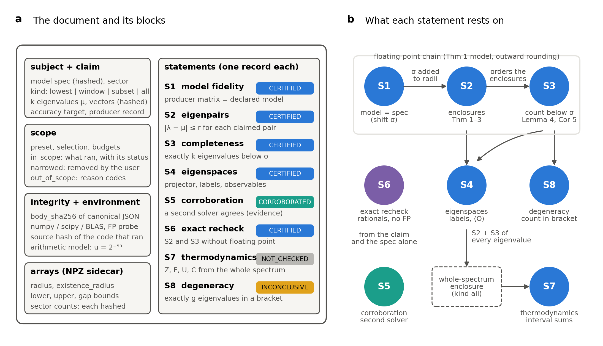
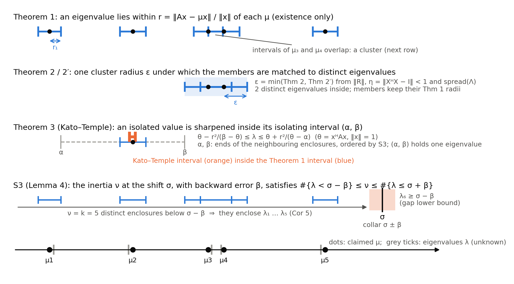
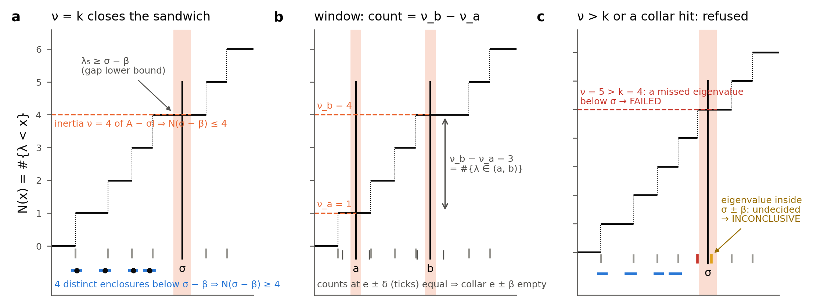
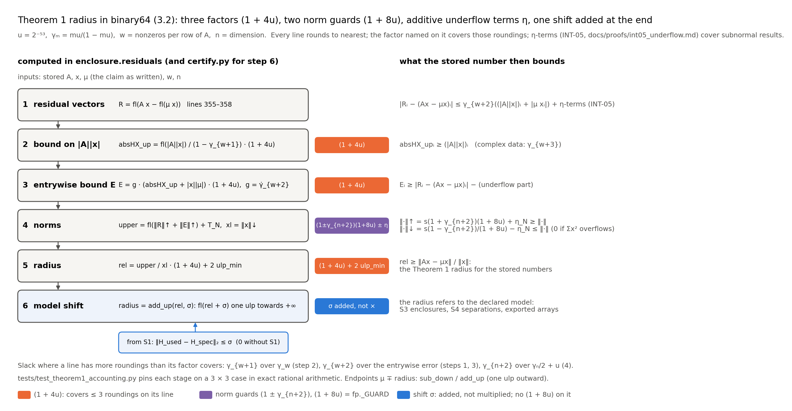

# Architecture of certify-ed

This document describes what the software does and how its parts fit together, at the state of the code repository in
`code/certify-ed/` (branch `dev/3.2` at `a814d28`, which carries the same computational source as tag `v3.2.1` =
`f3c478b`). The module-by-module description is `02_modules.md`; the command line is `03_cli_and_presets.md`; the file
formats are `06_formats_and_schema.md`. The mathematics behind each statement is in `code/certify-ed/docs/theory.md`
and the derivation documents of `code/certify-ed/docs/proofs/`, and is summarised in `docs/math/` of this repository.
Unless another file is named, facts are taken from `code/certify-ed/README.md`, `code/certify-ed/docs/presets.md` and
`report/04_software.md`.

## What the software takes and what it returns

An exact-diagonalization (ED) code, called the producer in these documents, computes eigenvalues and usually
eigenvectors of a Hamiltonian matrix. certify-ed takes the producer's output and a declared model and returns a
certificate. It never calls the producer's code, with one opt-in exception: a matrix-free operator given as a Python
file runs only with `--allow-code`.

The output of the producer is held in a `Claim`: the claimed eigenvalues, optionally the eigenvectors, optionally the
operator (a dense matrix, a sparse matrix, or a matrix-free `LinearOperator`), optionally a basis (a list of basis
states of a U(1) block, or the isometry of a symmetry sector), and the kind of claim. The kind says what completeness
the producer asserts: `subset` (these are some eigenpairs), `lowest` (these are the k lowest eigenvalues), `window`
(these are all eigenvalues in an interval [a, b]) or `all` (this is the whole spectrum). A claim may also state an
accuracy target; without one, S2 presumes 1e-8 times max(1, the norm of H) (decision D-19).

The declared model is a `ModelSpec`: a local Hilbert space (spin S, spinless fermions with a Jordan-Wigner order, or
bosons with an occupation cutoff), a list of operator strings with coefficients in the `static` format of QuSpin, a
site order and a state order. A spec is serialised as canonical JSON and identified by its SHA-256 hash. The spec is
written independently of the producer: it is the statement of what the producer was meant to compute.

The certificate is a machine-readable list of statements about the claim and the declared model. Each statement
carries a status and evidence. The certificate also carries a scope block (what was attempted, what was narrowed and
what is out of scope, each with a reason code), the floating-point model the bounds assume and the result of a
run-time probe of that model, the versions and the source fingerprint of the code that produced it, a list of what the
certificate does not say, and an integrity hash. Large arrays (eigenvalues, radii, optionally the eigenvectors) go
into a side file in NPZ format whose arrays are hashed into the body.

## The statements

| Statement | Identifier | What it says when CERTIFIED | Mathematical basis |
|---|---|---|---|
| S1 | `S1.model_fidelity` | the producer's matrix (or symmetry block) is the matrix of the declared model; entrywise for stored matrices, by isometry and invariance defects for sectors, by random probes for matrix-free operators (marked probabilistic); on failure a least-squares fit names the terms whose coefficients differ | two independent reference builders |
| S2 | `S2.eigenpairs` | each claimed eigenvalue lies within a stated radius of a distinct eigenvalue of the declared model | Theorems 1 to 3: residual bound, cluster bound through the polar factor with radius min(ρ, ε\*), Kato-Temple |
| S3 | `S3.completeness` | no eigenvalue below the top claimed one (or inside the claimed window) is missing; the next eigenvalue is bounded | Sylvester inertia with a backward error, Lemma 4, Corollary 5, Proposition 9 |
| S4 | `S4.eigenspaces` | for a cluster of close eigenvalues: the distance of the claimed subspace to the true eigenspace, basis-independent observables tr(PO), certified quantum numbers, correlations and structure factors | Theorem 6, Proposition 7, Proposition 15 |
| S5 | `S5.corroboration` | independent solvers reproduce the values; the components they share are recorded | evidence, not a certified statement; status CORROBORATED |
| S6 | `S6.exact_recheck` | S2 and S3 of a `lowest` claim re-derived in integer arithmetic, with no floating-point assumption | Lemmas 10 to 12, Proposition 13 |
| S7 | `S7.thermodynamics` | interval bounds on the partition function Z, the free energy F, the energy U and the heat capacity C from a complete whole-spectrum enclosure | Proposition 16, with Lemma 17 for the interval exponential |
| S8 | `S8.degeneracy` | the number of eigenvalues in each certified cluster, by bracketing inertia counts | Proposition 14 |

The statements depend on each other: S3, S6 and S8 need S2; S4 and S7 need S2 and S3. A statement whose dependency did
not run is not attempted and is recorded with the reason (`03_cli_and_presets.md`).

The four statuses are fixed by decision D-18. CERTIFIED means the statement holds under its stated hypotheses. FAILED
means the claim is contradicted, or a certified bound exceeds a stated threshold (for example the accuracy target).
INCONCLUSIVE means the evidence was too weak to decide; the claim is not contradicted. NOT_CHECKED means the statement
was not attempted, for example because the user narrowed the scope, a budget ran out, an input was missing or the
factorization did not fit in memory; the certificate gives the reason code. Since 3.2 every INCONCLUSIVE or
NOT_CHECKED statement also carries `evidence.next_action`, a concrete instruction such as "supply eigenvectors" or
"use `kind='window'`"; it is advice and changes no status.

Figure: the blocks of a certificate (a) and what each statement rests on (b), a concept figure with no data drawn by
`experiments/figures/fig_certificate_anatomy.py` (copied from `code/certify-ed/docs/figures/`, where `INDEX.md`
describes it). The statuses shown are an example.

Figure: the enclosures on the real line: Theorem 1 radii, a cluster radius, a Kato-Temple interval and the S3 count
with its collar, a concept figure with illustrative positions drawn by `experiments/figures/fig_enclosure_geometry.py`
(copied from `code/certify-ed/docs/figures/`, where `INDEX.md` describes it).

Figure: how inertia counts certify that exactly k eigenvalues lie below a shift, and the gap bound that follows, a
concept figure drawn by `experiments/figures/fig_inertia_completeness.py` (copied from
`code/certify-ed/docs/figures/`, where `INDEX.md` describes it).

## Hypotheses and the not-checked list

The bounds of S1 to S5, S7 and S8 hold under the standard floating-point model of IEEE 754 binary64 arithmetic: round
to nearest, no flush of subnormal numbers to zero, and full-precision BLAS. A run-time probe
(`fp.probe_float_environment`) tests these hypotheses in the certifying process on every run. If the probe finds a
non-standard environment (flush-to-zero or denormals-are-zero flags, a non-default rounding mode, reduced-precision
BLAS), every certified floating-point statement is downgraded to INCONCLUSIVE. The bounds also assume that no operand
underflows: since 3.2 the code scans its inputs and radii for nonzero magnitudes below 2^-900 and refuses CERTIFIED
with the reason code `UNDERFLOW_RISK` when it finds one (known issue INT-01,
`docs/failures/02_integration_findings.md`), and the subnormal intermediate residual entries that ordinary LAPACK
output produces are covered by additive terms in the radii (INT-05). Interval endpoints and margins are rounded one
unit in the last place outward (`fp.sub_down`, `fp.add_up`), after the gap found under decision D-46.

S6 and the functions whose names start with `exact_` do not rely on the floating-point model at all. Floating point
only proposes a factorization; integer arithmetic (FLINT, through python-flint) checks it exactly. The exact checker
(`checker.py` and `exact_sectors.py`) is kept small on purpose, in the sense of de Bruijn's criterion that the part of
a system one must trust should be small enough to read: 713 lines of code without blank lines, comments and docstrings
(433 in `checker.py`, 280 in `exact_sectors.py`), counted by `make_numbers.py` for the 3.2.1 run
(`code/certify-ed/results/run_full_20261105/paper/numbers.tex`).

Every certificate carries a list of what it does not say. It always contains two entries: that the specification is
the Hamiltonian the user intended, and that the producer's code is correct in general. It also lists "bounds rely on
the standard floating-point model" unless S6 is certified.

Figure: the floating-point accounting of the Theorem 1 radius as the code implements it, step by step with its
factors, a concept figure drawn by `experiments/figures/fig_rounding_accounting.py` (copied from
`code/certify-ed/docs/figures/`, where `INDEX.md` describes it). The line numbers printed in step 1 (355 to 358) are
one line early for `a814d28`: there `certify_ed/enclosure.py` forms the product at line 356 and the residual at line
359.

## Data flow

The path of a claim through the package has five stages. First, an importer turns the producer's output into a `Claim`
and, where possible, a `ModelSpec`: `claim_from_quspin` for QuSpin objects, `claim_from_bundle` for a producer bundle
directory (files in NPY, NPZ, HDF5, CSV, text, JSON or Matrix Market), and readers for the native output of HΦ,
DiagHam, SPINPACK and ALPS (`07_importers_and_producers.md`). Second, `Options` select the statements, either from a
preset, from `only` and `skip`, or by default every statement whose inputs exist; budgets of time and memory are
attached. Third, `certify(claim, spec, options)` in `certify.py` runs the statements in order. For S1 it builds the
reference matrix from the spec by two independent builders (`construct.py`) and compares; the difference plus the
builder's rounding becomes the model shift, which is added to every later radius so that all bounds refer to the
declared model rather than to the producer's matrix (decision D-22). S2 calls `enclosure.py`, S3 calls `inertia.py`
(dense Bunch-Kaufman, or sparse SuperLU with the a-posteriori residual of `ldl_residual.py`), S4 calls `eigenspace.py`
and its extensions, S5 calls `corroborate.py`, S6 calls the exact checker, S7 `thermo.py`, S8 `degeneracy.py`. Fourth,
the results are assembled into a `Certificate` (`certificate_v2.py`) with its scope block (`scope.py`), sealed by a
hash of its canonical JSON. Fifth, the certificate is saved, and can be loaded with an integrity check
(`Certificate.load(path, verify=True)`), validated against the JSON Schema (`schema.py`), turned into a one-sentence
summary, a full report or a methods paragraph (`report.py`), rendered as an offline HTML page (`viewer.py`), or
re-checked by the independent C verifier (`09_verifier.md`).

Three paths do not fit the single-claim pattern. The assembly of symmetry sectors (`compose.certify_low_energy`) takes
one certificate per block, checks that every block is present, that the blocks are mutually orthogonal and that their
dimensions add up, and returns the K lowest eigenvalues of the whole Hamiltonian with a common radius and a lower
bound on the next one (Theorem 8). The whole-spectrum enclosure (`spectrum.enclose_spectrum`, which replaced the
engine of the symveig package under decision D-42) encloses every eigenvalue, optionally sector by sector, certifies
the counts by the cluster theorem and checks conservation and Hermiticity exactly. The exact sector re-check
(`exact_sectors.exact_recheck_sector_lowest`) re-derives the lowest eigenvalues of a symmetry sector in integer
arithmetic, using orbit-sum bases with characters in {±1, ±i}.

## What was added in 3.2

Version 3.2 (the expansion roadmap of decision D-58 and the completion plan of decision D-60) added, among others, a
one-call entry point (`api.quick`), methods paragraphs, next-action diagnostics, an advisory cost model and planner,
JSON Schemas with a conformance check, readers for further producers, a record hook for producers written in Python,
the offline viewer, a planted-error corpus, the C verifier, and new statements and records: gap records, certified
crossings of levels, interval level statistics, entanglement entropy of a certified eigenvector, correlation functions
lifted to sectors, certified eigenvalue tubes over a coupling interval, Davis-Kahan bounds for labels and fidelities,
truncated thermodynamics, exact degeneracy brackets, variational certificates for states that are not ED eigenvectors,
generalized eigenproblems with a positive definite B, certified moments and sum rules, an a-posteriori residual for
the sparse factorization (roadmap item D-01) and a matrix-free S2 path up to dimension 2^24 (roadmap item D-02). The
finite-size extrapolation report (`extrapolation.py`) is presentation only and says that nothing in it is certified.
Every new result that rests on new mathematics carries a derivation document in `code/certify-ed/docs/proofs/` and the
status "derived, machine-checked, independently re-derived, Sarang's check pending" (decisions D-12 and D-59); the
code marks such statements `UNVERIFIED`.

According to `code/certify-ed/results/run_full_20261105/paper/numbers.tex`, the core package of 3.2.1 has 51 modules
and about 14,100 lines of code (the same macros give 29 modules and about 6,300 lines for 3.1.0 in
`code/certify-ed/results/run_full_20261022/paper/numbers.tex`). The test suite of the 3.2.1 run had 1180 tests, of
which 1172 passed and 8 were skipped (`code/certify-ed/results/run_full_20261105/manifest.json`).

## The applications

Two applications use the package to certify numbers that enter published proofs. `apps/pyrochlore` certifies the
lowest eigenvalue of the 18-site crown cluster of Kránitz and Penc (arXiv:2601.07800), which enters an Anderson-type
lower bound on the ground-state energy of the pyrochlore Heisenberg antiferromagnet. `apps/aklt` certifies upper
bounds on the quantity η in the spectral-gap criteria of Pomata and Wei (arXiv:1911.01410) for two-dimensional AKLT
models, in exact arithmetic, and checks the kernel lemma exactly where the size allows. Experiments E9 and E10 run
them (`docs/experiments/`), and the application documents of this repository describe the results.
