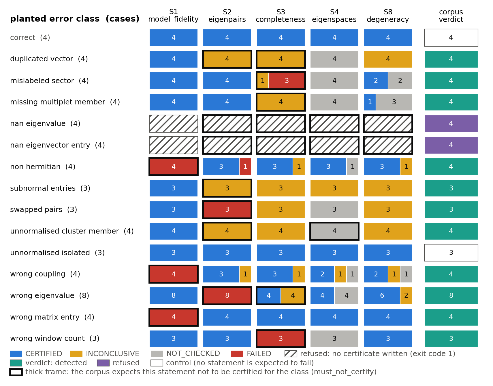

# The test suite, mutation analysis and the planted-error corpus

Three instruments measure the code itself rather than a physics result. The test suite checks that each function does
what its docstring and its derivation document say. Mutation analysis (experiment E6) measures how many deliberate
faults the test suite detects. The planted-error corpus measures whether the certifier, run as a black box, refuses to
certify results that contain known errors. This document describes all three; the E6 results of every run are in
`docs/experiments/E6_mutation.md`. Facts are from the test files in `code/certify-ed/tests/`, the run manifests,
`code/certify-ed/experiments/e6_mutation.py` and `code/certify-ed/corpus/README.md`.

## The test suite

At `a814d28` the folder `tests/` holds 73 Python files (71 test modules, `conftest.py` and the reference helper
`_enclosure_reference.py`) and a folder `fixtures/` with the generators of producer files. `docs/CODE_INDEX.md` lists
every file with what it tests. By subject the modules fall into these groups, named here by their file stems.
Statements and certificates: `test_certify`, `test_core_api`, `test_presets_scope`, `test_report`, `test_diagnostics`,
`test_viewer`, `test_schema_conformance`, `test_fix_3_1_1`, `test_review_fixes`. Bounds against references:
`test_bounds` (comparison with Arb balls), `test_exact_s2`, `test_theorem1_accounting`, `test_directed_rounding`,
`test_underflow_check`, `test_sparse_residual`, `test_matrixfree`, `test_windows`, `test_vectorless_window`,
`test_whole_spectrum`, `test_spectrum`, `test_compat_symveig`. Construction and sectors: `test_construction` (against
QuSpin), `test_sector_decomposition`, `test_label_audit`, `test_total_spin`, `test_exact_sectors`, `test_operators`,
`test_hermitian_decomposition`, `test_pauli_specs`. Floating-point environment: `test_fp_environment`, with a negative
control that sets the MXCSR flags. Generic test methods: `test_manufactured` (spectra with known eigenvalues),
`test_metamorphic` (relations that must hold between related inputs), `test_adversarial`. New statements of 3.2:
`test_correlations`, `test_correlation_lift`, `test_entanglement`, `test_davis_kahan`, `test_degeneracy`,
`test_exact_degeneracy`, `test_thermo`, `test_thermo_truncated`, `test_moments`, `test_variational`,
`test_generalized`, `test_sweep`, `test_gaps_crossings`, `test_levelstats_extrapolation`. Derivation documents:
`test_backlog_proofs`, `test_proofs_props` and `test_independent_check` pin the formulas the derivation documents
prove, so that a change to a constant is caught even when value tests cannot see it. Producers and formats:
`test_io_formats`, `test_io_ed_codes`, `test_integrations_quspin`, `test_recorder`, `test_corpus`, `test_verifier`
(skipped when no C compiler is found). Tooling: `test_driver`, `test_compare_runs`, `test_make_numbers_helpers`,
`test_figures`, `test_portable`, `test_planner`, `test_cost`, `test_packaging`, `test_examples`,
`test_e9_named_sectors`, `test_apps`. Gaps found by mutation: `test_gaps_from_mutation` and its continuations `_2` to
`_4`.

The suite grew with the code. The counts recorded by the runs are given in the table, each from the `tests.summary`
field of the run's `manifest.json`.

| Run | Version | Tests step |
|---|---|---|
| `run_full_20261018` | 3.0.0 | 334 passed |
| `run_full_final` (18 October 2026) | 3.0.0 | 349 passed |
| `run_quick_final` (18 October 2026) | 3.0.0 | 356 passed |
| `run_full_20261021` | 3.0.0 | 363 passed |
| `run_full_20261022_attempt1` | 3.1.0 (first cut) | 1 failed, 536 passed, 1 skipped |
| `run_full_20261022` | 3.1.0 | 541 passed, 1 skipped |
| `run_full_20261104` | 3.2.0 | 1170 passed, 8 skipped |
| `run_full_20261105` | 3.2.1 | 1172 passed, 8 skipped |

The skipped tests of the 3.2 runs are those whose optional dependency or platform is absent on the Windows workstation
(for example the `-ffast-math` shared-library test, which needs gcc on Linux or macOS;
`code/certify-ed/docs/reproducibility.md`). The single failure of the first 3.1.0 attempt is described in
`docs/failures/04_failed_runs_and_attempts.md`. Linting is `ruff check` over `certify_ed`, `tests`, `experiments`,
`conformance` and `corpus`, recorded as clean at the 3.2 integration (`code/certify-ed/RESULT_integration_3.2.md`),
and a CI workflow (`.github/workflows/ci.yml`) runs the tests, the lint and the wheel build.

Two rules of the project govern tests. The soundness rule of `CONTRIBUTING.md` says that no change may make a
statement CERTIFIED where the previous release said less unless it implements a theorem already in `docs/theory.md`,
and that every new code path that can affect a status needs a negative control: a test with a planted error (a wrong
eigenvalue, a perturbed matrix, a missing vector, a tampered certificate) that must not come out CERTIFIED. The rule
of decision D-59 allows a bound to become tighter only on the strength of a derivation document, while a looser
correction may go in at once with a negative-control test.

## Mutation analysis (E6)

A mutant is a copy of the code with one small change: an arithmetic operator, a comparison, a boolean operator, a sign
or a constant in the verification core. `experiments/e6_mutation.py` enumerates the mutation sites of the core
modules, samples a fixed number of mutants with a fixed seed, runs the whole test suite against each mutant on two
workers, and calls a mutant killed if any test fails or errors. A mutant that survives is either a gap of the test
suite or an equivalent mutant, a change with no observable effect. The baseline (the unmutated copy) must survive the
suite first, otherwise the copy itself is broken. Since 3.1.0 the copy given to the mutants holds every tracked file
(`git ls-files`), because the first 3.1.0 attempt showed that six tests read files outside the three folders copied
before (`docs/failures/04_failed_runs_and_attempts.md`).

Decision D-35 makes the score part of the evidence only together with a classification of the survivors.
`experiments/e6_classify.py` sorts survivors by rule into five classes (a rounding allowance in a worst-case bound, a
strict against a non-strict comparison, a heuristic or performance parameter, no effect on any statement, and needs
inspection), and `experiments/e6_recheck.py` re-runs survivors against a later test suite. The class "needs
inspection" waits for a verdict by a person (finding RA-25 of the review); the readings written so far are
suggestions, recorded in `E6_inspection_worksheet.md` of the 3.1.0 run folder and in
`code/certify-ed/E6_inspection_worksheet_3.2.0.md`. Decision D-35 records why the method has a limit: a mutant that
shrinks a worst-case rounding term cannot be detected by tests, because real rounding errors are far below the worst
case; such terms are protected by the exact checker and by pinning tests of the formulas. Decision D-46 records the
converse lesson: two soundness gaps were found by writing proofs against the code, and mutation analysis could not
have found them.

A mutant runs the full suite, so the cost of E6 grows with the suite: the 3.1.0 run took 8573.2 s for 64 mutants and
the 3.2.1 run 24917.5 s (`manifest.json` of the two runs). For that reason the 3.2 integration ran a 16-mutant sample
(13 of 16 killed, `code/certify-ed/RESULT_integration_3.2.md`) and left the 64-mutant sample to the evidence run
(decision D-58).

## The planted-error corpus

`corpus/` holds small ED results, each with one known error, in the producer bundle layout, so that any checker can be
run on them. `corpus/make_corpus.py` generates the cases deterministically; `corpus/run_corpus.py` runs a checker
command on every case and scores its output without trusting it. A case is detected when a statement that the error
makes false is FAILED or INCONCLUSIVE, unsound when such a statement is CERTIFIED, and silent when all of them are
NOT_CHECKED; a false alarm is a FAILED statement on a case a correct checker certifies. The run of 29 October 2026
(`code/certify-ed/corpus/results/certify-ed/report.md`) scored certify-ed on 60 cases: 53 of 53 planted cases
detected, 0 missed, 0 false alarms, and 7 of 7 controls clean. The decision log records that one expectation of the
corpus was revised before that score, and the scores before the revision are kept in
`corpus/results/certify-ed_expectations-before-revision/` (decision D-58). The corpus is not part of the computational
source.

Figure: the statuses certify-ed gave on the planted-error corpus, per error class and statement, with the corpus
verdict, drawn by `experiments/figures/fig_corpus_detection.py` from `corpus/results/certify-ed/report.json` (copied
from `code/certify-ed/docs/figures/`, where `INDEX.md` describes it).
