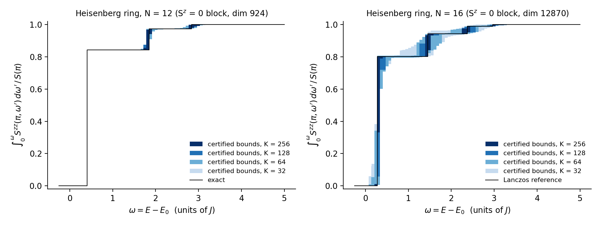
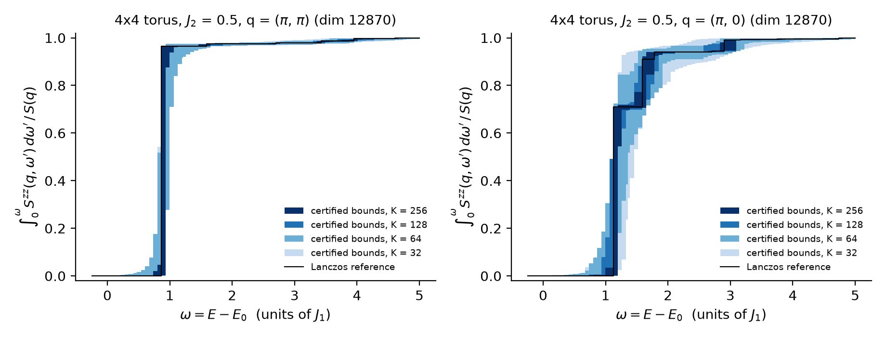

# M5/M6: certified bounds on the dynamical structure factor from a certified ground state — result (2026-11-25)

Branch `feat/m4-spectral-bounds` from `fix/backlog-small` (6944e35f). Code `certify_ed/spectral_bounds.py` (statements
M5 and M6 of the moments record family), derivation `docs/proofs/C-07b_spectral_bounds.md`, machine check
`docs/proofs/verify_C-07b.py` (run record `docs/proofs/runs/verify_C-07b.txt`), tests `tests/test_spectral_bounds.py`,
experiment `experiments/m6_spectral_bounds.py`, data `results/m6_spectral_20261125/` (commit 521c9384); square-lattice
experiment `experiments/m6_square_lattice.py`, data `results/m6_square_20261126/` (commit 0fc1408). All of it is
UNVERIFIED until Sarang's check (D-12); no independent re-derivation has been made yet.

## What is certified

For a certified cluster of the stored Hermitian H (projector P, g vectors, sin θ bound s, Gram defect η) and a stored
Hermitian O, the measure μ(S) = tr(P O E(S) O)/g is the spectral weight of O on the level; for a ground state and
O = O_q it is the dynamical structure factor, F(E) = μ((−∞, E]) its integrated weight.

* **M5** encloses the Chebyshev moments τ_j = tr(P O T_j(A) O)/g, j = 0..K, of A = (H − cI)s. The spectrum of H lies
  in [lo, hi]: Gershgorin's discs, the lower end narrowed by the lowest eigenvalue of the certificate (S2 and S3
  CERTIFIED, 'lowest' claim); c and s are binary64 numbers with (lo − c)s ≥ −1 and (hi − c)s ≤ 1, checked in exact
  rationals. The recurrence runs on the vectors O x_i, with every rounding propagated through the Chebyshev
  polynomials of the second kind; the projector term is (2gs + gη)‖O‖².
* **M6** bounds F(E) at given energies by ∫ p dμ for polynomials p on either side of the step 1_{(−∞, ξ]},
  ξ = (E − c)s. The sign conditions of every polynomial are proved in exact integer arithmetic (Bernstein
  coefficients, de Casteljau subdivision rounded downwards), the sum over the moment intervals is exact and rounded
  outward, and a monotone envelope combines the energies. Which polynomial is used is a heuristic that the bound does
  not rest on: Hermite step polynomials at the Gauss–Radau nodes of the moments (several orders) or at Chebyshev points
  of the first kind (Hermite–Fejér type), ranked by an estimate; a linear program as the fallback (not needed in any
  run below).

## Machine check

`python docs/proofs/verify_C-07b.py --cases 60` (seed 20261124):

```
A exact tau_j = tr(P O T_j(A) O)/g inside the M5 intervals; spectral interval holds the spectrum: 755 random + 393 adversarial cases, 0 skipped (hypothesis not met), 0 violations
B exact F(xi) between the M6 bounds (default candidates, Chebyshev-Hermite alone, linear program alone; atoms at the query point): 480 random + 520 adversarial cases, 0 skipped (hypothesis not met), 0 violations
C Bernstein proofs: no sign violation where proved; one-unit dips never proved: 53 random + 96 adversarial cases, 0 skipped (hypothesis not met), 0 violations
   negative control: s = eta = 0 claimed for tilted vectors breaks the M5 enclosure in 33/962 moments; a spectral lower bound 20% of the span too high breaks it in 442/962 moments
   negative control: one moment interval shifted beyond its width moves the M6 bound in 221/260 queries and puts the exact F outside in 17
TOTAL: 1288 random + 1009 adversarial cases; violations: 0
```

The negative controls show that the checks can fail: claiming s = η = 0 for tilted vectors, or a spectral lower bound
20 % of the span too high, breaks the M5 enclosure, and shifting one moment interval beyond its width moves the M6
bound (in some queries off the exact F). The first run of this script found an edge case: for a spectrum far from 0
(a shift of about 10⁵) the scale search stepped down one ulp at a time and gave up. The scale is now 1/max(c − lo,
hi − c), rounded down in exact rationals; `tests/test_spectral_bounds.py` holds the case.

## Experiment: S^zz(π, ω) of the Heisenberg ring

H = Σ_j S_j · S_{j+1} (J = 1, periodic) on N sites, O = √(2/N) Σ_j cos(πj) S^z_j, both restricted to the S^z = 0
block (an exact submatrix: the script checks that no entry couples the block to the rest). The ground state comes from
a dense diagonalization of the block (dimension ≤ 4000) or ARPACK, and is certified with a 'lowest' claim
(`Options(store_eigenvectors=True, eigenspaces='all')`). F(E₀ + ω) is bounded on 81 energies ω ∈ [−0.25, 5] plus the two
edges of the window around the lowest excitation that carries weight. The reference F is exact (dense diagonalization
of the block) for N ≤ 14 and, for N = 16, a floating-point Lanczos run with full reorthogonalization from O|0⟩ (a
reference, not a certified quantity). A violation is a reference value outside [lower, upper] by more than 10⁻¹² (exact)
or 10⁻⁹ (Lanczos). Workstation (Windows, Python 3.11.17, NumPy 2.4.4, SciPy 1.17.1), one thread.

| N | dim | reference | S2 / S3 / S4 | certify (s) | spectral interval | S(pi) certified (K = max) | S(pi) reference |
|---|---|---|---|---|---|---|---|
| 8 | 70 | exact | CERTIFIED / CERTIFIED / CERTIFIED | 0.88 | [-3.6510934089, 2.0000000000] | [1.720905326285, 1.720905326285] | 1.720905326285 |
| 10 | 252 | exact | CERTIFIED / CERTIFIED / CERTIFIED | 0.99 | [-4.5154463545, 2.5000000000] | [1.854266634883, 1.854266634884] | 1.854266634883 |
| 12 | 924 | exact | CERTIFIED / CERTIFIED / CERTIFIED | 2.03 | [-5.3873909174, 3.0000000000] | [1.965817273499, 1.965817273501] | 1.965817273500 |
| 14 | 3432 | exact | CERTIFIED / CERTIFIED / CERTIFIED | 11.54 | [-6.2635495335, 3.5000000000] | [2.061814974297, 2.061814974300] | 2.061814974298 |
| 16 | 12870 | floating point | CERTIFIED / CERTIFIED / CERTIFIED | 225.44 | [-7.1422963606, 4.0000000000] | [2.146151754138, 2.146151754142] | 2.146151754140 |

| N | K | M6 (s) | energies | violations | mean width | median width | max width | lowest window, certified | reference | polynomials (radau / chebyshev / LP) |
|---|---|---|---|---|---|---|---|---|---|---|
| 8 | 32 | 29.28 | 83 | 0 | 1.64e-06 | 2.67e-08 | 1.13e-04 | [1.556093, 1.556093] | 1.556093 | 158 / 0 / 0 |
| 8 | 64 | 55.69 | 83 | 0 | 1.64e-06 | 2.67e-08 | 1.13e-04 | [1.556093, 1.556093] | 1.556093 | 158 / 0 / 0 |
| 8 | 128 | 150.61 | 83 | 0 | 1.64e-06 | 2.67e-08 | 1.13e-04 | [1.556093, 1.556093] | 1.556093 | 158 / 0 / 0 |
| 8 | 256 | 346.58 | 83 | 0 | 1.64e-06 | 2.67e-08 | 1.13e-04 | [1.556093, 1.556093] | 1.556093 | 158 / 0 / 0 |
| 10 | 32 | 36.23 | 83 | 0 | 7.23e-04 | 5.87e-06 | 1.73e-02 | [1.613080, 1.613080] | 1.613080 | 158 / 0 / 0 |
| 10 | 64 | 69.0 | 83 | 0 | 7.23e-04 | 5.87e-06 | 1.73e-02 | [1.613080, 1.613080] | 1.613080 | 158 / 0 / 0 |
| 10 | 128 | 156.41 | 83 | 0 | 6.63e-04 | 5.87e-06 | 1.73e-02 | [1.613080, 1.613080] | 1.613080 | 153 / 5 / 0 |
| 10 | 256 | 435.87 | 83 | 0 | 5.13e-04 | 5.87e-06 | 1.71e-02 | [1.613080, 1.613080] | 1.613080 | 146 / 12 / 0 |
| 12 | 32 | 37.78 | 83 | 0 | 1.02e-02 | 1.22e-04 | 2.56e-01 | [1.656266, 1.656351] | 1.656278 | 158 / 0 / 0 |
| 12 | 64 | 78.24 | 83 | 0 | 1.01e-02 | 1.22e-04 | 2.56e-01 | [1.656266, 1.656351] | 1.656278 | 151 / 7 / 0 |
| 12 | 128 | 203.09 | 83 | 0 | 6.60e-03 | 1.22e-04 | 2.45e-01 | [1.656266, 1.656351] | 1.656278 | 127 / 31 / 0 |
| 12 | 256 | 543.82 | 83 | 0 | 5.96e-03 | 1.22e-04 | 2.45e-01 | [1.656266, 1.656351] | 1.656278 | 115 / 43 / 0 |
| 14 | 32 | 52.52 | 83 | 0 | 5.42e-02 | 1.27e-02 | 4.01e-01 | [1.676617, 1.700894] | 1.690932 | 153 / 5 / 0 |
| 14 | 64 | 101.69 | 83 | 0 | 3.99e-02 | 5.87e-03 | 4.00e-01 | [1.676617, 1.693401] | 1.690932 | 123 / 35 / 0 |
| 14 | 128 | 221.66 | 83 | 0 | 2.63e-02 | 5.06e-03 | 4.00e-01 | [1.676617, 1.693401] | 1.690932 | 99 / 59 / 0 |
| 14 | 256 | 781.47 | 83 | 0 | 5.09e-03 | 2.39e-04 | 1.42e-01 | [1.689596, 1.690985] | 1.690932 | 70 / 88 / 0 |
| 16 | 32 | 42.01 | 83 | 0 | 1.09e-01 | 4.64e-02 | 1.72e+00 | [1.444568, 1.804238] | 1.719808 | 126 / 32 / 0 |
| 16 | 64 | 81.01 | 83 | 0 | 8.34e-02 | 1.98e-02 | 1.72e+00 | [1.588132, 1.730320] | 1.719808 | 103 / 55 / 0 |
| 16 | 128 | 204.1 | 83 | 0 | 4.26e-02 | 2.99e-03 | 1.60e+00 | [1.715126, 1.720780] | 1.719808 | 83 / 75 / 0 |
| 16 | 256 | 627.99 | 83 | 0 | 2.33e-02 | 8.94e-04 | 1.01e+00 | [1.716894, 1.720121] | 1.719808 | 71 / 87 / 0 |



The data were made at 521c9384. The two later code commits (2bc8f2d9: `chebyshev_interval` converts narrower formats
and sums repeated entries first; ab6c3d4a: a test call) change nothing for the binary64 input of the experiment: a
rerun of N = 8 and 10 at K = 32 from ab6c3d4a gives the same 728 recorded values (every value of the record for
those runs except timings and the metadata block), bit for bit.

## Reading

* **No violation.** 1660 (sizes × K × energies) certified bounds against the reference, none violated.
* **S(π) to eleven or twelve digits.** τ₀ = ⟨0|O²|0⟩ = S(π) is certified to an interval of width at most 4.6e-12 at
  every size (M5 alone).
* **The weight of the lowest excitation.** The lowest level that carries weight (the lowest triplet at q = π) holds
  the fraction W₁/S(π) of the sum rule; certified at the largest K: N = 8: [0.9042, 0.9043]; N = 10: [0.8699, 0.8700]; N = 12: [0.8425, 0.8426]; N = 14: [0.8194, 0.8202]; N = 16: [0.7999, 0.8015]. The fraction decreases with N, as the
  weight spreads over the two-spinon continuum.
* **Resolution against K.** For N ≤ 10 the moments determine the measure (few levels carry weight) and K = 32 already
  gives mean widths of 10⁻⁶ to 10⁻³. For N = 14 and 16 the mean width falls by a factor of about five to ten from
  K = 32 to K = 256, and the share of Chebyshev–Hermite polynomials grows with K.
* **Where K stops helping the Radau polynomials.** The structure factor fills only a third of the certified interval
  [E₀, N/4], and from moments known to about 10⁻¹¹ the modified Chebyshev algorithm recovers about 20 recurrence
  coefficients whatever K is; full-order Radau polynomials grow by orders of magnitude where the measure has no mass.
  The Chebyshev–Hermite polynomials use all K degrees with coefficients of order one, at a resolution of one node
  spacing (about π/K times the half-width of the interval in the bulk, finer near its ends).
* **Cost.** M5 takes about a second at most; M6 takes 0.35 to 9.4 s per energy (N = 8, K = 32 to N = 14, K = 256; the exact
  proofs run on Python integers and dominate). Certifying the N = 16 ground state (S3 included) took 225.44 s.

## Experiment: S^zz(q, ω) of the J1–J2 model on the 4 × 4 torus

`experiments/m6_square_lattice.py` applies the same construction to H = Σ⟨ij⟩ S_i · S_j + J2 Σ⟨⟨ij⟩⟩ S_i · S_j on the
periodic 4 × 4 lattice (sites y·4 + x), with O_q = √(2/N) Σ_j cos(q · r_j) S^z_j for q = (π, π) and (π, 0), in the
S^z = 0 block (dimension 12870), at J2 = 0 and at the frustrated point J2 = 0.5. The reference F is a floating-point
Lanczos run with full reorthogonalization (800 steps) from O_q|0⟩ for the same ground-state vector, with the tolerance
10⁻⁹ used above. At J2 = 0.5 the sparse factorization of S3 does not fit in the 4.5 GiB of the workstation
(`docs/project/experiments/E2_cost.md`), so both points were run on the Linux host (Python 3.12.13, NumPy 2.5.5, SciPy
1.18.1, python-flint 0.9.0, eight BLAS threads) from a `git archive` of 0fc1408;
`results/m6_square_20261126/run_host.txt` gives the archive's SHA-256, the command and the times. The records'
`git_head` is empty and `tracked_changes` false because the archive holds no repository, and their `outdir` was
shortened to the repository path. Peak memory was not recorded.

| lattice | J2 | dim | S2 / S3 / S4 | certify (s) | E0 (reference) | gap in the block (reference) |
|---|---|---|---|---|---|---|
| 4x4 | 0 | 12870 | CERTIFIED / CERTIFIED / CERTIFIED | 286.1 | -11.2284832084 | 0.578598 |
| 4x4 | 0.5 | 12870 | CERTIFIED / CERTIFIED / CERTIFIED | 965.43 | -8.4579233514 | 0.318934 |

| J2 | q | K | M6 (s) | violations | mean width | median width | S(q) certified | S(q) reference | lowest window, certified | reference | fraction of S(q) | polynomials (radau / chebyshev / LP) |
|---|---|---|---|---|---|---|---|---|---|---|---|---|
| 0 | (pi, pi) | 32 | 10.59 | 0 | 6.70e-03 | 5.79e-04 | [2.949622785204, 2.949622785212] | 2.949622785208 | [2.910671, 2.911331] | 2.910928 | [0.9868, 0.9870] | 158 / 0 / 0 |
| 0 | (pi, pi) | 64 | 18.34 | 0 | 5.89e-03 | 3.26e-04 | [2.949622785204, 2.949622785212] | 2.949622785208 | [2.910671, 2.911155] | 2.910928 | [0.9868, 0.9870] | 139 / 19 / 0 |
| 0 | (pi, pi) | 128 | 40.94 | 0 | 4.21e-03 | 3.26e-04 | [2.949622785204, 2.949622785212] | 2.949622785208 | [2.910671, 2.911155] | 2.910928 | [0.9868, 0.9870] | 130 / 28 / 0 |
| 0 | (pi, pi) | 256 | 104.38 | 0 | 2.63e-03 | 2.64e-04 | [2.949622785204, 2.949622785212] | 2.949622785208 | [2.910671, 2.911155] | 2.910928 | [0.9868, 0.9870] | 128 / 30 / 0 |
| 0 | (pi, 0) | 32 | 12.64 | 0 | 9.20e-03 | 5.69e-04 | [0.334729870470, 0.334729870477] | 0.334729870474 | [0.320344, 0.324223] | 0.321814 | [0.9570, 0.9686] | 158 / 0 / 0 |
| 0 | (pi, 0) | 64 | 24.61 | 0 | 4.34e-03 | 1.87e-05 | [0.334729870470, 0.334729870477] | 0.334729870474 | [0.321749, 0.323604] | 0.321814 | [0.9612, 0.9668] | 156 / 2 / 0 |
| 0 | (pi, 0) | 128 | 54.09 | 0 | 3.39e-03 | 1.87e-05 | [0.334729870470, 0.334729870477] | 0.334729870474 | [0.321749, 0.322160] | 0.321814 | [0.9612, 0.9624] | 142 / 16 / 0 |
| 0 | (pi, 0) | 256 | 133.66 | 0 | 2.86e-03 | 1.87e-05 | [0.334729870470, 0.334729870477] | 0.334729870474 | [0.321749, 0.321861] | 0.321814 | [0.9612, 0.9616] | 131 / 27 / 0 |
| 0.5 | (pi, pi) | 32 | 10.65 | 0 | 8.63e-02 | 3.02e-02 | [1.708292201631, 1.708292201646] | 1.708292201638 | [1.552667, 1.666801] | 1.647072 | [0.9089, 0.9757] | 158 / 0 / 0 |
| 0.5 | (pi, pi) | 64 | 20.11 | 0 | 8.27e-02 | 2.39e-02 | [1.708292201631, 1.708292201646] | 1.708292201638 | [1.552667, 1.666801] | 1.647072 | [0.9089, 0.9757] | 124 / 34 / 0 |
| 0.5 | (pi, pi) | 128 | 51.42 | 0 | 2.93e-02 | 4.00e-03 | [1.708292201631, 1.708292201646] | 1.708292201638 | [1.643024, 1.647978] | 1.647072 | [0.9618, 0.9647] | 61 / 97 / 0 |
| 0.5 | (pi, pi) | 256 | 145.43 | 0 | 2.69e-02 | 2.71e-03 | [1.708292201631, 1.708292201646] | 1.708292201638 | [1.643024, 1.647978] | 1.647072 | [0.9618, 0.9647] | 47 / 111 / 0 |
| 0.5 | (pi, 0) | 32 | 11.44 | 0 | 5.27e-02 | 1.61e-02 | [0.445089775615, 0.445089775630] | 0.445089775622 | [0.141492, 0.418418] | 0.316294 | [0.3179, 0.9401] | 131 / 27 / 0 |
| 0.5 | (pi, 0) | 64 | 25.25 | 0 | 4.01e-02 | 8.59e-03 | [0.445089775615, 0.445089775630] | 0.445089775622 | [0.225953, 0.376597] | 0.316294 | [0.5077, 0.8461] | 88 / 70 / 0 |
| 0.5 | (pi, 0) | 128 | 60.91 | 0 | 1.75e-02 | 1.63e-03 | [0.445089775615, 0.445089775630] | 0.445089775622 | [0.309383, 0.322075] | 0.316294 | [0.6951, 0.7236] | 57 / 101 / 0 |
| 0.5 | (pi, 0) | 256 | 162.49 | 0 | 1.01e-02 | 6.71e-04 | [0.445089775615, 0.445089775630] | 0.445089775622 | [0.310313, 0.319649] | 0.316294 | [0.6972, 0.7182] | 46 / 112 / 0 |



The figure for J2 = 0 is `results/m6_square_20261126/j2_0/m6_square_lattice.png`.

* **No violation.** 1328 certified bounds (2 values of J2, 2 wavevectors, 4 values of K, 83 energies each), none
  violated by the reference. S2, S3, S4 and S8 are CERTIFIED for both ground states, and S(q) = τ₀ is certified to an
  interval of width at most 1.5e-11 (M5 alone).
* **One level carries S(π, π).** At K = 256 the lowest excitation that carries weight at (π, π) holds
  [0.9868, 0.9870] of S(π, π) at J2 = 0 and [0.9618, 0.9647] at J2 = 0.5.
* **Frustration spreads the weight at (π, 0).** The lowest excitation at (π, 0) holds [0.9612, 0.9616] of
  S(π, 0) at J2 = 0 and [0.6972, 0.7182] at J2 = 0.5; at the frustrated point 28.2 % to 30.3 % of the weight
  lies above it. These are statements about the 4 × 4 cluster only.
* **Resolution against K.** At J2 = 0.5 the mean width falls from 8.63e-02 (K = 32) to
  2.69e-02 (K = 256) at (π, π) and from 5.27e-02 to 1.01e-02 at (π, 0); the share of
  Chebyshev–Hermite polynomials grows with K, as for the ring. At J2 = 0 the measure is dominated by a few levels and
  the widths are smaller (2.63e-03 and 2.86e-03 at K = 256).
* **Cost.** Certifying the ground state took 286 s (J2 = 0) and 965 s (J2 = 0.5) on eight threads; M6 took
  10.6 to 162.5 s per run of 83 energies.

## Limits

* The polynomials are not the optimal Chebyshev–Markov–Stieltjes ones for the given moment intervals; nothing is
  claimed about the distance to them.
* The window edges for the lowest excitation are taken from the reference spectrum; they are query points only, and
  the bracket [L(b) − U(a), U(b) − L(a)] holds for any a < b.
* The N = 16 reference and the 4 × 4 references are not exact. The bounds hold with or without them; they only
  measure their width.
* The spectral density itself (a line shape) is not bounded; only integrated weights are. M4 (the continued fraction)
  stays NOT_IMPLEMENTED.
